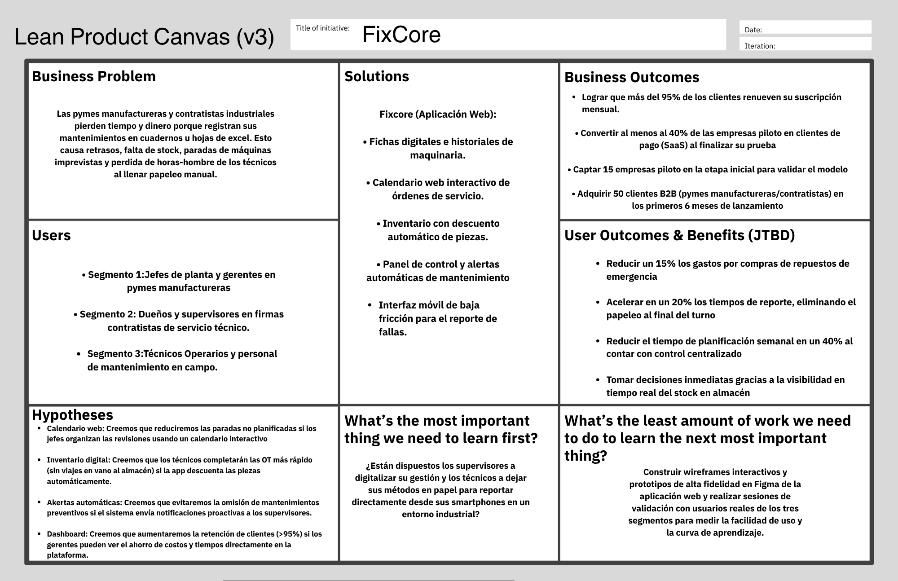

# Capítulo I: Introduction

## 1.1. Startup Profile

### 1.1.1. Descripción de la Startup

TechMakers es una startup conformada por estudiantes de Ingeniería de Software que busca desarrollar soluciones tecnológicas orientadas a mejorar y digitalizar procesos presentes en distintos sectores empresariales.

Actualmente, TechMakers se enfoca en una problemática presente en empresas del sector industrial: la gestión del mantenimiento de maquinaria y equipos. En muchas organizaciones, actividades como la programación de mantenimientos, el registro de fallas y el control de repuestos todavía se gestionan mediante cuadernos, pizarras, archivos de Excel o canales de comunicación separados.

Esta forma de trabajo dificulta el acceso y seguimiento de la información y puede provocar que ciertos mantenimientos no se realicen en las fechas previstas, que no exista suficiente disponibilidad de repuestos o que una falla no sea atendida oportunamente. Estas situaciones pueden ocasionar tiempos muertos, interrupciones en la producción y mayores costos para las empresas.

Frente a esta problemática surge **FixCore**, una plataforma orientada a centralizar la información y las actividades relacionadas con el mantenimiento industrial. FixCore permitirá gestionar los activos de una empresa mediante fichas digitales que contienen información como marca, modelo, manuales e historial de mantenimiento. Asimismo, busca facilitar la programación de mantenimientos, el registro de fallas, la gestión de órdenes de trabajo y el control de repuestos.

De esta manera, TechMakers busca ofrecer una solución accesible y fácil de utilizar que permita a las empresas mejorar la organización de sus actividades de mantenimiento y reducir los problemas generados por procesos manuales o información dispersa.

**Misión**

La misión de TechMakers es ofrecer a empresas manufactureras y contratistas de mantenimiento industrial una solución tecnológica que facilite la organización y gestión de sus actividades de mantenimiento. Mediante FixCore buscamos centralizar la información de las máquinas, mejorar la programación de los mantenimientos y facilitar el control de los repuestos, contribuyendo a reducir las interrupciones ocasionadas por fallas o una planificación inadecuada.

**Visión**

La visión de TechMakers es lograr que FixCore se convierta progresivamente en una alternativa reconocida en el Perú para la gestión del mantenimiento industrial. Buscamos desarrollar una plataforma que pueda adaptarse al crecimiento de las empresas y contribuir a la digitalización de procesos que actualmente se realizan de manera manual o mediante herramientas desconectadas.

### 1.1.2. Perfiles de integrantes del equipo

A continuación, se presentan los integrantes de TechMakers y las principales capacidades que cada uno aporta al desarrollo del proyecto.

<table border="1">
  <tr>
    <th>Integrante</th>
    <th colspan="2">Descripción</th>
  </tr>

  <tr>
    <th rowspan="2">Alvar Lucas Córdova</th>
    <td colspan="2"></td>
  </tr>
  <tr>
    <td colspan="2">
      <b>Código:</b> u202324461  
      <b>Carrera:</b> Ingeniería de Software  
      <b>Conocimientos técnicos y habilidades:</b> Cuenta con conocimientos en desarrollo web utilizando HTML, CSS y JavaScript, así como conocimientos básicos de Vue.js y C# con .NET. También posee experiencia utilizando Git y GitHub para el control de versiones y trabajo colaborativo. Destaca por su organización, responsabilidad y capacidad para coordinar actividades dentro del equipo.
    </td>
  </tr>

  <tr>
    <th rowspan="2">Sunio Danilo Landa Sánchez</th>
    <td colspan="2"></td>
  </tr>
  <tr>
    <td colspan="2">
      <b>Código:</b> u202423973  
      <b>Carrera:</b> Ingeniería de Software  
      <b>Conocimientos técnicos y habilidades:</b> Posee conocimientos en programación con C++ y JavaScript, además de fundamentos de HTML y CSS para el desarrollo de interfaces web. También conoce el uso básico de Git, GitHub y el marco de trabajo Scrum. Destaca por su capacidad de aprendizaje, responsabilidad y disposición para trabajar en equipo.
    </td>
  </tr>

  <tr>
    <th rowspan="2">Giuseppe Adrián Villanueva Rodríguez</th>
    <td colspan="2"></td>
  </tr>
  <tr>
    <td colspan="2">
      <b>Código:</b> u20221c554  
      <b>Carrera:</b> Ingeniería de Software  
      <b>Conocimientos técnicos y habilidades:</b> Cuenta con conocimientos básicos de Java, SQL y desarrollo de aplicaciones web. Tiene experiencia introductoria con Angular y TypeScript, además del uso de Git y GitHub para gestionar cambios en proyectos. Se caracteriza por su capacidad para resolver problemas, adaptarse a nuevas tecnologías y colaborar con otros integrantes.
    </td>
  </tr>

  <tr>
    <th rowspan="2">Diego Rances Rojas Huaranga</th>
    <td colspan="2"></td>
  </tr>
  <tr>
    <td colspan="2">
      <b>Código:</b> u20241E096  
      <b>Carrera:</b> Ingeniería de Software  
      <b>Conocimientos técnicos y habilidades:</b> Posee conocimientos básicos de C#, .NET y SQL, así como fundamentos para el desarrollo y consumo de servicios REST. También cuenta con conocimientos de Vue.js, HTML y CSS para la creación de interfaces web. Destaca por su pensamiento lógico, capacidad de análisis y disposición para aprender nuevas herramientas.
    </td>
  </tr>

  <tr>
    <th rowspan="2">Pierre Alessandro Mendoza Boluarte</th>
    <td colspan="2"></td>
  </tr>
  <tr>
    <td colspan="2">
      <b>Código:</b> u202320973  
      <b>Carrera:</b> Ingeniería de Software  
      <b>Conocimientos técnicos y habilidades:</b> Considero que tengo conocimientos en HTML, CSS,C++ y un poco de JavaScript . Ademas uso GitHub para el trabajo colaborativo y tengo nociones de diseño de interfaces y prototipado. Creo que soy creativo y apoyare en lo que pueda para tener una comunicación y capacidad para trabajar de manera colaborativa.
    </td>
  </tr>
</table>

## 1.2. Solution Profile

### 1.2.1 Antecedentes y problemática

El sector manufacturero depende en gran medida de la disponibilidad y correcto funcionamiento de sus máquinas y equipos. Por ello, una adecuada gestión del mantenimiento resulta importante para reducir interrupciones en la producción, organizar las intervenciones técnicas y mantener un mayor control sobre los activos de una empresa.

En este contexto, una de las principales dificultades identificadas se encuentra en la forma en que algunas pymes manufactureras, empresas contratistas y equipos técnicos gestionan sus actividades de mantenimiento. Procesos como la programación de mantenimientos preventivos, el registro de fallas, la asignación de órdenes de trabajo y el control de repuestos todavía pueden realizarse mediante cuadernos, pizarras, hojas de cálculo, llamadas telefónicas o mensajes de WhatsApp.

El uso de diferentes medios para registrar y compartir información puede ocasionar que los datos se encuentren dispersos o desactualizados. Como consecuencia, los responsables de mantenimiento pueden tener dificultades para conocer qué equipos necesitan atención, qué actividades se encuentran pendientes, qué técnico está encargado de una intervención o qué repuestos se encuentran disponibles.

Estas dificultades también afectan a los técnicos y operarios que trabajan directamente en planta, quienes necesitan consultar información de las máquinas, registrar fallas, revisar órdenes de trabajo y reportar las actividades realizadas durante una intervención.

Frente a esta problemática surge la oportunidad de centralizar estas actividades mediante una plataforma web que permita organizar la información relacionada con los activos, los mantenimientos, las fallas, las órdenes de trabajo y los repuestos.

FixCore busca responder a esta necesidad mediante una solución orientada a pymes manufactureras, empresas contratistas de mantenimiento industrial y técnicos u operarios que participan directamente en los procesos de mantenimiento.

**Técnica de The 5 'W's y 2 'H's**

| Pregunta | Formulación | Respuesta |
| :--- | :--- | :--- |
| **Who?** | ¿Quiénes son los afectados? | Dueños, administradores, jefes de mantenimiento y responsables de pymes manufactureras; empresas contratistas de mantenimiento industrial; y técnicos u operarios encargados de ejecutar actividades de mantenimiento. |
| **What?** | ¿Cuál es el problema? | Existen dificultades para programar mantenimientos, registrar y atender fallas, gestionar órdenes de trabajo, controlar repuestos y consultar información histórica debido al uso de registros manuales o herramientas desconectadas. |
| **Where?** | ¿Dónde ocurre? | En plantas de producción, fábricas, talleres industriales y empresas contratistas que realizan actividades de mantenimiento. |
| **When?** | ¿Cuándo ocurre el problema? | Durante las actividades diarias de mantenimiento, especialmente cuando se aproxima una fecha de mantenimiento, ocurre una falla, se asigna una intervención o se necesita consultar la disponibilidad de un repuesto. |
| **Why?** | ¿Por qué ocurre? | Porque la información puede encontrarse distribuida entre cuadernos, hojas de cálculo, llamadas, mensajes y otros medios que no mantienen un registro centralizado de las actividades. |
| **How?** | ¿Cómo se manifiesta? | Mediante información desactualizada, dificultades para coordinar técnicos, mantenimientos realizados fuera de la fecha prevista, falta de trazabilidad de las intervenciones y problemas para conocer la disponibilidad de repuestos. |
| **How Much?** | ¿Cuál es la magnitud? | Su impacto varía según el tamaño y operación de cada empresa, pero puede traducirse en tiempo adicional dedicado a buscar información, retrasos en la atención de fallas, interrupciones operativas y mayores costos asociados al mantenimiento. |

### 1.2.2 Lean UX Process.

#### 1.2.2.1. Lean UX Problem Statements

El mantenimiento de maquinaria y equipos en pymes manufactureras y empresas contratistas puede presentar dificultades cuando la información relacionada con activos, mantenimientos, fallas, órdenes de trabajo y repuestos se administra mediante herramientas separadas o registros manuales.

Los principales usuarios afectados son los responsables de mantenimiento, administradores, técnicos y operarios, quienes necesitan consultar y registrar información durante sus actividades diarias. Cuando estos procesos dependen de cuadernos, hojas de cálculo, llamadas o mensajes, puede resultar más difícil mantener la información actualizada y conocer el estado de las actividades de mantenimiento.

Las soluciones existentes no siempre se adaptan a las necesidades y recursos de pequeñas y medianas organizaciones, especialmente cuando requieren procesos de implementación complejos o interfaces poco prácticas para el personal que trabaja directamente en planta.

Existe, por lo tanto, una oportunidad para desarrollar una solución que centralice la información y permita realizar las principales actividades de mantenimiento desde una interfaz sencilla y adaptable a diferentes dispositivos.

FixCore abordará esta oportunidad mediante una aplicación web SaaS que permitirá registrar activos, programar mantenimientos preventivos, reportar fallas, gestionar órdenes de trabajo, controlar repuestos y consultar información relacionada con las actividades realizadas.

El producto estará orientado inicialmente a pymes manufactureras, empresas contratistas de mantenimiento industrial y técnicos u operarios. El éxito de la solución será evaluado mediante la validación con usuarios, considerando aspectos como facilidad de uso, organización de la información, reducción de tareas manuales y utilidad de las principales funcionalidades propuestas.

#### 1.2.2.2. Lean UX Assumptions

**Business Assumptions**

* Creemos que las pymes manufactureras y empresas contratistas necesitan una forma más organizada de gestionar la información relacionada con sus máquinas y actividades de mantenimiento.
* Creemos que centralizar la información de los activos puede facilitar el seguimiento de mantenimientos, fallas e intervenciones realizadas.
* Creemos que nuestros clientes iniciales pueden ser responsables de mantenimiento, administradores de pymes manufactureras y responsables de empresas que prestan servicios de mantenimiento industrial.
* Creemos que uno de los principales valores de FixCore será facilitar la organización de las actividades de mantenimiento y reducir la dependencia de registros manuales o herramientas desconectadas.
* Creemos que los responsables de las empresas valorarán poder consultar información sobre máquinas, órdenes de trabajo, técnicos y repuestos desde una misma plataforma.
* Creemos que las demostraciones y pruebas con empresas pueden ayudarnos a validar si FixCore responde adecuadamente a sus necesidades.
* Creemos que un modelo de suscripción SaaS puede ser una alternativa adecuada para ofrecer la plataforma a empresas de diferentes tamaños.
* Creemos que algunas soluciones empresariales existentes pueden resultar complejas para pequeñas organizaciones que únicamente necesitan gestionar sus actividades de mantenimiento.
* Creemos que una interfaz especializada en mantenimiento industrial puede facilitar la adopción del producto.
* Creemos que uno de los principales riesgos es que la plataforma resulte difícil de utilizar desde dispositivos móviles durante las actividades realizadas en planta.
* Creemos que un diseño web adaptable puede facilitar el uso de FixCore desde computadoras, tablets y smartphones.

**Business Outcome Assumptions**

* Creemos que algunas empresas que prueben FixCore podrían considerar utilizar la plataforma de manera continua si perciben mejoras en la organización de sus actividades de mantenimiento.
* Creemos que una experiencia sencilla y útil puede favorecer la permanencia de los clientes que utilicen la plataforma.
* Creemos que las pymes manufactureras y empresas contratistas representan un mercado inicial en el que podemos validar el modelo de negocio de FixCore.
* Creemos que realizar demostraciones y pruebas piloto puede ayudarnos a conocer el interés de potenciales clientes antes de realizar una expansión del producto.

**User Assumptions**

* Creemos que los principales usuarios de FixCore serán los responsables de mantenimiento y los técnicos u operarios que participan en las actividades de mantenimiento.
* Creemos que FixCore puede utilizarse como una herramienta para organizar las actividades diarias realizadas en plantas, talleres y empresas contratistas.
* Creemos que los usuarios presentan dificultades para conocer los mantenimientos próximos, consultar información de las máquinas y verificar la disponibilidad de repuestos.
* Creemos que algunos usuarios necesitarán utilizar la plataforma desde dispositivos móviles mientras se encuentran realizando actividades en planta.
* Creemos que funciones como el calendario de mantenimiento, las fichas de los activos, las órdenes de trabajo, el control de repuestos y las notificaciones pueden resultar útiles para los usuarios.
* Creemos que los usuarios valorarán una interfaz sencilla que les permita registrar y consultar información rápidamente.

**User Outcome and Benefit Assumptions**

* Creemos que los responsables de mantenimiento podrán organizar mejor las actividades semanales al centralizar la programación y seguimiento de los mantenimientos.
* Creemos que los técnicos podrán registrar fallas e intervenciones de manera más ordenada desde la plataforma.
* Creemos que disponer de información actualizada sobre el inventario permitirá a los responsables conocer con mayor facilidad la disponibilidad de repuestos.
* Creemos que mantener un historial digital de las actividades puede reducir la pérdida de información y facilitar la comunicación entre responsables y técnicos.
* Creemos que los usuarios podrán consultar con mayor rapidez la información relacionada con una máquina o una intervención.

**Feature Assumptions**

* Creemos que el uso de códigos QR asociados a las máquinas puede facilitar a los técnicos el acceso a sus fichas e información técnica.
* Creemos que las Órdenes de Trabajo digitales pueden facilitar la asignación, seguimiento y registro de las actividades realizadas por los técnicos.
* Creemos que un módulo de inventario relacionado con las Órdenes de Trabajo puede mejorar el control de los repuestos utilizados durante una intervención.
* Creemos que las alertas y notificaciones pueden ayudar a los responsables a recordar mantenimientos próximos o identificar eventos que requieren atención.
* Creemos que un dashboard con indicadores puede facilitar a los responsables la consulta del estado general de las actividades de mantenimiento.

#### 1.2.2.3. Lean UX Hypothesis Statements

A partir de los Business Outcome Assumptions, User Assumptions, User Outcome and Benefit Assumptions y Feature Assumptions previamente definidos, se plantean las siguientes hipótesis. Estas hipótesis permitirán validar si las principales funcionalidades propuestas generan valor para los segmentos objetivo de FixCore.

* **Hipótesis 1:** Creemos que lograremos incrementar el interés de las empresas en utilizar FixCore si los técnicos de mantenimiento pueden consultar rápidamente la información de una máquina mediante fichas digitales accesibles a través de códigos QR desde sus dispositivos.

* **Hipótesis 2:** Creemos que aumentará la utilidad percibida de FixCore si los responsables de mantenimiento y técnicos pueden reducir la pérdida de información y mejorar la coordinación de sus actividades mediante Órdenes de Trabajo digitales.

* **Hipótesis 3:** Creemos que las empresas encontrarán mayor valor en FixCore si los responsables de mantenimiento pueden consultar y actualizar la disponibilidad de repuestos mediante un módulo de inventario relacionado con las Órdenes de Trabajo.

* **Hipótesis 4:** Creemos que los responsables de mantenimiento utilizarán FixCore con mayor frecuencia si pueden conocer los mantenimientos próximos y los eventos que requieren atención mediante un sistema de alertas y notificaciones.

* **Hipótesis 5:** Creemos que los jefes de mantenimiento y responsables de las empresas podrán comprender con mayor facilidad el estado de sus operaciones si cuentan con un dashboard que consolide información relevante sobre mantenimientos, órdenes de trabajo e incidencias.

#### 1.2.2.4. Lean UX Canvas

El Lean UX Canvas de FixCore resume los principales problemas identificados, los segmentos involucrados, los resultados esperados para el negocio y los usuarios, así como las funcionalidades e hipótesis que deberán ser validadas durante el desarrollo del producto.

  
<b>Gráfico 1</b>: Lean UX Canvas FixCore

  

*Fuente: Elaboración propia.*

## 1.3. Segmentos objetivo

A partir del problema identificado y del contexto en el que se desarrollará FixCore, se definieron tres segmentos principales. Estos segmentos representan tanto a las organizaciones responsables de gestionar el mantenimiento como a los usuarios que participan directamente en las actividades operativas.

> **Segmento 1: Pymes de Manufactura y Producción**

* **Usuarios principales:** Jefes de planta, responsables de mantenimiento, coordinadores de producción y administradores de pequeñas y medianas empresas manufactureras.
* **Descripción:** Organizaciones que dependen del funcionamiento continuo de sus máquinas y equipos para desarrollar sus actividades productivas. Necesitan mantener organizada la información de sus activos, programar mantenimientos y conocer el estado de las actividades realizadas sobre cada máquina.
* **Contexto de uso:** Plantas de producción, fábricas y talleres donde se realizan actividades de mantenimiento preventivo y correctivo.
* **Principales necesidades:** Programar mantenimientos, consultar el historial de los equipos, conocer las fallas reportadas, supervisar las Órdenes de Trabajo y verificar la disponibilidad de repuestos.
* **Problemas identificados:** Información distribuida en diferentes medios, dificultad para realizar seguimiento a los mantenimientos, falta de trazabilidad de las intervenciones y problemas para conocer el estado actualizado de los equipos.
* **Relación con FixCore:** Este segmento utilizará FixCore principalmente para administrar los activos de la empresa, organizar los mantenimientos, supervisar las actividades técnicas y consultar información relacionada con el estado de las máquinas.

> **Segmento 2: Firmas Consultoras y Contratistas de Ingeniería Industrial**

* **Usuarios principales:** Dueños, gerentes de operaciones, supervisores de mantenimiento y responsables de planificación de empresas que brindan servicios de mantenimiento industrial.
* **Descripción:** Organizaciones que realizan actividades de mantenimiento preventivo y correctivo para diferentes clientes y necesitan coordinar técnicos, equipos, Órdenes de Trabajo y repuestos durante la prestación de sus servicios.
* **Contexto de uso:** Oficinas, talleres y plantas de clientes donde los técnicos realizan intervenciones de mantenimiento.
* **Principales necesidades:** Organizar las Órdenes de Trabajo, asignar técnicos, consultar información de las máquinas atendidas, registrar intervenciones y controlar los repuestos utilizados.
* **Problemas identificados:** Dificultades para mantener centralizada la información de diferentes servicios, coordinación mediante llamadas o mensajes, seguimiento limitado del trabajo realizado y registros distribuidos entre diferentes herramientas.
* **Relación con FixCore:** Este segmento utilizará FixCore para organizar los servicios realizados a sus clientes, coordinar las actividades de los técnicos y mantener un registro de las intervenciones y recursos utilizados.

> **Segmento 3: Técnicos y Operarios de Mantenimiento Industrial**

* **Usuarios principales:** Técnicos, operarios y personal encargado de ejecutar actividades de mantenimiento preventivo y correctivo.
* **Descripción:** Usuarios operativos que trabajan directamente con máquinas y equipos y que necesitan consultar información, reportar fallas, ejecutar Órdenes de Trabajo y registrar las actividades realizadas durante una intervención.
* **Contexto de uso:** Plantas industriales, fábricas, talleres y otras áreas en las que se realizan actividades de mantenimiento.
* **Principales necesidades:** Consultar información de las máquinas, conocer las tareas asignadas, registrar fallas, actualizar el estado de una Orden de Trabajo y verificar los repuestos necesarios para una intervención.
* **Problemas identificados:** Dependencia de registros manuales, comunicación mediante llamadas o mensajes, dificultad para acceder rápidamente a información técnica y necesidad de utilizar herramientas sencillas desde dispositivos móviles.
* **Relación con FixCore:** Este segmento utilizará principalmente las funciones operativas de la plataforma para consultar activos, revisar Órdenes de Trabajo, registrar intervenciones y actualizar información directamente desde el lugar donde realiza el mantenimiento.

