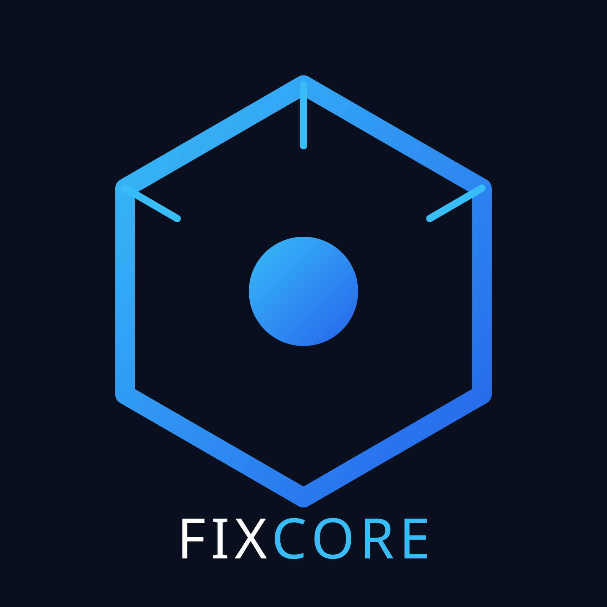
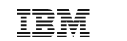
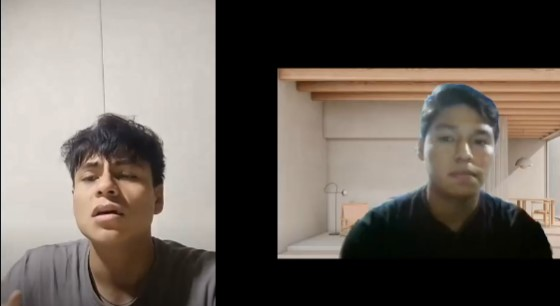
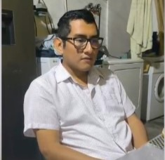
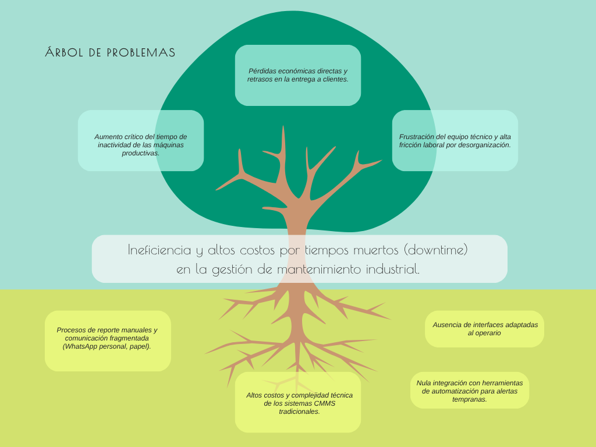
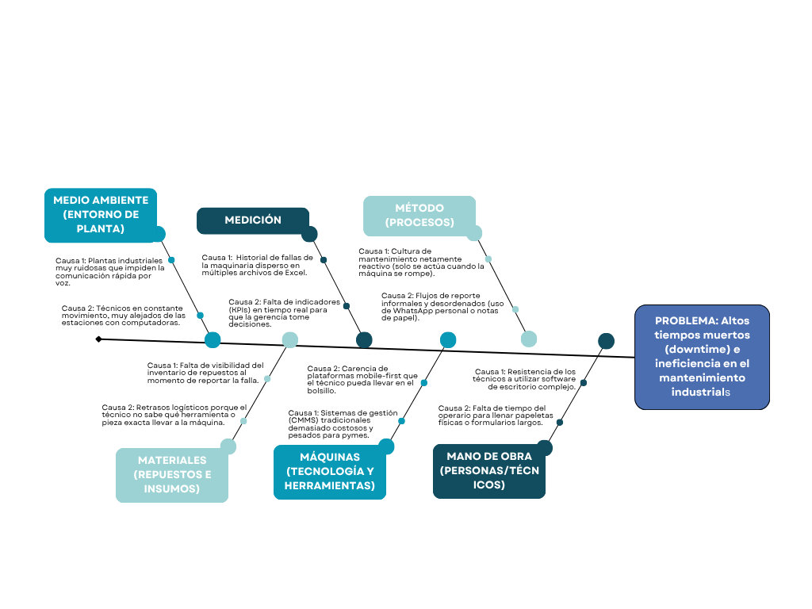

# Capítulo II: Requirements Elicitation & Analysis

## 2.1. Competidores.

**1. Fracttal**
- Plataforma CMMS 100% en la nube y móvil, muy consolidada en el mercado hispanohablante. Ofrece gestión de activos y mantenimiento predictivo con módulos de IoT. Sin embargo, sus planes de pago y la complejidad de implementación inicial pueden ser barreras de entrada para pymes industriales que buscan soluciones inmediatas.

**2. UpKeep**
- Solución de mantenimiento *"mobile-first"* diseñada específicamente para facilitar el trabajo del técnico en campo. Agiliza la creación de órdenes de trabajo mediante una interfaz sencilla. No obstante, carece de la profundidad necesaria para integraciones corporativas complejas con ERPs en industrias de gran escala.

**3. IBM Maximo**
- Software líder mundial en gestión de activos empresariales (EAM). Es extremadamente potente y personalizable, ideal para corporaciones gigantes con operaciones críticas. Su principal debilidad radica en sus altísimos costos de licencia, infraestructura pesada y una curva de aprendizaje muy pronunciada.

### 2.1.1. Análisis competitivo.

<table border="1" cellspacing="0" cellpadding="8">
<tr>
<th colspan="6">Competitive Analysis Landscape</th>
</tr>
<tr>
<th colspan="2">¿Por qué llevar a cabo este análisis?</th>
<td colspan="4">El objetivo de este análisis es identificar las fortalezas, debilidades, oportunidades y amenazas del entorno competitivo en el sector de software CMMS, con el fin de reconocer la ventaja competitiva de FixCore frente a otras soluciones existentes y orientar sus estrategias de diferenciación.</td>
</tr>
<tr>
<th colspan="2">Competidor</th>
<th>
  
FixCore
</th>
<th>
  
Fracttal
</th>
<th>
  
UpKeep
</th>
<th>
  
IBM Maximo
</th>
</tr>
<tr>
<th rowspan="2">Perfil</th>
<th>Overview</th>
<td>Plataforma web SaaS orientada a la gestión del mantenimiento industrial, centralizando activos, mantenimientos, fallas, órdenes de trabajo, inventario de repuestos y reportes.</td>
<td>Plataforma CMMS/EAM en la nube orientada a la gestión del mantenimiento, activos, órdenes de trabajo, analítica, IoT e integraciones.</td>
<td>Plataforma CMMS mobile-first orientada a gestionar órdenes de trabajo, mantenimiento preventivo, activos, inventario y actividades realizadas por técnicos.</td>
<td>Plataforma empresarial EAM orientada a la gestión, mantenimiento y confiabilidad de activos utilizados en operaciones de alta complejidad.</td>
</tr>
<tr>
<th>Ventaja competitiva ¿Qué valor ofrece a los clientes?</th>
<td>Baja fricción para técnicos, facilidad de adopción, centralización de la información y enfoque en pymes manufactureras y contratistas de mantenimiento industrial.</td>
<td>Amplio ecosistema de mantenimiento que integra movilidad, IoT, automatización, monitoreo de activos y analítica.</td>
<td>Experiencia mobile-first que facilita a los técnicos consultar, crear y gestionar órdenes de trabajo directamente desde campo.</td>
<td>Alta capacidad para administrar activos críticos, mantenimiento, planificación y operaciones empresariales complejas dentro de una misma plataforma.</td>
</tr>
<tr>
<th rowspan="2">Perfil de Marketing</th>
<th>Mercado objetivo</th>
<td>Pymes manufactureras, firmas consultoras y contratistas industriales, además de técnicos y operarios encargados de ejecutar actividades de mantenimiento.</td>
<td>Empresas y equipos de mantenimiento que necesitan digitalizar la gestión de activos y actividades de mantenimiento.</td>
<td>Equipos de mantenimiento y organizaciones que requieren gestionar operaciones desde dispositivos móviles y computadoras.</td>
<td>Grandes organizaciones intensivas en activos, como industrias manufactureras, energéticas, mineras y otras operaciones de alta complejidad.</td>
</tr>
<tr>
<th>Estrategias de marketing</th>
<td>Modelo freemium, pruebas piloto, demostraciones técnicas, alianzas con empresas industriales y énfasis en una adopción sencilla para los usuarios.</td>
<td>Contenido especializado, demostraciones comerciales, presencia internacional y comunicación orientada a la eficiencia operativa y mantenimiento inteligente.</td>
<td>Pruebas del producto, marketing digital, demostraciones y posicionamiento basado en una experiencia mobile-first.</td>
<td>Ventas empresariales, servicios especializados, alianzas estratégicas y una amplia red de partners tecnológicos.</td>
</tr>
<tr>
<th rowspan="3">Perfil de Producto</th>
<th>Productos y Servicios</th>
<td>Gestión de activos, mantenimiento preventivo, reporte de fallas, órdenes de trabajo, inventario de repuestos, alertas, notificaciones y reportes.</td>
<td>Gestión de activos, órdenes de trabajo, mantenimiento preventivo, dashboards, KPIs, IoT, automatización, analítica e integraciones.</td>
<td>Órdenes de trabajo, mantenimiento preventivo, gestión de activos, inventario, repuestos, códigos QR, reportes e integraciones.</td>
<td>Enterprise Asset Management, mantenimiento de activos, confiabilidad, planificación, inspecciones, analítica e inteligencia artificial.</td>
</tr>
<tr>
<th>Precios y Costos</th>
<td>Modelo freemium con funcionalidades básicas gratuitas y planes premium para acceder a capacidades y módulos avanzados.</td>
<td>Modelo de suscripción comercial con planes definidos según las necesidades y características de cada organización.</td>
<td>Modelo de suscripción basado en usuarios y funcionalidades contratadas.</td>
<td>Modelo de licenciamiento y suscripción empresarial configurable según los módulos y necesidades de cada organización.</td>
</tr>
<tr>
<th>Canales de distribución (Web y/o Móvil)</th>
<td>Web Application responsive accesible desde computadoras, tablets y smartphones.</td>
<td>Plataforma web y aplicación móvil.</td>
<td>Plataforma web y aplicaciones móviles para iOS y Android.</td>
<td>Plataforma web y soluciones empresariales pertenecientes al ecosistema IBM Maximo.</td>
</tr>
<tr>
<th rowspan="5">Análisis SWOT</th>
<td colspan="5">El análisis SWOT permite comparar la posición de FixCore frente a sus competidores. Las fortalezas identificadas deben permitir aprovechar las oportunidades del mercado y contribuir a establecer una ventaja competitiva sostenible.</td>
</tr>
<tr>
<th>Fortalezas</th>
<td>Facilidad de uso, enfoque en pymes y contratistas, diseño web adaptable, baja fricción para técnicos y centralización de los procesos de mantenimiento.</td>
<td>Solución madura, integración de IoT, analítica, automatización y amplia cobertura funcional.</td>
<td>Experiencia móvil sencilla, facilidad de adopción y fuerte orientación hacia el trabajo diario de los técnicos.</td>
<td>Alta capacidad empresarial, gestión integral de activos, analítica avanzada y soporte para operaciones de gran escala.</td>
</tr>
<tr>
<th>Debilidades</th>
<td>Marca nueva, ausencia inicial de casos de éxito y menor cantidad de funcionalidades avanzadas frente a plataformas consolidadas.</td>
<td>Su amplia cantidad de funcionalidades puede incrementar la complejidad de adopción para organizaciones pequeñas que buscan soluciones sencillas.</td>
<td>Algunas funcionalidades avanzadas dependen de planes superiores y su amplitud puede superar las necesidades de pequeñas empresas.</td>
<td>Mayor complejidad de implementación y costos potencialmente elevados para pequeñas y medianas organizaciones.</td>
</tr>
<tr>
<th>Oportunidades</th>
<td>Crecimiento de la digitalización de pymes industriales, existencia de procesos manuales y mayor uso de smartphones por técnicos y operarios de mantenimiento.</td>
<td>Expansión del mantenimiento predictivo, IoT, inteligencia artificial y automatización aplicada a activos industriales.</td>
<td>Crecimiento de la digitalización móvil y automatización de las operaciones de mantenimiento.</td>
<td>Mayor adopción de inteligencia artificial, mantenimiento predictivo y modernización de organizaciones intensivas en activos.</td>
</tr>
<tr>
<th>Amenazas</th>
<td>Competidores consolidados, resistencia al cambio en organizaciones tradicionales y aparición de soluciones similares con precios competitivos.</td>
<td>Aparición de nuevas soluciones CMMS más económicas, simples y especializadas.</td>
<td>Competencia creciente de otras plataformas CMMS con experiencias móviles similares.</td>
<td>Soluciones CMMS modernas y más sencillas capaces de ofrecer las funciones esenciales con menor complejidad y costo.</td>
</tr>
</table>

### 2.1.2. Estrategias y tácticas frente a competidores.

| Estrategia / Táctica | Descripción |
| :--- | :--- |
| **Enfoque en Pymes y Contratistas Industriales** | Orientar FixCore principalmente a pymes manufactureras y firmas contratistas que necesitan digitalizar su mantenimiento sin la complejidad y los costos asociados a soluciones empresariales de gran escala. |
| **Automatización de Notificaciones** | Integrar alertas automáticas para informar sobre fallas, mantenimientos próximos, órdenes de trabajo y niveles bajos de stock, reduciendo retrasos y mejorando la coordinación entre supervisores y técnicos. |
| **Modelo Freemium** | Ofrecer una versión básica que permita a las empresas probar las funciones principales de FixCore antes de contratar planes con capacidades avanzadas, disminuyendo la barrera inicial de adopción. |
| **Alianzas Estratégicas B2B** | Establecer alianzas con firmas consultoras, contratistas de mantenimiento y organizaciones relacionadas con el sector industrial para facilitar la adopción de FixCore y ampliar su presencia en el mercado. |
| **Innovación en UX y Baja Fricción** | Diseñar una Web Application responsive, sencilla y accesible desde computadoras, tablets y smartphones, reduciendo la cantidad de pasos necesarios para tareas frecuentes como reportar fallas, consultar órdenes de trabajo o revisar repuestos. |

## 2.2. Entrevistas.

### 2.2.1. Diseño de entrevistas.

**Guía de preguntas para Pymes de Manufactura y Producción**

* ¿Cuál es tu nombre, edad y qué cargo ocupas en la planta?
* ¿A qué sector industrial pertenece la empresa y, aproximadamente, cuántas máquinas principales operan?
* Para coordinar el día a día y gestionar el mantenimiento, ¿qué herramientas o software utilizas habitualmente en tu computadora (ej. Excel, sistemas de gestión) y qué dispositivos móviles manejas (smartphones, tablets) para mantenerte comunicada con tu equipo?
* ¿Qué marca y modelo de smartphone y computadora sueles utilizar para tus labores, y qué navegador web (ej. Chrome, Safari, Edge) prefieres para abrir tus plataformas de trabajo?
* ¿Cómo gestionan actualmente el reporte de fallas de maquinaria y las órdenes de trabajo (ej. Excel, papel, grupos de WhatsApp, pizarras)?
* ¿Cuáles son tus canales de comunicación principales (llamadas, WhatsApp, reuniones presenciales o correo) cuando ocurre una emergencia en planta, y cómo lidias con que la información esté dispersa entre ellos?
* ¿Qué dispositivos utilizan más los operarios y técnicos durante su turno en planta (smartphones personales, tablets de la empresa, radios)?
* ¿Qué tan frecuente es que una máquina sufra tiempos muertos (downtime) debido a una mala comunicación o lentitud al reportar la falla?
* ¿Cuáles son las mayores frustraciones que enfrentas al intentar consolidar la información de mantenimiento a fin de mes?
* ¿Has intentado implementar algún software de mantenimiento anteriormente? Si es así, ¿cuál fue el resultado o la principal barrera de adopción por parte de los técnicos?
* ¿Qué elemento te generaría más confianza para adoptar un nuevo sistema: la facilidad de uso para el operario, la automatización de alertas, o el costo de implementación?
* A nivel profesional o tecnológico, ¿qué marcas, empresas referentes o fuentes de contenido industrial e innovación sigues o consideras un modelo a imitar en tu gestión?
* ¿Cómo crees que impactaría en la productividad si los técnicos pudieran reportar una falla en menos de 3 clics desde su celular?
* ¿Qué tan útil te resultaría recibir notificaciones automáticas de fallas críticas directamente en tu WhatsApp?
* Si existiera una versión básica gratuita (modelo freemium) para probar el sistema con algunas máquinas, ¿te animarías a implementarlo en tu planta?
* Una vez comprobado el valor del sistema, ¿cuánto estarías dispuesto a pagar mensualmente por módulos avanzados y analítica de datos (rango en dólares o soles)?

**Guía de preguntas para Firmas Consultoras y Contratistas de Ingeniería Industrial**

* ¿Podría indicarme su nombre, cargo y el tipo de servicios de ingeniería o mantenimiento que brinda su empresa?
* ¿A cuántas plantas industriales o clientes prestan servicio de manera simultánea?
* Para coordinar las operaciones desde la oficina o campo, ¿qué dispositivos utilizas habitualmente y qué herramientas o software manejas para gestionar el día a día?
* ¿Qué marca y modelo de computadora/laptop y smartphone utilizas para tus labores de coordinación, y qué navegador web (ej. Chrome, Safari, Edge) prefieres utilizar en tu día a día?
* ¿Cómo coordinan actualmente el despliegue de sus técnicos en campo cuando un cliente reporta una emergencia o falla en sus equipos?
* ¿Cuáles son tus canales de comunicación principales (llamadas telefónicas, WhatsApp o correos) para contactar a los técnicos y clientes, y cómo manejas la dispersión de información entre ellos?
* Desde su experiencia operativa, ¿cuáles son las mayores limitaciones logísticas o tecnológicas que enfrentan para atender múltiples plantas a la vez?
* ¿Qué tan complejo les resulta estandarizar los reportes de mantenimiento y KPIs para entregárselos a diferentes clientes?
* ¿Suelen utilizar herramientas de automatización de flujos de trabajo o integración de APIs en sus operaciones diarias?
* ¿Qué funcionalidades considera indispensables en una plataforma digital para que decida utilizarla como el motor operativo de todos sus técnicos (ej. webhooks, portal multi-cliente, alertas en tiempo real)?
* ¿Qué tan importante sería para su firma poder integrar el sistema de mantenimiento con otras herramientas de comunicación (como notificaciones automáticas vía WhatsApp)?
* A nivel tecnológico o de gestión de operaciones, ¿qué marcas, empresas referentes o plataformas digitales sigues o tomas como inspiración para tu trabajo?
* ¿Cree que ofrecer a sus clientes una herramienta ágil para que les reporten fallas mejoraría la percepción de su servicio tercerizado? ¿Por qué?
* ¿Preferiría un modelo de precios basado en la cantidad de técnicos (usuarios) o en la cantidad de plantas/clientes gestionados?
* ¿Estaría dispuesto a recomendar e implementar este sistema directamente en la infraestructura tecnológica de sus clientes?

**Guía de preguntas para Técnicos y Operarios de Mantenimiento Industrial**

- ¿Cuál es tu nombre, edad y qué función desempeñas actualmente dentro del área de mantenimiento?
- ¿Cuánto tiempo llevas trabajando en mantenimiento industrial y qué tipo de máquinas o equipos atiendes con mayor frecuencia?
- ¿Qué dispositivo utilizas con mayor frecuencia durante tu jornada de trabajo y para qué tareas lo utilizas?
- ¿Qué marca y modelo de smartphone utilizas principalmente en campo, y qué navegador web (ej. Chrome, Safari) sueles emplear si necesitas consultar algo desde el celular o una computadora?
- ¿Cómo recibes actualmente las tareas u órdenes de mantenimiento que debes realizar durante tu turno?
- Cuando detectas una falla en una máquina, ¿cómo la reportas y a quién se la comunicas?
- ¿Qué información necesitas consultar antes de comenzar un mantenimiento o una reparación?
- ¿Cómo consultas actualmente los manuales, historiales de mantenimiento o información técnica de una máquina?
- ¿Cómo verificas si existe un repuesto disponible antes o durante una reparación?
- ¿Qué problemas o dificultades encuentras al utilizar papel, Excel, WhatsApp u otras herramientas durante tus actividades de mantenimiento?
- ¿Qué características debería tener una herramienta digital para que puedas utilizarla fácilmente mientras trabajas en planta?
- ¿Qué situaciones suelen hacer que una orden de trabajo se retrase o sea difícil de completar?
- ¿Cómo registras actualmente el trabajo realizado después de terminar un mantenimiento?
- ¿Qué tipo de alertas o información te sería más útil recibir durante tu turno?
- A nivel de herramientas tecnológicas, aplicaciones o plataformas del día a día, ¿qué marcas, apps móviles o referentes sigues o te parecen más intuitivos para trabajar?
- ¿Qué es lo que más te frustra del proceso actual de mantenimiento y qué cambiarías para hacerlo más sencillo?

### 2.2.2. Registro de entrevistas

**Segmento 1: Pymes de Manufactura y Producción**

<table>
  <thead>
    <tr>
      <th align="center">Foto</th>
      <th align="left">Campo</th>
      <th align="left">Detalle</th>
    </tr>
  </thead>
  <tbody>
    <tr>
      <td rowspan="6" align="center" valign="middle" width="200">
        
      </td>
      <td><strong>Nombre y apellido</strong></td>
      <td>Caterina Villanueva</td>
    </tr>
    <tr>
      <td><strong>Edad</strong></td>
      <td>35 años</td>
    </tr>
    <tr>
      <td><strong>Ubicación</strong></td>
      <td>San Miguel</td>
    </tr>
    <tr>
      <td><strong>Timing de la entrevista</strong></td>
      <td>Inicia: 00:00 - Termina: 04:38</td>
    </tr>
    <tr>
      <td><strong>Duración</strong></td>
      <td>4 minutos y 38 segundos</td>
    </tr>
    <tr>
      <td><strong>Enlace</strong></td>
      <td><a href="https://upcedupe-my.sharepoint.com/:v:/g/personal/u202423973_upc_edu_pe/IQBCKuUvc8VeT4YtxyBRxNnnAerbBFUqAE8C5H7KH6vx3GU?e=f8X1Pp">Video de las entrevistas</a></td>
    </tr>
  </tbody>
</table>

**Resumen:**

**¿Cuál es tu nombre, edad y qué cargo ocupas en la planta?**

Mi nombre es Caterina Villanueva, tengo 35 años y soy coordinadora de producción. Principalmente superviso que la producción se desarrolle con normalidad y coordino con el área de mantenimiento cuando ocurre algún problema con las máquinas.

**¿A qué sector industrial pertenece la empresa y, aproximadamente, cuántas máquinas principales operan?**

La empresa pertenece al sector manufacturero y tenemos alrededor de 18 máquinas principales en operación.

**¿Cómo gestionan actualmente el reporte de fallas de maquinaria y las órdenes de trabajo?**

La mayoría de los problemas se reportan mediante WhatsApp porque es el medio más rápido. Tenemos un grupo de producción y mantenimiento donde se comunican las fallas. También utilizamos Microsoft Excel y algunos formatos físicos para registrar información.

**¿Qué dispositivos, marcas y herramientas digitales utilizan con mayor frecuencia durante el trabajo?**

Durante el trabajo utilizamos principalmente celulares. En mi caso utilizo un iPhone para comunicarme y revisar información cuando estoy fuera de la oficina. También trabajo desde una laptop con Windows. Para las coordinaciones utilizamos WhatsApp y, cuando necesitamos revisar o compartir información, usamos Microsoft Excel, Google Drive, Gmail y Google Chrome. Algunos trabajadores también utilizan radios para coordinaciones rápidas dentro de la planta.

**¿Qué tan frecuente es que una máquina sufra tiempos muertos debido a una mala comunicación o lentitud al reportar la falla?**

No sucede todos los días, pero sí puede ocurrir varias veces al mes. Algunas fallas se comunican rápidamente, pero el mensaje puede perderse entre todas las conversaciones del grupo de WhatsApp. Esto puede retrasar la atención y terminar afectando la producción.

**¿Cuáles son las mayores frustraciones que enfrentas al intentar consolidar la información de mantenimiento a fin de mes?**

Lo más complicado es que la información se encuentra distribuida en diferentes medios. Tengo que revisar WhatsApp, archivos de Excel y formatos físicos, por lo que consolidar todo termina siendo un proceso tedioso.

**¿Has intentado implementar algún software de mantenimiento anteriormente? Si es así, ¿cuál fue el resultado o la principal barrera de adopción por parte de los técnicos?**

Sí, anteriormente se intentó utilizar un sistema, pero varios trabajadores tuvieron dificultades para entenderlo y finalmente se dejó de usar. Algunos integrantes del personal no estaban acostumbrados a llenar formularios o utilizar herramientas con muchas opciones.

**¿Qué elemento te generaría más confianza para adoptar un nuevo sistema: la facilidad de uso para el operario, la automatización de alertas o el costo de implementación?**

Considero que lo más importante sería la facilidad de uso. Tenemos trabajadores con diferentes niveles de experiencia utilizando herramientas digitales, por lo que el sistema debería ser sencillo de entender. Después consideraría la automatización de alertas y, finalmente, el costo.

**¿Cómo crees que impactaría en la productividad si los técnicos pudieran reportar una falla en pocos pasos desde su celular?**

Sería mucho más práctico que llenar formularios extensos. Permitiría comunicar las fallas más rápido y facilitaría el seguimiento de las actividades posteriores.

**¿Qué tan útil te resultaría recibir notificaciones automáticas de fallas críticas directamente en WhatsApp?**

Me resultaría bastante útil, especialmente para las fallas de mayor prioridad. De esta manera sería posible distinguir rápidamente cuáles requieren atención inmediata y cuáles pueden esperar.

**Si existiera una versión básica gratuita para probar el sistema con algunas máquinas, ¿te animarías a implementarlo en tu planta?**

Sí. Empezaría probándolo con dos o tres máquinas y, dependiendo de los resultados, evaluaría implementarlo progresivamente en el resto de la empresa.

**Una vez comprobado el valor del sistema, ¿cuánto estarías dispuesta a pagar mensualmente por módulos avanzados y analítica de datos?**

Consideraría un rango aproximado de 500 a 1000 soles mensuales, dependiendo de las funcionalidades incluidas y del beneficio que pueda generar para las operaciones de la empresa.

<table>
  <thead>
    <tr>
      <th align="center">Foto</th>
      <th align="left">Campo</th>
      <th align="left">Detalle</th>
    </tr>
  </thead>
  <tbody>
    <tr>
      <td rowspan="6" align="center" valign="middle" width="200">
        
      </td>
      <td><strong>Nombre y apellido</strong></td>
      <td>Carla Aguilar</td>
    </tr>
    <tr>
      <td><strong>Edad</strong></td>
      <td>26 años</td>
    </tr>
    <tr>
      <td><strong>Ubicación</strong></td>
      <td>Magdalena del Mar</td>
    </tr>
    <tr>
      <td><strong>Timing de la entrevista</strong></td>
      <td>Inicia: 04:38 - Termina: 08:57</td>
    </tr>
    <tr>
      <td><strong>Duración</strong></td>
      <td>4 minutos y 19 segundos</td>
    </tr>
    <tr>
      <td><strong>Enlace</strong></td>
      <td><a href="https://upcedupe-my.sharepoint.com/:v:/g/personal/u202423973_upc_edu_pe/IQBCKuUvc8VeT4YtxyBRxNnnAerbBFUqAE8C5H7KH6vx3GU?e=f8X1Pp">Video de las entrevistas</a></td>
    </tr>
  </tbody>
</table>

**Resumen:**

**¿Cuál es tu nombre, edad y qué cargo ocupas en la planta?**

Mi nombre es Carla Aguilar, tengo 26 años y soy jefa de planta.

**¿A qué sector industrial pertenece la empresa y, aproximadamente, cuántas máquinas principales operan?**

La empresa es una fábrica de envases de plástico. Actualmente tenemos aproximadamente 15 máquinas principales operando, entre inyectoras y sopladoras.

**¿Cómo gestionan actualmente el reporte de fallas de maquinaria y las órdenes de trabajo?**

La mayor parte de las coordinaciones se realiza mediante grupos de WhatsApp. También utilizamos una pizarra para organizar algunas órdenes de trabajo y, al finalizar el mes, consolido la información en Microsoft Excel para elaborar los reportes de gerencia.

**¿Qué dispositivos, marcas y herramientas digitales utilizan con mayor frecuencia durante el trabajo?**

Casi todos los técnicos utilizan sus celulares personales durante el turno. La mayoría cuenta con dispositivos Android, principalmente de marcas como Samsung y Xiaomi. Yo también utilizo una laptop con Windows para preparar los reportes. Para coordinarnos usamos WhatsApp y para organizar información utilizamos Microsoft Excel y Google Sheets. También usamos Google Drive y Google Chrome cuando necesitamos consultar o compartir documentos.

**¿Qué tan frecuente es que una máquina sufra tiempos muertos debido a una mala comunicación o lentitud al reportar la falla?**

Puede ocurrir aproximadamente dos o tres veces al mes. Algunas veces una máquina comienza a presentar problemas y la información no llega a tiempo al responsable de mantenimiento, lo que puede provocar que la línea permanezca detenida durante varias horas.

**¿Cuáles son las mayores frustraciones que enfrentas al intentar consolidar la información de mantenimiento a fin de mes?**

Lo más complicado es revisar las conversaciones de WhatsApp para recordar cuándo se cambió una pieza, qué falla ocurrió o quién realizó una determinada intervención. La información se encuentra demasiado dispersa.

**¿Has intentado implementar algún software de mantenimiento anteriormente? Si es así, ¿cuál fue el resultado o la principal barrera de adopción por parte de los técnicos?**

En una oportunidad intentamos trabajar con hojas de cálculo de Google, pero a varios técnicos les resultaba incómodo completar la información desde sus celulares porque las celdas eran pequeñas y el proceso les tomaba tiempo. Algunos tampoco estaban acostumbrados a utilizar este tipo de herramientas, por lo que finalmente dejamos de usarlas.

**¿Qué elemento te generaría más confianza para adoptar un nuevo sistema: la facilidad de uso para el operario, la automatización de alertas o el costo de implementación?**

Principalmente la facilidad de uso. Si el sistema requiere escribir demasiado o completar formularios extensos, probablemente los técnicos no lo utilizarían de manera constante.

**¿Cómo crees que impactaría en la productividad si los técnicos pudieran reportar una falla en pocos pasos desde su celular?**

Ayudaría bastante porque permitiría comunicar una falla rápidamente sin interrumpir demasiado el trabajo del técnico.

**¿Qué tan útil te resultaría recibir notificaciones automáticas de fallas críticas directamente en WhatsApp?**

Sería bastante útil porque utilizo WhatsApp constantemente durante la jornada. Recibir una alerta permitiría conocer un problema sin tener que recorrer toda la planta o esperar a que alguien lo comunique personalmente.

**Si existiera una versión básica gratuita para probar el sistema con algunas máquinas, ¿te animarías a implementarlo en tu planta?**

Sí. Empezaría utilizando el sistema con las tres máquinas inyectoras que son más importantes para la producción y evaluaría los resultados antes de ampliarlo.

**Una vez comprobado el valor del sistema, ¿cuánto estarías dispuesta a pagar mensualmente por módulos avanzados y analítica de datos?**

Consideraría pagar entre 80 y 100 dólares mensuales si la plataforma realmente permite organizar mejor las actividades y reducir los problemas actuales.

<table>
  <thead>
    <tr>
      <th align="center">Foto</th>
      <th align="left">Campo</th>
      <th align="left">Detalle</th>
    </tr>
  </thead>
  <tbody>
    <tr>
      <td rowspan="6" align="center" valign="middle" width="200">
        
      </td>
      <td><strong>Nombre y apellido</strong></td>
      <td>Mitjail Landa</td>
    </tr>
    <tr>
      <td><strong>Edad</strong></td>
      <td>29 años</td>
    </tr>
    <tr>
      <td><strong>Ubicación</strong></td>
      <td>Ate Vitarte</td>
    </tr>
    <tr>
      <td><strong>Timing de la entrevista</strong></td>
      <td>Inicia: 08:58 - Termina: 16:47</td>
    </tr>
    <tr>
      <td><strong>Duración</strong></td>
      <td>7 minutos y 49 segundos</td>
    </tr>
    <tr>
      <td><strong>Enlace</strong></td>
      <td><a href="https://upcedupe-my.sharepoint.com/:v:/g/personal/u202423973_upc_edu_pe/IQBCKuUvc8VeT4YtxyBRxNnnAerbBFUqAE8C5H7KH6vx3GU?e=f8X1Pp">Video de las entrevistas</a></td>
    </tr>
  </tbody>
</table>

**Resumen:**

Mitjail Landa, de 29 años, trabaja en el área de gestión de proyectos dentro del sector de telecomunicaciones. La empresa administra cientos de equipos distribuidos a nivel nacional y coordina los reportes mediante llamadas telefónicas y correos electrónicos. Entre las principales dificultades identifica la desorganización de la información y la coordinación entre diferentes áreas. Considera que una nueva solución debe ser fácil de utilizar y permitir la automatización de alertas.

**¿Cuál es tu nombre, edad y qué cargo ocupas?**

Mi nombre es Mitjail Landa, tengo 29 años y trabajo en gestión de proyectos.

**¿A qué sector pertenece la empresa y, aproximadamente, cuántos equipos gestionan?**

La empresa pertenece al sector de telecomunicaciones y opera cientos de equipos distribuidos a nivel nacional.

**¿Cómo gestionan actualmente el reporte de fallas y las actividades de mantenimiento?**

Los reportes son comunicados principalmente mediante llamadas telefónicas y correos electrónicos.

**¿Qué dispositivos, marcas y herramientas digitales utilizan con mayor frecuencia durante sus actividades?**

Los operarios utilizan principalmente celulares Android, mientras que para las actividades administrativas trabajamos desde computadoras y laptops con Windows. En mi caso utilizo un smartphone Android y una laptop. Para las comunicaciones usamos llamadas telefónicas, WhatsApp y correo electrónico, principalmente Gmail y Outlook. También utilizamos Microsoft Excel, Google Drive y Google Chrome para organizar, compartir y consultar información.

**¿Qué tan frecuente es que un equipo presente tiempos muertos debido a una mala comunicación o lentitud al reportar la falla?**

No ocurre con mucha frecuencia, pero cuando sucede los tiempos de inactividad pueden ser elevados.

**¿Cuáles son las mayores frustraciones que enfrentas al intentar consolidar la información de mantenimiento?**

La principal dificultad es la desorganización y la saturación de información generada por el trabajo de personas pertenecientes a diferentes áreas.

**¿Has intentado implementar algún software de mantenimiento anteriormente?**

Se ha evaluado la implementación de este tipo de software y actualmente se considera su uso para proyectos que requieren mantenimiento preventivo.

**¿Qué elemento te generaría más confianza para adoptar un nuevo sistema?**

Considero que lo más importante sería la facilidad de uso para los operarios, ya que esto facilitaría su adaptación. También resultaría importante contar con alertas automáticas para anticiparse a determinados problemas.

**¿Cómo crees que impactaría en la productividad si los técnicos pudieran reportar una falla en pocos pasos desde su celular?**

Sería beneficioso porque permitiría reportar una incidencia con mayor rapidez y reduciría el tiempo necesario para comunicar una falla al personal responsable.

**¿Qué tan útil te resultaría recibir notificaciones automáticas de fallas críticas?**

Sería bastante útil, especialmente si el sistema pudiera integrarse con mensajes de texto, WhatsApp u otros medios de comunicación que permitan informar rápidamente una incidencia.

**Si existiera una versión básica gratuita para probar el sistema, ¿te animarías a utilizarla?**

Sí. La probaría inicialmente para evaluar cómo se adapta al contexto de trabajo y qué beneficios proporciona.

**Una vez comprobado el valor del sistema, ¿cuánto estarías dispuesto a pagar mensualmente?**

El monto dependería de los módulos y funcionalidades disponibles. Como referencia inicial consideraría un rango de 50 a 100 soles mensuales, aunque sería necesario evaluar previamente las características del producto.

**Segmento 2: Firmas Consultoras y Contratistas de Ingeniería Industrial**

<table>
  <thead>
    <tr>
      <th align="center">Foto</th>
      <th align="left">Campo</th>
      <th align="left">Detalle</th>
    </tr>
  </thead>
  <tbody>
    <tr>
      <td rowspan="6" align="center" valign="middle" width="200">
        
      </td>
      <td><strong>Nombre y apellido</strong></td>
      <td>Cristofer Vilchez</td>
    </tr>
    <tr>
      <td><strong>Edad</strong></td>
      <td>20 años</td>
    </tr>
    <tr>
      <td><strong>Ubicación</strong></td>
      <td>Lima</td>
    </tr>
    <tr>
      <td><strong>Timing de la entrevista</strong></td>
      <td>Inicia: 16:47 - Termina: 24:10</td>
    </tr>
    <tr>
      <td><strong>Duración</strong></td>
      <td>7 minutos y 23 segundos</td>
    </tr>
    <tr>
      <td><strong>Enlace</strong></td>
      <td><a href="https://upcedupe-my.sharepoint.com/:v:/g/personal/u202423973_upc_edu_pe/IQBCKuUvc8VeT4YtxyBRxNnnAerbBFUqAE8C5H7KH6vx3GU?e=f8X1Pp">Video de las entrevistas</a></td>
    </tr>
  </tbody>
</table>

**Resumen:**

**¿Podría indicarme su nombre, cargo y el tipo de servicios de ingeniería o mantenimiento que brinda su empresa?**

Mi nombre es Cristofer Vilchez, tengo 20 años y trabajo como asistente de operaciones en una empresa que brinda servicios de mantenimiento preventivo y correctivo para equipos electromecánicos utilizados en pequeñas y medianas empresas industriales.

**¿A cuántas plantas industriales o clientes prestan servicio de manera simultánea?**

Normalmente tenemos entre cinco y siete clientes activos durante la semana. Dependiendo de las emergencias, podemos tener técnicos trabajando en varias plantas al mismo tiempo.

**¿Cómo coordinan actualmente el despliegue de sus técnicos cuando un cliente reporta una emergencia o falla?**

La mayoría de las coordinaciones se realiza mediante llamadas telefónicas y WhatsApp. Cuando ocurre una emergencia, el supervisor revisa quién se encuentra disponible y se comunica con los técnicos para determinar quién puede atender al cliente con mayor rapidez.

**¿Qué dispositivos, marcas y herramientas digitales utiliza normalmente para coordinar sus actividades y las de los técnicos?**

Utilizo principalmente un smartphone Samsung con Android y una laptop con Windows. Durante el trabajo usamos WhatsApp y llamadas telefónicas para comunicarnos con los técnicos. Para las coordinaciones por correo utilizo Gmail y, cuando tenemos que organizar información, usamos Microsoft Excel y Google Sheets. También utilizamos Google Drive para compartir documentos, Google Calendar para algunas programaciones y Google Chrome para acceder a servicios web.

**Desde su experiencia operativa, ¿cuáles son las mayores limitaciones logísticas o tecnológicas que enfrentan para atender múltiples plantas a la vez?**

Uno de los principales problemas es no disponer de información actualizada sobre el estado de cada técnico. También puede ocurrir que un técnico llegue a la planta y recién descubra que necesita un repuesto que no se encuentra disponible, lo cual genera retrasos.

**¿Qué tan complejo les resulta estandarizar los reportes de mantenimiento y KPIs para entregarlos a diferentes clientes?**

Resulta complicado porque cada cliente solicita información diferente. Algunas empresas requieren archivos de Excel, otras documentos PDF y otras únicamente un resumen. Finalmente terminamos recopilando información de mensajes, fotografías y diferentes formatos para preparar cada reporte.

**¿Suelen utilizar herramientas de automatización de flujos de trabajo o integración de APIs?**

Actualmente utilizamos principalmente WhatsApp, correo electrónico y hojas de cálculo. No contamos con automatizaciones avanzadas, aunque sería útil que determinadas notificaciones o cambios de estado pudieran enviarse automáticamente.

**¿Qué funcionalidades considera indispensables en una plataforma digital?**

Me parecería importante contar con un panel donde podamos visualizar las órdenes de trabajo, los técnicos asignados, el estado de cada servicio y la disponibilidad de repuestos. También serían útiles las alertas cuando ocurre una emergencia o cambia la prioridad de una tarea.

**¿Qué tan importante sería integrar el sistema con herramientas de comunicación como WhatsApp?**

Sería bastante importante porque WhatsApp es una herramienta utilizada diariamente. Si los avisos pudieran enviarse automáticamente, reduciríamos el tiempo empleado en llamar o escribir individualmente a cada persona.

**¿Cree que permitir a los clientes reportar fallas mediante una plataforma mejoraría la percepción del servicio?**

Sí. Permitir que un cliente reporte una falla y consulte el estado de su atención proyectaría una imagen más organizada y profesional.

**¿Preferiría un modelo de precios basado en la cantidad de técnicos o en la cantidad de plantas gestionadas?**

Preferiría un modelo basado en la cantidad de técnicos activos porque la cantidad de clientes puede cambiar dependiendo del mes, mientras que el equipo de trabajo suele mantenerse más estable.

**¿Estaría dispuesto a recomendar e implementar este sistema con sus clientes?**

Sí, siempre que sea sencillo, estable y no requiera demasiado tiempo de capacitación. Si permite organizar mejor las operaciones, sería una herramienta que podríamos recomendar.

<table>
  <thead>
    <tr>
      <th align="center">Foto</th>
      <th align="left">Campo</th>
      <th align="left">Detalle</th>
    </tr>
  </thead>
  <tbody>
    <tr>
      <td rowspan="6" align="center" valign="middle" width="200">
        
      </td>
      <td><strong>Nombre y apellido</strong></td>
      <td>Valeria Salazar</td>
    </tr>
    <tr>
      <td><strong>Edad</strong></td>
      <td>34 años</td>
    </tr>
    <tr>
      <td><strong>Ubicación</strong></td>
      <td>San Miguel</td>
    </tr>
    <tr>
      <td><strong>Timing de la entrevista</strong></td>
      <td>Inicia: 24:11 - Termina: 28:37</td>
    </tr>
    <tr>
      <td><strong>Duración</strong></td>
      <td>4 minutos y 26 segundos</td>
    </tr>
    <tr>
      <td><strong>Enlace</strong></td>
      <td><a href="https://upcedupe-my.sharepoint.com/:v:/g/personal/u202423973_upc_edu_pe/IQBCKuUvc8VeT4YtxyBRxNnnAerbBFUqAE8C5H7KH6vx3GU?e=f8X1Pp">Video de las entrevistas</a></td>
    </tr>
  </tbody>
</table>

**Resumen:**

**¿Podría indicarme su nombre, cargo y el tipo de servicios de ingeniería o mantenimiento que brinda su empresa?**

Mi nombre es Valeria Salazar y trabajo en el área de Operaciones de una empresa dedicada a brindar servicios de mantenimiento industrial preventivo y correctivo.

**¿A cuántas plantas industriales o clientes prestan servicio de manera simultánea?**

Actualmente atendemos ocho plantas con las que mantenemos contratos anuales.

**¿Cómo coordinan actualmente el despliegue de sus técnicos cuando un cliente reporta una emergencia o falla?**

La coordinación se realiza principalmente mediante llamadas telefónicas y correos electrónicos. Cuando un cliente reporta una emergencia, tengo que comunicarme con los técnicos para conocer quién se encuentra disponible o quién está más cerca de la planta.

**¿Qué dispositivos, marcas y herramientas digitales utiliza normalmente para coordinar sus actividades y las de los técnicos?**

Utilizo principalmente un iPhone y una laptop con Windows. Durante el día utilizo WhatsApp y llamadas telefónicas para las coordinaciones rápidas, mientras que para comunicaciones más formales utilizo Gmail y Outlook. También trabajo con Microsoft Excel para los reportes, Google Drive para compartir archivos, documentos PDF y Google Chrome para acceder a diferentes servicios y sistemas web.

**Desde su experiencia operativa, ¿cuáles son las mayores limitaciones logísticas o tecnológicas que enfrentan para atender múltiples plantas a la vez?**

Una de las principales limitaciones es el cruce de horarios y no saber con anticipación si el técnico cuenta con el repuesto necesario antes de llegar a la planta del cliente.

**¿Qué tan complejo les resulta estandarizar los reportes de mantenimiento y KPIs para entregarlos a diferentes clientes?**

Es un proceso bastante demandante porque cada cliente solicita formatos diferentes. Algunos requieren documentos PDF, otros archivos de Excel y, en varios casos, tenemos que dedicar bastante tiempo a consolidar y transcribir la información antes de entregar el reporte.

**¿Suelen utilizar herramientas de automatización de flujos de trabajo o integración de APIs?**

Actualmente no utilizamos automatizaciones avanzadas. Gran parte del flujo operativo sigue siendo manual y depende de la coordinación realizada por los responsables de operaciones.

**¿Qué funcionalidades considera indispensables en una plataforma digital?**

Considero indispensable contar con un portal centralizado desde el cual pueda visualizar a los clientes, las órdenes de trabajo, los técnicos asignados y el estado de cada servicio.

**¿Qué tan importante sería integrar el sistema con herramientas de comunicación como WhatsApp?**

Sería muy útil porque permitiría automatizar parte de la comunicación con los clientes y técnicos. De esta manera podrían recibir avisos sobre cambios importantes sin que el coordinador tenga que comunicarlos manualmente uno por uno.

**¿Cree que ofrecer a sus clientes una herramienta para reportar fallas mejoraría la percepción del servicio?**

Sí. Una plataforma de este tipo permitiría proyectar una imagen más organizada y tecnológica, además de ofrecer mayor visibilidad sobre el estado de los servicios.

**¿Preferiría un modelo de precios basado en la cantidad de técnicos o en la cantidad de plantas gestionadas?**

Preferiría un modelo basado en la cantidad de técnicos, porque permitiría incorporar nuevos clientes sin incrementar directamente el costo por cada planta registrada.

**¿Estaría dispuesta a recomendar e implementar este sistema con sus clientes?**

Sí, siempre que permita adaptar los reportes a las necesidades de la empresa y facilite la gestión de los servicios realizados.

<table>
  <thead>
    <tr>
      <th align="center">Foto</th>
      <th align="left">Campo</th>
      <th align="left">Detalle</th>
    </tr>
  </thead>
  <tbody>
    <tr>
      <td rowspan="6" align="center" valign="middle" width="200">
        
      </td>
      <td><strong>Nombre y apellido</strong></td>
      <td>Anderson Cabanillas</td>
    </tr>
    <tr>
      <td><strong>Edad</strong></td>
      <td>20 años</td>
    </tr>
    <tr>
      <td><strong>Ubicación</strong></td>
      <td>Ventanilla</td>
    </tr>
    <tr>
      <td><strong>Timing de la entrevista</strong></td>
      <td>Inicia: 28:37 - Termina: 34:28</td>
    </tr>
    <tr>
      <td><strong>Duración</strong></td>
      <td>5 minutos y 51 segundos</td>
    </tr>
    <tr>
      <td><strong>Enlace</strong></td>
      <td><a href="https://upcedupe-my.sharepoint.com/:v:/g/personal/u202423973_upc_edu_pe/IQBCKuUvc8VeT4YtxyBRxNnnAerbBFUqAE8C5H7KH6vx3GU?e=f8X1Pp">Video de las entrevistas</a></td>
    </tr>
  </tbody>
</table>

**Resumen:**

**¿Podría indicarme su nombre, cargo y el tipo de servicios de ingeniería o mantenimiento que brinda su empresa?**

Mi nombre es Anderson Cabanillas, tengo 20 años y trabajo como asistente de operaciones y soporte en una empresa que brinda servicios de mantenimiento preventivo y correctivo para sistemas electromecánicos y equipos utilizados en pequeñas plantas industriales.

**¿A cuántas plantas industriales o clientes prestan servicio de manera simultánea?**

Normalmente atendemos entre cuatro y seis clientes activos durante la semana. Algunas veces se presentan emergencias de manera simultánea y tenemos que reorganizar rápidamente a los técnicos.

**¿Cómo coordinan actualmente el despliegue de sus técnicos cuando un cliente reporta una emergencia o falla?**

Las asignaciones se coordinan mediante llamadas, mensajes directos y el grupo de WhatsApp de la empresa. El jefe de operaciones determina qué técnico se encuentra disponible o más cerca de la planta, aunque algunas veces no sabemos con exactitud si terminó su servicio anterior o si cuenta con los repuestos necesarios.

**¿Qué dispositivos, marcas y herramientas digitales utiliza normalmente durante sus actividades?**

Utilizo principalmente un smartphone Android, normalmente de marcas como Samsung o Xiaomi, y una computadora con Windows cuando realizo actividades administrativas. Para las coordinaciones utilizamos WhatsApp y llamadas telefónicas. También utilizo Gmail para el correo, Google Chrome para acceder a páginas y sistemas web, Google Drive para compartir archivos y Microsoft Excel para organizar información y preparar algunos reportes.

**Desde su experiencia operativa, ¿cuáles son las mayores limitaciones logísticas o tecnológicas que enfrentan para atender múltiples plantas?**

Una de las principales dificultades es la falta de comunicación en tiempo real. Los técnicos se encuentran trabajando en distintas plantas y algunas veces no reportan una falla inmediatamente. Además, no tenemos un inventario completamente actualizado de los repuestos disponibles en el taller o transportados por cada técnico.

**¿Qué tan complejo les resulta estandarizar los reportes de mantenimiento y KPIs?**

Es bastante complejo porque cada cliente solicita sus reportes de una manera diferente. Tenemos que trasladar información de notas y conversaciones hacia documentos de Word o Excel. Asimismo, preparar los indicadores de fin de mes puede tomar varias horas.

**¿Suelen utilizar herramientas de automatización de flujos de trabajo o integración de APIs?**

Actualmente no utilizamos automatizaciones complejas. Dependemos principalmente de herramientas básicas como WhatsApp, aunque sería útil contar con un sistema que envíe determinados avisos de manera automática.

**¿Qué funcionalidades considera indispensables en una plataforma digital?**

Las principales serían las alertas en tiempo real y un panel donde podamos visualizar el estado de cada orden de trabajo sin tener que comunicarnos constantemente con cada técnico.

**¿Qué tan importante sería integrar el sistema con herramientas de comunicación como WhatsApp?**

Sería muy útil. Si el cliente o el responsable pudiera recibir automáticamente un mensaje cuando el técnico termina una tarea o cuando ocurre una emergencia, sería posible responder con mayor rapidez.

**¿Cree que ofrecer a sus clientes una herramienta para reportar fallas mejoraría la percepción del servicio?**

Sí. Si el cliente dispone de un sistema organizado donde pueda reportar una falla rápidamente y consultar el avance de la atención, tendría mayor confianza en el servicio.

**¿Preferiría un modelo de precios basado en la cantidad de técnicos o en la cantidad de plantas gestionadas?**

Considero que sería más conveniente un modelo basado en la cantidad de técnicos activos, porque la cantidad de clientes puede variar mientras que normalmente se trabaja con un equipo relativamente estable.

**¿Estaría dispuesto a recomendar e implementar este sistema con sus clientes?**

Sí, siempre que sea una herramienta estable y fácil de utilizar. Considero que trabajar con una plataforma digital organizada también podría mejorar la imagen de la empresa frente a los clientes.

**Segmento 3: Técnicos y Operarios de Mantenimiento Industrial**

<table>
  <thead>
    <tr>
      <th align="center">Foto</th>
      <th align="left">Campo</th>
      <th align="left">Detalle</th>
    </tr>
  </thead>
  <tbody>
    <tr>
      <td rowspan="6" align="center" valign="middle" width="200">
        
      </td>
      <td><strong>Nombre y apellido</strong></td>
      <td>George Cunya</td>
    </tr>
    <tr>
      <td><strong>Edad</strong></td>
      <td>25 años</td>
    </tr>
    <tr>
      <td><strong>Ubicación</strong></td>
      <td>Ventanilla</td>
    </tr>
    <tr>
      <td><strong> Timing de la entrevista</strong></td>
      <td>Inicio: 34:28 - Termina: 40:29</td>
    </tr>
    <tr>
      <td><strong>Duración</strong></td>
      <td>6:01 minutos</td>
    </tr>
    <tr>
      <td><strong>Enlace</strong></td>
      <td><a href="https://upcedupe-my.sharepoint.com/:v:/g/personal/u202423973_upc_edu_pe/IQBCKuUvc8VeT4YtxyBRxNnnAerbBFUqAE8C5H7KH6vx3GU?e=f8X1Pp">Video de las entrevistas</a></td>
    </tr>
  </tbody>
</table>

**Resumen:**

**¿Cuál es tu nombre, edad y qué función desempeñas actualmente dentro del área de mantenimiento?**\
Hola, me llamo Geroge Cunya, tengo 25 años y trabajo como técnico de mantenimiento mecánico. Principalmente me encargo de revisar las máquinas, realizar mantenimientos preventivos y atender fallas cuando algún equipo deja de funcionar correctamente.

**¿Cuánto tiempo llevas trabajando en mantenimiento industrial y qué tipo de máquinas o equipos atiendes con mayor frecuencia?**\
Llevo aproximadamente cinco años trabajando en mantenimiento industrial. Normalmente atiendo motores, bombas, fajas transportadoras y algunas máquinas utilizadas directamente en producción.

**¿Cómo recibes actualmente las tareas u órdenes de mantenimiento que debes realizar durante tu turno?**\
Normalmente el supervisor nos comunica las tareas personalmente o mediante un grupo de WhatsApp. También tenemos algunas actividades programadas que se anotan en una pizarra.

**Cuando detectas una falla en una máquina, ¿cómo la reportas y a quién se la comunicas?**\
Primero le aviso al supervisor. Generalmente tomo una foto o un video con el celular y lo envío al grupo de WhatsApp indicando qué máquina tiene el problema y qué es lo que se ha observado.

**¿Qué información necesitas consultar antes de comenzar un mantenimiento o una reparación?**\
Necesito saber qué problema presenta la máquina, si anteriormente tuvo una falla parecida, qué mantenimiento se realizó y si contamos con los repuestos necesarios para trabajar.

**¿Cómo consultas actualmente los manuales, historiales de mantenimiento o información técnica de una máquina?**\
Algunos manuales están guardados en PDF y otros están impresos. Para revisar los mantenimientos anteriores normalmente tenemos que buscar en archivos de Excel o preguntar directamente al supervisor.

**¿Cómo verificas si existe un repuesto disponible antes o durante una reparación?**\
Normalmente tengo que preguntarle al encargado del almacén o ir personalmente a revisar si el repuesto está disponible.

**¿Qué problemas o dificultades encuentras al utilizar papel, Excel, WhatsApp u otras herramientas durante tus actividades de mantenimiento?**\
El problema principal es que toda la información está separada. Algunas cosas están en WhatsApp, otras en Excel y otras en documentos físicos. Cuando necesitamos revisar información antigua podemos perder bastante tiempo buscando.

**¿Qué dispositivo utilizas con mayor frecuencia durante tu jornada de trabajo y para qué tareas lo utilizas?**\
Principalmente utilizo mi celular. Lo uso para comunicarme con el supervisor, enviar fotografías de las fallas, revisar algunos documentos y buscar información técnica.

**¿Qué características debería tener una herramienta digital para que puedas utilizarla fácilmente mientras trabajas en planta?**\
Debería ser sencilla y rápida. Me gustaría que tenga botones claros y que no sea necesario llenar formularios muy largos para registrar una falla o terminar un trabajo.

**¿Qué situaciones suelen hacer que una orden de trabajo se retrase o sea difícil de completar?**\
Principalmente la falta de repuestos, no tener suficiente información sobre la máquina o recibir instrucciones incompletas sobre lo que tenemos que revisar.

**¿Cómo registras actualmente el trabajo realizado después de terminar un mantenimiento?**\
Avisamos al supervisor y normalmente llenamos un formato indicando lo que se realizó. Algunas veces también enviamos fotografías del trabajo terminado mediante WhatsApp.

**¿Qué tipo de alertas o información te sería más útil recibir durante tu turno?**\
Sería útil recibir alertas cuando me asignan una nueva orden de trabajo, cuando cambia la prioridad de una tarea o cuando llega un repuesto que estaba pendiente.

**¿Qué es lo que más te frustra del proceso actual de mantenimiento y qué cambiarías para hacerlo más sencillo?**\
Lo que más me incomoda es tener que preguntar varias veces dónde está determinada información. Me gustaría tener toda la información de la máquina y mis tareas disponibles desde el celular.

<table>
  <thead>
    <tr>
      <th align="center">Foto</th>
      <th align="left">Campo</th>
      <th align="left">Detalle</th>
    </tr>
  </thead>
  <tbody>
    <tr>
      <td rowspan="6" align="center" valign="middle" width="200">
        
      </td>
      <td><strong>Nombre y apellido</strong></td>
      <td>Mathias Romero</td>
    </tr>
    <tr>
      <td><strong>Edad</strong></td>
      <td>35 años</td>
    </tr>
    <tr>
      <td><strong>Ubicación</strong></td>
      <td>Callao</td>
    </tr>
    <tr>
      <td><strong>Iiming de la entrevista</strong></td>
      <td>Inicia: 40:29 - Termina: 45:16</td>
    </tr>
    <tr>
      <td><strong>Duración</strong></td>
      <td>4:47 minutos</td>
    </tr>
    <tr>
      <td><strong>Enlace</strong></td>
      <td><a href="https://upcedupe-my.sharepoint.com/:v:/g/personal/u202423973_upc_edu_pe/IQBCKuUvc8VeT4YtxyBRxNnnAerbBFUqAE8C5H7KH6vx3GU?e=f8X1Pp">Video de las entrevistas</a></td>
    </tr>
  </tbody>
</table>

**Resumen:**

**¿Cuál es tu nombre, edad y qué función desempeñas actualmente dentro del área de mantenimiento?**\
Me llamo Mathias Romero, tengo 35 años y trabajo como técnico electricista industrial. Me encargo principalmente de revisar los sistemas eléctricos de las máquinas, tableros, motores y sensores.

**¿Cuánto tiempo llevas trabajando en mantenimiento industrial y qué tipo de máquinas o equipos atiendes con mayor frecuencia?**\
Tengo aproximadamente nueve años de experiencia. Trabajo principalmente con motores eléctricos, tableros de control, sensores y algunas máquinas automatizadas de producción.

**¿Cómo recibes actualmente las tareas u órdenes de mantenimiento que debes realizar durante tu turno?**\
Al inicio del turno el jefe nos comunica qué actividades están pendientes. Cuando aparece alguna falla urgente normalmente nos llama directamente o nos escribe por WhatsApp.

**Cuando detectas una falla en una máquina, ¿cómo la reportas y a quién se la comunicas?**\
Primero reviso el problema para identificar aproximadamente qué puede estar fallando. Luego se lo comunico al supervisor y, si es necesario, envío fotografías o videos por WhatsApp.

**¿Qué información necesitas consultar antes de comenzar un mantenimiento o una reparación?**\
Necesito revisar el modelo del equipo, los diagramas eléctricos, el historial de mantenimiento y conocer si tenemos disponibles los componentes o repuestos que posiblemente vamos a utilizar.

**¿Cómo consultas actualmente los manuales, historiales de mantenimiento o información técnica de una máquina?**\
Tenemos algunos documentos guardados digitalmente y otros impresos. Cuando no encuentro rápidamente el manual, muchas veces termino buscando información del modelo de la máquina por Internet.

**¿Cómo verificas si existe un repuesto disponible antes o durante una reparación?**\
Normalmente consultamos al almacén. Algunas veces el Excel indica que existe un componente, pero cuando vamos a buscarlo ya fue utilizado y todavía no actualizaron el registro.

**¿Qué problemas o dificultades encuentras al utilizar papel, Excel, WhatsApp u otras herramientas durante tus actividades de mantenimiento?**\
WhatsApp funciona bien para comunicarnos rápido, pero después encontrar información antigua es complicado porque hay demasiados mensajes. Con Excel también tenemos el problema de que algunas veces no está actualizado.

**¿Qué dispositivo utilizas con mayor frecuencia durante tu jornada de trabajo y para qué tareas lo utilizas?**\
Uso bastante mi smartphone. Lo utilizo para comunicarme, tomar fotografías, revisar archivos PDF, buscar especificaciones técnicas y enviar evidencias del trabajo realizado.

**¿Qué características debería tener una herramienta digital para que puedas utilizarla fácilmente mientras trabajas en planta?**\
Debería cargar rápido desde el celular, mostrar solamente la información importante y permitir adjuntar fotografías. También debería evitar formularios demasiado largos.

**¿Qué situaciones suelen hacer que una orden de trabajo se retrase o sea difícil de completar?**\
La falta de repuestos es una de las principales. También ocurre cuando no tenemos el diagrama correcto de la máquina o el reporte de la falla tiene poca información.

**¿Cómo registras actualmente el trabajo realizado después de terminar un mantenimiento?**\
Normalmente llenamos un formato con lo que se hizo y luego esa información es revisada por el supervisor. Algunas veces termina siendo registrada nuevamente en Excel.

**¿Qué tipo de alertas o información te sería más útil recibir durante tu turno?**\
Me gustaría recibir alertas de órdenes nuevas, fallas críticas, mantenimientos próximos y avisos cuando algún repuesto importante se esté agotando.

**¿Qué es lo que más te frustra del proceso actual de mantenimiento y qué cambiarías para hacerlo más sencillo?**\
Lo que más me molesta es registrar varias veces la misma información. Preferiría registrar directamente desde mi celular lo que hice y que automáticamente quede almacenado.

<table>
  <thead>
    <tr>
      <th align="center">Foto</th>
      <th align="left">Campo</th>
      <th align="left">Detalle</th>
    </tr>
  </thead>
  <tbody>
    <tr>
      <td rowspan="6" align="center" valign="middle" width="200">
        
      </td>
      <td><strong>Nombre y apellido</strong></td>
      <td>Carlos Huamán</td>
    </tr>
    <tr>
      <td><strong>Edad</strong></td>
      <td>24 años</td>
    </tr>
    <tr>
      <td><strong>Ubicación</strong></td>
      <td>San Juan de Lurigancho</td>
    </tr>
    <tr>
      <td><strong>Inicio de la entrevista</strong></td>
      <td>Inicia: 45:16 - Termina: 48:42</td>
    </tr>
    <tr>
      <td><strong>Duración</strong></td>
      <td>3:26</td>
    </tr>
    <tr>
      <td><strong>Enlace</strong></td>
      <td><a href="https://upcedupe-my.sharepoint.com/:v:/g/personal/u202423973_upc_edu_pe/IQBCKuUvc8VeT4YtxyBRxNnnAerbBFUqAE8C5H7KH6vx3GU?e=f8X1Pp">Video de las entrevistas</a></td>
    </tr>
  </tbody>
</table>

**Resumen:**

**¿Cuál es tu nombre, edad y qué función desempeñas actualmente dentro del área de mantenimiento?**\
Me llamo Carlos Huamán, tengo 24 años y trabajo como operario de mantenimiento. Principalmente apoyo a los técnicos en inspecciones, limpieza, cambios de piezas y reparaciones básicas.

**¿Cuánto tiempo llevas trabajando en mantenimiento industrial y qué tipo de máquinas o equipos atiendes con mayor frecuencia?**\
Llevo aproximadamente dos años trabajando en mantenimiento. Normalmente trabajo con máquinas de producción, motores y fajas transportadoras.

**¿Cómo recibes actualmente las tareas u órdenes de mantenimiento que debes realizar durante tu turno?**\
Generalmente el supervisor me indica personalmente qué actividades tengo que realizar. Algunas veces también manda las tareas al grupo de WhatsApp.

**Cuando detectas una falla en una máquina, ¿cómo la reportas y a quién se la comunicas?**\
Le aviso inmediatamente al supervisor o a uno de los técnicos con mayor experiencia. Si es necesario, tomo una fotografía y la envío por WhatsApp.

**¿Qué información necesitas consultar antes de comenzar un mantenimiento o una reparación?**\
Principalmente necesito saber cuál es el problema, qué parte de la máquina tengo que revisar y qué herramientas o repuestos se van a necesitar.

**¿Cómo consultas actualmente los manuales, historiales de mantenimiento o información técnica de una máquina?**\
Normalmente pregunto a alguno de los técnicos con más experiencia. No siempre conozco dónde están guardados los manuales o los registros anteriores de la máquina.

**¿Cómo verificas si existe un repuesto disponible antes o durante una reparación?**\
Normalmente preguntamos al encargado del almacén o vamos directamente a revisar si tienen disponible el repuesto.

**¿Qué problemas o dificultades encuentras al utilizar papel, Excel, WhatsApp u otras herramientas durante tus actividades de mantenimiento?**\
En WhatsApp se envían muchos mensajes y algunas veces se pierde información importante. Los papeles también pueden perderse o terminar guardados en diferentes lugares.

**¿Qué dispositivo utilizas con mayor frecuencia durante tu jornada de trabajo y para qué tareas lo utilizas?**\
Uso principalmente mi celular. Lo utilizo para WhatsApp, tomar fotografías y revisar información que me envían los técnicos o el supervisor.

**¿Qué características debería tener una herramienta digital para que puedas utilizarla fácilmente mientras trabajas en planta?**\
Debería ser fácil de entender, tener pocas opciones en cada pantalla y mostrar claramente qué tarea tengo que realizar.

**¿Qué situaciones suelen hacer que una orden de trabajo se retrase o sea difícil de completar?**\
Cuando no encontramos algún repuesto, falta una herramienta o no tenemos suficiente información sobre cuál es exactamente el problema de la máquina.

**¿Cómo registras actualmente el trabajo realizado después de terminar un mantenimiento?**\
Primero aviso al supervisor. Dependiendo del trabajo, también llenamos un formato indicando qué se realizó y aproximadamente cuánto tiempo tomó.

**¿Qué tipo de alertas o información te sería más útil recibir durante tu turno?**\
Me sería útil recibir una alerta cuando tengo una nueva tarea, conocer cuál es la prioridad y saber exactamente qué máquina tengo que atender.

**¿Qué es lo que más te frustra del proceso actual de mantenimiento y qué cambiarías para hacerlo más sencillo?**\
A veces tenemos que esperar o preguntar para conseguir información que necesitamos. Me gustaría poder revisar desde el celular cuáles son mis tareas y registrar directamente cuando termino.

### 2.2.3. Análisis de entrevistas

El análisis de las entrevistas permitió identificar patrones comunes y diferencias entre los tres segmentos objetivo de FixCore. Para realizarlo se revisaron las respuestas de los participantes y se agruparon los principales hallazgos relacionados con la forma en que actualmente se desarrollan las actividades de mantenimiento, los medios utilizados para coordinar el trabajo, el acceso a la información, la disponibilidad de repuestos, el uso de herramientas digitales y las principales dificultades presentes durante estos procesos.

Los resultados presentados a continuación corresponden exclusivamente a los participantes entrevistados en esta etapa de investigación. Por ello, los porcentajes se utilizan de manera descriptiva para representar coincidencias dentro de la muestra y no pretenden generalizar los resultados a la totalidad del mercado.

Estos hallazgos sirven posteriormente como base para la construcción de los User Personas y los demás artefactos de Needfinding de FixCore.

**Segmento 1: Pymes de Manufactura y Producción**

**Variables analizadas**

Para este segmento se consideraron las siguientes variables:

1. Responsabilidad dentro de la organización.
2. Dispositivos utilizados durante las actividades de mantenimiento.
3. Marcas y ecosistemas tecnológicos utilizados.
4. Herramientas digitales utilizadas durante el trabajo.
5. Medios empleados para comunicar y registrar fallas.
6. Organización de la información de mantenimiento.
7. Dificultades en la adopción de herramientas digitales.
8. Importancia de la facilidad de uso.
9. Utilidad de las alertas automáticas.
10. Impacto de un reporte de fallas más rápido.
11. Disposición para probar una nueva herramienta.

Estas variables permiten conocer cómo se gestionan actualmente las actividades de mantenimiento y qué aspectos pueden facilitar o dificultar la adopción de una solución digital dentro de una organización.

**Tabla de resultados**

| Variable analizada | Resultado |
| :--- | :---: |
| Entrevistados que desempeñan funciones relacionadas con coordinación, supervisión o gestión | **100 % (3 de 3)** |
| Entrevistados que indican que los técnicos u operarios utilizan principalmente celulares durante sus actividades | **100 % (3 de 3)** |
| Entrevistados que utilizan herramientas digitales de comunicación durante sus actividades | **100 % (3 de 3)** |
| Entrevistados que utilizan más de un medio para comunicar o registrar actividades | **100 % (3 de 3)** |
| Entrevistados que mencionan problemas de desorganización, dispersión o dificultad para recuperar información | **100 % (3 de 3)** |
| Entrevistados que consideran la facilidad de uso como un factor importante para adoptar una nueva herramienta | **100 % (3 de 3)** |
| Entrevistados que consideran útiles las alertas automáticas | **100 % (3 de 3)** |
| Entrevistados que consideran que reportar una falla rápidamente desde el celular mejoraría la atención | **100 % (3 de 3)** |
| Entrevistados dispuestos a probar inicialmente una solución digital antes de extender su uso | **100 % (3 de 3)** |
| Entrevistados que mencionaron dificultades anteriores relacionadas con la complejidad o usabilidad de una herramienta | **67 % (2 de 3)** |

**Interpretación de resultados**

Uno de los principales problemas identificados es que la información relacionada con el mantenimiento se encuentra distribuida entre diferentes medios. Los entrevistados mencionaron herramientas como WhatsApp, llamadas telefónicas, correos electrónicos, Microsoft Excel, Google Sheets, pizarras y formatos físicos. Esta fragmentación hace que posteriormente resulte más complicado encontrar información relacionada con una falla, un mantenimiento realizado, una pieza reemplazada o una coordinación anterior.

El smartphone tiene una presencia importante dentro de las actividades diarias. Los entrevistados señalaron que los técnicos y operarios utilizan principalmente sus celulares para comunicarse, reportar incidencias y compartir información. También se identificó el uso de dispositivos Android y iOS, incluyendo equipos de marcas como Samsung, Xiaomi y Apple.

Para actividades de supervisión y gestión se combina el uso del smartphone con laptops o computadoras con Windows. Entre las herramientas digitales mencionadas se encuentran WhatsApp, Microsoft Excel, Google Sheets, Google Drive, Gmail, Microsoft Outlook y Google Chrome.

Este comportamiento evidencia que los usuarios ya poseen experiencia utilizando diferentes herramientas digitales. Sin embargo, el problema no se encuentra necesariamente en la ausencia de tecnología, sino en que cada actividad se desarrolla mediante una herramienta diferente y la información termina distribuida entre múltiples canales.

La facilidad de uso fue otro aspecto importante. Algunos entrevistados mencionaron experiencias anteriores en las que determinadas herramientas dejaron de utilizarse porque resultaban complicadas para los operarios o requerían demasiado tiempo para registrar información. Por este motivo, una solución destinada al personal de planta debe permitir realizar las principales acciones rápidamente y reducir la cantidad de pasos y campos necesarios.

Las alertas automáticas también fueron valoradas positivamente. Los entrevistados consideran útil recibir avisos cuando ocurre una falla importante o una situación requiere atención inmediata, especialmente cuando estos avisos pueden consultarse desde dispositivos que utilizan constantemente durante su jornada.

Finalmente, los tres entrevistados mostraron disposición para probar inicialmente una solución digital antes de implementarla completamente. Esto permite considerar una estrategia de adopción progresiva, comenzando con determinadas máquinas o procesos y ampliando posteriormente el uso de la plataforma según los resultados obtenidos.

**Relación con el User Persona**

Los resultados de este segmento permiten construir un User Persona relacionado principalmente con la supervisión y coordinación de las actividades de mantenimiento dentro de una organización.

Entre las principales características identificadas se encuentran:

1. Responsabilidad sobre la continuidad de las operaciones.
2. Necesidad de supervisar máquinas y actividades de mantenimiento.
3. Uso frecuente de smartphones y computadoras.
4. Familiaridad con dispositivos Android, iOS y Windows.
5. Uso de herramientas como WhatsApp, Excel, Google Sheets, Google Drive, Gmail y Google Chrome.
6. Necesidad de centralizar la información.
7. Preocupación por los tiempos muertos y retrasos.
8. Interés en recibir alertas sobre situaciones importantes.
9. Necesidad de que la herramienta sea sencilla para los técnicos y operarios.
10. Interés en consultar información desde diferentes dispositivos.

Las marcas y tecnologías incluidas posteriormente en el User Persona representan patrones identificados entre los participantes del segmento y no necesariamente las características exactas de una sola persona entrevistada.

**Segmento 2: Firmas Consultoras y Contratistas de Ingeniería Industrial**

**Variables analizadas**

Para este segmento se analizaron las siguientes variables:

1. Gestión simultánea de diferentes clientes y plantas.
2. Forma de coordinación de los técnicos en campo.
3. Dispositivos utilizados para realizar las coordinaciones.
4. Marcas y ecosistemas tecnológicos utilizados.
5. Herramientas digitales utilizadas durante las operaciones.
6. Visibilidad sobre la disponibilidad y situación de los técnicos.
7. Disponibilidad de repuestos antes de realizar un servicio.
8. Elaboración y estandarización de reportes.
9. Uso de procesos manuales y herramientas separadas.
10. Necesidad de visualizar las operaciones desde un mismo lugar.
11. Interés en automatizaciones y notificaciones.
12. Preferencia sobre el modelo de precios.
13. Necesidad de adaptar los reportes a diferentes clientes.

Estas variables permiten conocer las principales dificultades que aparecen cuando una empresa contratista debe coordinar simultáneamente técnicos, servicios y clientes ubicados en diferentes plantas.

**Tabla de resultados**

| Variable analizada | Resultado |
| :--- | :---: |
| Entrevistados que atienden varios clientes o plantas de manera simultánea | **100 % (3 de 3)** |
| Entrevistados que coordinan a los técnicos mediante llamadas, mensajes, correos o WhatsApp | **100 % (3 de 3)** |
| Entrevistados que utilizan smartphones y computadoras durante sus actividades | **100 % (3 de 3)** |
| Entrevistados que utilizan herramientas digitales para organizar o compartir información | **100 % (3 de 3)** |
| Entrevistados que presentan dificultades para conocer rápidamente la disponibilidad o situación de los técnicos | **100 % (3 de 3)** |
| Entrevistados que identifican la disponibilidad de repuestos como un problema que puede retrasar la atención | **100 % (3 de 3)** |
| Entrevistados que presentan dificultades para preparar o estandarizar reportes para diferentes clientes | **100 % (3 de 3)** |
| Entrevistados que utilizan principalmente procesos manuales o herramientas separadas para coordinar sus operaciones | **100 % (3 de 3)** |
| Entrevistados interesados en contar con un panel centralizado para consultar Órdenes de Trabajo, técnicos o servicios | **100 % (3 de 3)** |
| Entrevistados que consideran útiles las alertas automáticas o la integración con canales como WhatsApp | **100 % (3 de 3)** |
| Entrevistados que prefieren un modelo de precios relacionado con la cantidad de técnicos activos | **100 % (3 de 3)** |
| Entrevistados que necesitan adaptar la información o los reportes según los requerimientos de cada cliente | **100 % (3 de 3)** |

**Interpretación de resultados**

Las entrevistas muestran que una de las principales dificultades de las firmas consultoras y contratistas es coordinar varias operaciones al mismo tiempo. Los tres entrevistados trabajan con diferentes clientes o plantas y señalaron que la coordinación de los técnicos depende actualmente de llamadas telefónicas, mensajes, WhatsApp o correos electrónicos.

Los smartphones son utilizados constantemente para las coordinaciones rápidas, mientras que las laptops y computadoras se emplean para actividades que requieren administrar una mayor cantidad de información. Entre los dispositivos mencionados aparecen smartphones Android y iPhone, además de computadoras con Windows.

Entre las herramientas digitales utilizadas se encuentran WhatsApp, Gmail, Microsoft Outlook, Microsoft Excel, Google Sheets, Google Drive, Google Calendar y Google Chrome. Estas herramientas permiten realizar diferentes actividades, pero no ofrecen una visión conjunta de las operaciones de mantenimiento.

La dependencia de múltiples canales dificulta conocer inmediatamente la situación de cada técnico. Cuando aparece una emergencia, los responsables deben comunicarse con ellos para saber quién se encuentra disponible, dónde está trabajando o si terminó una atención anterior. Esto puede generar demoras cuando existen varios servicios simultáneos.

La disponibilidad de repuestos también aparece como un problema común. Los entrevistados mencionaron situaciones en las que un técnico puede llegar a una planta sin saber previamente si dispone del repuesto requerido. La ausencia de información actualizada sobre estos recursos puede retrasar la atención y generar coordinaciones adicionales.

Otro problema importante se encuentra en la elaboración de reportes. Los clientes pueden solicitar diferentes formatos y tipos de información. Como consecuencia, los responsables deben recopilar datos desde mensajes, fotografías, archivos de Excel, documentos PDF y otros registros antes de preparar el reporte correspondiente.

Las operaciones actuales todavía dependen de herramientas separadas y procesos manuales. Los entrevistados no utilizan automatizaciones avanzadas como parte habitual de la coordinación de mantenimiento. Por este motivo, valoraron la posibilidad de contar con alertas automáticas y con un panel donde puedan consultar el estado de las Órdenes de Trabajo, los técnicos y los servicios sin tener que comunicarse constantemente con cada persona.

Respecto al modelo comercial, los participantes mostraron preferencia por un precio relacionado con la cantidad de técnicos activos. La razón principal es que la cantidad de clientes atendidos puede variar con el tiempo, mientras que el equipo técnico suele mantenerse relativamente estable.

También se identificó la necesidad de adaptar los reportes a los requerimientos de los diferentes clientes. En una de las entrevistas se mencionó además el interés por incorporar la identidad visual de la empresa contratista en los documentos entregados. Debido a que esta característica fue mencionada directamente por un solo participante, se considera una necesidad específica que deberá validarse posteriormente antes de incorporarla como requerimiento general.

**Relación con el User Persona**

Los resultados permiten construir un User Persona relacionado con la coordinación de operaciones dentro de una firma consultora o contratista de mantenimiento.

Entre las principales características identificadas se encuentran:

1. Gestión simultánea de diferentes clientes y plantas.
2. Coordinación constante de técnicos en campo.
3. Uso frecuente de smartphones y laptops.
4. Familiaridad con Android, iOS y Windows.
5. Uso de WhatsApp, Gmail, Outlook, Excel, Google Sheets, Google Drive, Google Calendar y Google Chrome.
6. Necesidad de conocer la disponibilidad y estado de los técnicos.
7. Seguimiento de Órdenes de Trabajo y servicios en ejecución.
8. Necesidad de conocer previamente la disponibilidad de repuestos.
9. Elaboración frecuente de reportes para diferentes clientes.
10. Interés en automatizar avisos y reducir coordinaciones manuales.
11. Necesidad de consultar las operaciones desde un mismo lugar.
12. Interés en utilizar una herramienta que pueda crecer junto con la cantidad de servicios atendidos.

Los atributos tecnológicos del User Persona se construyen a partir de estos patrones comunes y no representan necesariamente las herramientas utilizadas por un único entrevistado.

**Segmento 3: Técnicos y Operarios de Mantenimiento Industrial**

**Variables analizadas**

Para este segmento se consideraron las siguientes variables:

1. Experiencia y funciones dentro del mantenimiento.
2. Forma de recepción de tareas.
3. Forma de reporte de fallas.
4. Acceso a manuales, historiales e información técnica.
5. Consulta de disponibilidad de repuestos.
6. Herramientas digitales utilizadas durante el trabajo.
7. Dispositivo utilizado con mayor frecuencia.
8. Marcas y ecosistemas tecnológicos utilizados.
9. Principales causas de retraso de una Orden de Trabajo.
10. Preferencias relacionadas con la facilidad de uso.
11. Necesidades de alertas e información durante el turno.

Estas variables permiten conocer las condiciones en las que los técnicos y operarios desarrollan actualmente sus actividades y los problemas que aparecen directamente durante el trabajo en planta.

**Tabla de resultados**

| Variable analizada | Resultado |
| :--- | :---: |
| Entrevistados que realizan directamente actividades técnicas u operativas de mantenimiento | **100 % (3 de 3)** |
| Entrevistados con experiencia previa en mantenimiento industrial | **100 % (3 de 3)** |
| Entrevistados que reciben sus tareas directamente del supervisor y utilizan WhatsApp como medio complementario | **100 % (3 de 3)** |
| Entrevistados que reportan las fallas al supervisor y utilizan fotografías, videos o WhatsApp como apoyo | **100 % (3 de 3)** |
| Entrevistados que encuentran la información técnica distribuida entre diferentes medios o personas | **100 % (3 de 3)** |
| Entrevistados que necesitan consultar al almacén o verificar físicamente la disponibilidad de repuestos | **100 % (3 de 3)** |
| Entrevistados que utilizan principalmente el celular o smartphone durante su jornada | **100 % (3 de 3)** |
| Entrevistados que identifican la falta de repuestos como una causa de retraso en los mantenimientos | **100 % (3 de 3)** |
| Entrevistados que prefieren una herramienta sencilla, rápida y con pocas acciones por realizar | **100 % (3 de 3)** |
| Entrevistados interesados en recibir alertas relacionadas con tareas, prioridades, fallas o repuestos | **100 % (3 de 3)** |
| Entrevistados que desean consultar o registrar información relacionada con el mantenimiento desde el celular | **100 % (3 de 3)** |

**Interpretación de resultados**

Las entrevistas muestran que el smartphone es la principal herramienta digital utilizada por los técnicos y operarios durante su jornada. Los participantes lo utilizan para comunicarse con sus supervisores, tomar fotografías o videos, enviar evidencias, revisar documentos y consultar información relacionada con las máquinas.

Dentro de este segmento predominan los dispositivos móviles Android, incluyendo marcas como Samsung y Xiaomi. El uso de una computadora es menos frecuente durante la ejecución directa del mantenimiento y suele reservarse para actividades que requieren revisar documentos o información más extensa.

Entre las herramientas utilizadas aparecen WhatsApp, Google Chrome, Google Drive, búsquedas en Google, documentos PDF y la cámara del smartphone. Estas herramientas permiten resolver necesidades puntuales durante el trabajo, pero nuevamente la información se encuentra distribuida entre diferentes aplicaciones.

Los manuales pueden estar impresos o almacenados digitalmente, los historiales pueden encontrarse en archivos de Excel y, en determinados casos, es necesario consultar directamente a un supervisor o a un técnico con mayor experiencia para obtener información de una máquina.

La disponibilidad de repuestos constituye otra dificultad común. Los entrevistados señalaron que normalmente deben consultar al encargado del almacén o revisar físicamente si un repuesto se encuentra disponible. En uno de los casos también se mencionó que la información registrada digitalmente puede no coincidir con las existencias reales cuando los registros no se actualizan oportunamente.

La comunicación de tareas y fallas depende principalmente de los supervisores. Las actividades pueden comunicarse personalmente, mediante llamadas o a través de grupos de WhatsApp. Cuando aparece una falla, los técnicos utilizan fotografías o videos para explicar el problema. Aunque estos mecanismos permiten una comunicación rápida, posteriormente puede resultar complicado recuperar la información entre numerosos mensajes.

Los entrevistados también coincidieron en que una herramienta utilizada directamente en planta debe ser sencilla y rápida. Entre las características valoradas aparecen botones claros, pocas opciones por pantalla, formularios cortos y la posibilidad de registrar información directamente desde el celular.

Las alertas representan otra necesidad importante. Los técnicos consideran útil recibir avisos cuando aparece una nueva tarea, cambia la prioridad de una Orden de Trabajo, ocurre una falla crítica, se aproxima un mantenimiento o existe alguna novedad relacionada con la disponibilidad de un repuesto.

**Relación con el User Persona**

Los resultados permiten construir un User Persona representativo del técnico u operario que realiza directamente actividades de mantenimiento dentro de una planta.

Entre las principales características identificadas se encuentran:

1. Trabajo principalmente operativo dentro de planta.
2. Uso frecuente del smartphone durante la jornada.
3. Predominio de dispositivos Android.
4. Familiaridad con marcas como Samsung y Xiaomi.
5. Uso frecuente de WhatsApp, Google Chrome, Google Drive, documentos PDF y búsquedas web.
6. Comunicación constante con supervisores.
7. Necesidad de acceder rápidamente a información sobre las máquinas.
8. Necesidad de consultar manuales e historiales de mantenimiento.
9. Necesidad de conocer la disponibilidad de repuestos antes de realizar una actividad.
10. Frustración frente a información dispersa o desactualizada.
11. Preferencia por interfaces simples y rápidas.
12. Necesidad de recibir información sobre tareas y prioridades.
13. Interés en registrar directamente desde el celular el trabajo realizado.

Estas características justifican que el User Persona correspondiente a este segmento tenga un perfil tecnológico principalmente móvil y que FixCore deba ofrecer una experiencia adecuada para smartphones.

#### Principales hallazgos generales

Luego de analizar las entrevistas de los tres segmentos, se identificaron diferentes problemas que aparecen de manera recurrente en la gestión del mantenimiento, aunque cada grupo los enfrenta desde responsabilidades y contextos distintos.

Uno de los principales hallazgos es la dispersión de la información. Los entrevistados mencionaron el uso de WhatsApp, llamadas telefónicas, correos electrónicos, Microsoft Excel, Google Sheets, Google Drive, pizarras, documentos físicos y comunicación directa para coordinar o registrar actividades. Al encontrarse la información distribuida entre diferentes medios, resulta más difícil consultar antecedentes, comprobar qué actividad se realizó o realizar seguimiento a una incidencia.

También se identificó una alta dependencia de la comunicación entre personas. Los técnicos reciben indicaciones de sus supervisores y reportan fallas mediante mensajes, llamadas, fotografías o videos. Los responsables de planta necesitan comunicarse con diferentes áreas para conocer el estado de las máquinas, mientras que las firmas contratistas deben coordinar constantemente con técnicos que trabajan en diferentes clientes.

Otro hallazgo importante es el uso frecuente de smartphones. En las entrevistas aparecen dispositivos Android y iOS de marcas como Samsung, Xiaomi y Apple. Dependiendo del tipo de usuario, estos dispositivos se complementan con laptops o computadoras con Windows.

Las herramientas digitales más utilizadas incluyen WhatsApp para la comunicación inmediata; Microsoft Excel y Google Sheets para organizar información; Google Drive para compartir documentos; Gmail y Microsoft Outlook para correo electrónico; Google Chrome para acceder a servicios web; además de documentos PDF, búsquedas web y fotografías tomadas desde los smartphones.

La presencia de estas herramientas demuestra que los usuarios no son ajenos al uso de tecnología. Sin embargo, utilizan diferentes aplicaciones para resolver partes aisladas del proceso. Como consecuencia, la información relacionada con el mantenimiento continúa fragmentada.

El smartphone presenta una importancia especialmente alta entre los técnicos y operarios, quienes lo utilizan mientras realizan sus actividades directamente en planta. Por este motivo, una herramienta destinada a este perfil debe poder utilizarse correctamente desde una pantalla móvil y permitir realizar las principales acciones con pocos pasos.

Los responsables de planta y coordinadores de operaciones combinan el smartphone con computadoras para realizar actividades de planificación, supervisión y elaboración de reportes. Esto evidencia la necesidad de que FixCore mantenga una experiencia consistente tanto desde computadoras como desde smartphones.

El acceso a información actualizada también representa una necesidad común. Los técnicos necesitan conocer información de las máquinas, actividades asignadas, mantenimientos anteriores y repuestos disponibles. Los responsables de planta requieren estos datos para supervisar las operaciones, mientras que las firmas contratistas necesitan mantener visibilidad sobre diferentes técnicos, servicios y clientes simultáneamente.

La disponibilidad de repuestos aparece en los tres segmentos como un aspecto que puede afectar directamente el tiempo de atención. Cuando la información del inventario no se encuentra actualizada, puede ser necesario consultar personalmente al almacén o descubrir durante la intervención que determinado repuesto no está disponible.

Asimismo, los entrevistados mostraron interés en reducir parte de las coordinaciones manuales mediante alertas y notificaciones. Dependiendo del perfil, estas alertas pueden estar relacionadas con fallas importantes, nuevas Órdenes de Trabajo, cambios de prioridad, mantenimientos próximos o disponibilidad de repuestos.

A pesar de compartir varios problemas, las prioridades de cada segmento son diferentes. Los responsables de planta necesitan principalmente supervisar las operaciones, planificar mantenimientos y reducir los tiempos muertos. Las firmas consultoras y contratistas requieren coordinar técnicos y servicios para diferentes clientes, además de preparar reportes y mantener una visión general de sus operaciones. Los técnicos y operarios necesitan acceder rápidamente a la información necesaria para realizar su trabajo y registrar las actividades directamente desde el lugar donde se encuentran.

Los dispositivos, marcas y tecnologías identificados durante las entrevistas también sirven como referencia para definir los atributos tecnológicos de los User Personas. Debido a que un User Persona representa los patrones de un segmento y no a un participante específico, estos atributos reúnen características observadas entre diferentes entrevistados.

En conjunto, los resultados muestran la necesidad de centralizar la información relacionada con el mantenimiento y reducir la dependencia de procesos manuales o canales separados. Asimismo, respaldan que FixCore sea planteado como una aplicación web responsive que pueda utilizarse desde diferentes dispositivos sin depender de una marca o sistema operativo específico.

Estos hallazgos sirven como base para la elaboración de los User Personas, User Task Matrix, User Journey Maps y Empathy Maps de FixCore.

## 2.3. Needfinding.

El proceso de needfinding permitió identificar las necesidades, motivaciones, dificultades y oportunidades relacionadas con la digitalización del mantenimiento industrial en los tres segmentos objetivo de FixCore: pymes de manufactura y producción, firmas consultoras o contratistas de ingeniería industrial, y técnicos u operarios de mantenimiento industrial.

A partir de las entrevistas realizadas, se identificaron problemas recurrentes relacionados con el uso de herramientas manuales, la dispersión de información, las dificultades para coordinar actividades de mantenimiento y la necesidad de contar con herramientas digitales sencillas y accesibles desde diferentes dispositivos.

La digitalización de los procesos industriales representa una oportunidad para mejorar la organización y el acceso a la información. Sin embargo, su implementación también supone dificultades para las pequeñas y medianas empresas. Tamvada et al. (2022) analizaron los riesgos asociados con la adopción de tecnologías de la Industria 4.0 en pymes de economías emergentes e identificaron que los factores financieros y tecnológicos constituyen algunas de las principales barreras. Estos resultados permiten comprender la importancia de considerar los recursos y las capacidades tecnológicas de las organizaciones al diseñar soluciones digitales dirigidas a este segmento.

Por otra parte, las interrupciones no planificadas de maquinaria pueden generar pérdidas económicas significativas. En el informe *The True Cost of Downtime 2022*, Senseye Predictive Maintenance (2023) estimó que las pérdidas anuales por tiempos de inactividad no planificados alcanzaban aproximadamente 1,5 billones de dólares entre las organizaciones industriales pertenecientes a Fortune Global 500. El estudio también destaca la importancia de utilizar información sobre el estado de los equipos y estrategias de mantenimiento para reducir las interrupciones. Estos resultados permiten comprender la relevancia del problema que busca abordar FixCore, aunque las cifras corresponden a grandes organizaciones industriales y no representan directamente la situación económica de las pymes entrevistadas.

Asimismo, Bokrantz et al. (2020) estudiaron el concepto de Smart Maintenance e identificaron cuatro dimensiones relacionadas con la modernización del mantenimiento industrial: toma de decisiones basada en datos, recursos humanos, integración interna e integración externa. Su investigación destaca la importancia de compartir información y coordinar las actividades de mantenimiento entre diferentes áreas y participantes. Estos planteamientos se relacionan con los resultados de nuestras entrevistas, donde identificamos dificultades para acceder a información actualizada y coordinar las intervenciones. Además, el uso frecuente de smartphones entre los técnicos entrevistados respalda la decisión de diseñar FixCore como una aplicación web responsiva que pueda utilizarse desde dispositivos móviles.

En conjunto, los hallazgos obtenidos mediante las entrevistas y la literatura revisada permiten reconocer la necesidad de herramientas de mantenimiento que centralicen la información, faciliten la comunicación entre responsables y técnicos, permitan consultar la disponibilidad de repuestos y reduzcan la complejidad de las tareas de registro.

Estos resultados sirven como base para la elaboración de los User Personas, User Task Matrix, User Journey Maps, Empathy Maps y As-Is Scenario Maps de FixCore.

**Árbol de Problemas**

El Árbol de Problemas fue elaborado para representar las principales causas y consecuencias relacionadas con las dificultades en la gestión del mantenimiento industrial de las pymes. Se estableció como problema central la ineficiencia y los costos asociados a los tiempos muertos de maquinaria.

Para identificar sus causas y efectos, se consideraron los hallazgos obtenidos durante las entrevistas y la literatura revisada. Tamvada et al. (2022) identificaron barreras financieras y tecnológicas para la adopción de nuevas herramientas digitales en pymes, mientras que Senseye Predictive Maintenance (2023) presentó evidencia sobre el impacto económico de las interrupciones no planificadas en grandes organizaciones industriales.

Estas investigaciones permiten contextualizar los problemas relacionados con la digitalización y la continuidad operativa que se representan en el diagrama. Asimismo, los resultados de las entrevistas permitieron identificar dificultades relacionadas con el registro manual de información, la comunicación entre responsables y técnicos, y el seguimiento de las actividades de mantenimiento.

  <strong>Gráfico 2: Árbol de Problemas</strong>  
   
  <em>Fuente: Elaboración propia.</em>

**Diagrama de Ishikawa**

Para complementar el análisis de la problemática, se elaboró un Diagrama de Ishikawa con el propósito de organizar las posibles causas que contribuyen a las dificultades en la gestión del mantenimiento industrial.

Las causas identificadas se agruparon en seis categorías: Proceso, Personas, Tecnología, Información, Entorno y Gestión. Esta clasificación permitió analizar la problemática desde diferentes aspectos de las operaciones industriales y establecer relaciones entre las dificultades observadas durante las entrevistas.

Entre las principales causas consideradas se encuentran la dependencia de registros manuales, la información distribuida entre diferentes herramientas, las dificultades de comunicación, la falta de seguimiento de las actividades y las limitaciones para consultar información técnica durante las intervenciones.

El diagrama permite reconocer que los problemas de mantenimiento no dependen únicamente de las herramientas tecnológicas utilizadas, sino también de la organización de los procesos, la coordinación del personal y la disponibilidad de información actualizada.

Este análisis contribuye a identificar las necesidades que FixCore busca atender mediante la centralización de información, la gestión de Órdenes de Trabajo, la programación de mantenimientos, el control de repuestos y la comunicación entre los participantes.

  <strong>Gráfico 3: Diagrama de Ishikawa</strong>  
   
  <em>Fuente: Elaboración propia.</em>

### 2.3.1. User Personas.

A partir del análisis de las entrevistas realizadas a los tres segmentos objetivo de FixCore, se desarrollaron tres User Personas representativos. Cada uno reúne los principales objetivos, motivaciones, frustraciones, habilidades, comportamientos y características tecnológicas identificadas entre los participantes de cada segmento.

Los dispositivos, tecnologías y canales de comunicación incluidos en los User Personas fueron definidos a partir de los patrones identificados durante las entrevistas. Debido a que un User Persona representa las características recurrentes de un segmento y no a una única persona entrevistada, estos atributos reúnen comportamientos observados entre diferentes participantes del mismo grupo.

  <strong>Gráfico 4: User Persona - Carla García, Jefa de Planta</strong>  
   
  <em>Fuente: Elaboración propia.</em>

 

  <strong>Gráfico 5: User Persona - Víctor Salazar, Coordinador de Operaciones</strong>  
   
  <em>Fuente: Elaboración propia.</em>

 

  <strong>Gráfico 6: User Persona - José Ramírez, Técnico de Mantenimiento Industrial</strong>  
   
  <em>Fuente: Elaboración propia.</em>

### 2.3.2. User Task Matrix.

El User Task Matrix de FixCore presenta las principales tareas que realizan los User Personas de los tres segmentos objetivo durante sus actividades de mantenimiento industrial. Estas tareas se identificaron a partir de las entrevistas realizadas y corresponden a los procesos actuales de los usuarios, independientemente de la implementación de FixCore.

Para analizar cada tarea, se consideran dos criterios:

- **Frecuencia (Frc):** indica qué tan seguido el User Persona realiza la tarea durante sus actividades habituales.
- **Importancia (Imp):** indica qué tan relevante es la tarea para el cumplimiento de sus responsabilidades y objetivos.

Ambos criterios se evalúan utilizando los niveles **Alta, Media y Baja**. Las valoraciones permiten comparar las actividades de los tres perfiles e identificar aquellas que tienen mayor relevancia dentro de sus procesos de trabajo.

Los User Personas considerados son los siguientes:

1. **Técnicos y Operarios de Mantenimiento Industrial:** José Ramírez, Técnico de Mantenimiento Industrial.
2. **Pymes de Manufactura y Producción:** Carla García, Jefa de Planta.
3. **Firmas Consultoras y Contratistas de Ingeniería Industrial:** Víctor Salazar, Coordinador de Operaciones.

**User Task Matrix - FixCore**

| Tareas principales | Técnico (Frc) | Técnico (Imp) | Jefa de Planta (Frc) | Jefa de Planta (Imp) | Coordinador de Operaciones (Frc) | Coordinador de Operaciones (Imp) |
| :--- | :---: | :---: | :---: | :---: | :---: | :---: |
| **Reportar fallas o paradas de maquinaria** | Alta | Alta | Media | Alta | Baja | Media |
| **Ejecutar órdenes de trabajo de mantenimiento** | Alta | Alta | Baja | Baja | Baja | Baja |
| **Registrar las actividades realizadas después de un mantenimiento** | Alta | Alta | Baja | Media | Baja | Media |
| **Consultar manuales, historial e información técnica de una máquina** | Alta | Alta | Media | Alta | Baja | Media |
| **Verificar la disponibilidad de repuestos** | Alta | Alta | Alta | Alta | Media | Alta |
| **Comunicar fallas críticas o situaciones que requieren atención inmediata** | Alta | Alta | Alta | Alta | Media | Alta |
| **Asignar técnicos para atender mantenimientos o fallas** | Baja | Baja | Alta | Alta | Alta | Alta |
| **Planificar mantenimientos preventivos** | Baja | Media | Alta | Alta | Media | Alta |
| **Generar reportes de mantenimiento y KPIs** | Baja | Baja | Media | Alta | Alta | Alta |
| **Revisar tiempos muertos y disponibilidad de maquinaria** | Baja | Media | Alta | Alta | Media | Alta |
| **Dar seguimiento al estado y cumplimiento de las órdenes de trabajo** | Media | Alta | Alta | Alta | Alta | Alta |
| **Coordinar técnicos entre diferentes plantas o clientes** | Baja | Baja | Baja | Media | Alta | Alta |

**Análisis del User Task Matrix**

La matriz permite identificar diferencias en la frecuencia e importancia de las tareas realizadas por cada User Persona, de acuerdo con sus responsabilidades dentro de los procesos de mantenimiento industrial.

En el caso de **José Ramírez, Técnico de Mantenimiento Industrial**, las actividades más frecuentes e importantes se relacionan con la ejecución directa del mantenimiento. Entre ellas destacan el reporte de fallas, la ejecución de Órdenes de Trabajo, el registro de las actividades realizadas, la consulta de información técnica de las máquinas y la verificación de repuestos.

Estas tareas reflejan un perfil principalmente operativo, que necesita acceder a información actualizada para realizar sus actividades correctamente. Antes de comenzar una intervención, el técnico debe conocer las características de la máquina, las tareas asignadas y los recursos disponibles. Asimismo, necesita mantener una comunicación constante con los responsables del mantenimiento para informar sobre fallas o situaciones que requieren atención inmediata.

En el caso de **Carla García, Jefa de Planta**, las actividades de mayor importancia están relacionadas con la planificación, supervisión y control del mantenimiento. Sus principales responsabilidades incluyen asignar técnicos, programar mantenimientos preventivos, verificar la disponibilidad de repuestos, supervisar las Órdenes de Trabajo y revisar los tiempos muertos de las máquinas.

A diferencia del Técnico, la Jefa de Planta no participa habitualmente en la ejecución directa de los mantenimientos. Su trabajo se concentra en coordinar los recursos, supervisar las actividades y mantener la continuidad de las operaciones. Por ello, necesita disponer de información actualizada que le permita identificar problemas, establecer prioridades y tomar decisiones oportunas.

Por su parte, **Víctor Salazar, Coordinador de Operaciones**, desarrolla principalmente actividades relacionadas con la gestión de técnicos, servicios, clientes y plantas industriales. Las tareas de mayor frecuencia e importancia para este perfil incluyen la asignación y coordinación de técnicos, el seguimiento de Órdenes de Trabajo y la elaboración de reportes e indicadores de mantenimiento para diferentes clientes.

El Coordinador de Operaciones también necesita verificar la disponibilidad de repuestos y recursos antes de organizar una intervención, ya que la falta de materiales o personal puede ocasionar retrasos en la atención de los servicios. Sin embargo, su participación se concentra en la coordinación y supervisión, en lugar de la ejecución directa de las actividades técnicas.

Al comparar los tres perfiles, se observa que algunas tareas son importantes para todos, aunque se realizan con diferente frecuencia. Por ejemplo, verificar la disponibilidad de repuestos es relevante porque permite conocer si existen los materiales necesarios para realizar un mantenimiento. Del mismo modo, comunicar fallas críticas resulta importante para coordinar una atención oportuna, mientras que el seguimiento de las Órdenes de Trabajo permite conocer el avance de las actividades pendientes y realizadas.

No obstante, cada perfil utiliza esta información de acuerdo con sus responsabilidades. El Técnico la necesita para ejecutar correctamente sus tareas; la Jefa de Planta, para supervisar el mantenimiento y mantener la continuidad de la producción; y el Coordinador de Operaciones, para organizar los servicios realizados en diferentes plantas y clientes.

En conjunto, el User Task Matrix permite reconocer las actividades que requieren mayor frecuencia de interacción y aquellas que tienen mayor importancia para los usuarios. Estos resultados sirven como referencia para definir las funcionalidades, los flujos de interacción y las prioridades de diseño de FixCore, considerando las necesidades específicas de cada segmento objetivo.

### 2.3.3. User Journey Mapping.

A partir de los User Personas definidos, se elaboraron tres User Journey Maps con el propósito de representar el recorrido actual de cada perfil durante las actividades relacionadas con el mantenimiento industrial. En cada mapa se muestran sus objetivos, procesos, principales problemas, experiencia emocional y oportunidades de mejora identificadas durante las entrevistas.

  <strong>Gráfico 7: User Journey Map - Carla García, Jefa de Planta</strong>  
   
  <em>Fuente: Elaboración propia.</em>

 

  <strong>Gráfico 8: User Journey Map - Víctor Salazar, Coordinador de Operaciones</strong>  
   
  <em>Fuente: Elaboración propia.</em>

 

  <strong>Gráfico 9: User Journey Map - José Ramírez, Técnico de Mantenimiento Industrial</strong>  
   
  <em>Fuente: Elaboración propia.</em>

### 2.3.4. Empathy Mapping.

A partir de los User Personas definidos y de los hallazgos obtenidos en las entrevistas, se elaboraron tres Empathy Maps para profundizar en las necesidades, comportamientos, pensamientos, frustraciones y expectativas de cada perfil representativo de los segmentos objetivo de FixCore.

  <strong>Gráfico 10: Empathy Map - Carla García, Jefa de Planta</strong>  
   
  <em>Fuente: Elaboración propia.</em>

 

  <strong>Gráfico 11: Empathy Map - Víctor Salazar, Coordinador de Operaciones</strong>  
   
  <em>Fuente: Elaboración propia.</em>

 

  <strong>Gráfico 12: Empathy Map - José Ramírez, Técnico de Mantenimiento Industrial</strong>  
   
  <em>Fuente: Elaboración propia.</em>

### 2.3.5. As-Is Scenario Mapping.

A partir de las necesidades y dificultades identificadas durante las entrevistas, se elaboraron tres As-Is Scenario Maps para representar cómo los usuarios realizan actualmente sus actividades de mantenimiento industrial, antes de la implementación de FixCore.

Estos mapas permiten visualizar los principales pasos de cada proceso, las herramientas utilizadas, los problemas encontrados y las oportunidades de mejora correspondientes a los tres segmentos objetivo.

  <strong>Gráfico 13: As-Is Scenario Mapping - Pymes de Manufactura y Producción</strong>  
   
  <em>Fuente: Elaboración propia.</em>

 

  <strong>Gráfico 14: As-Is Scenario Mapping - Firmas Consultoras y Contratistas de Ingeniería Industrial</strong>  
   
  <em>Fuente: Elaboración propia.</em>

 

  <strong>Gráfico 15: As-Is Scenario Mapping - Técnicos y Operarios de Mantenimiento Industrial</strong>  
   
  <em>Fuente: Elaboración propia.</em>

## 2.4. Big Picture EventStorming.

El Big Picture EventStorming permite representar de manera visual los principales procesos del dominio de mantenimiento industrial. Para su elaboración se siguieron las ocho etapas del proceso de EventStorming, comenzando con la identificación de eventos del dominio y finalizando con la incorporación de los sistemas externos involucrados.

**1- Unstructured Exploration**

En esta primera etapa se realizó una exploración inicial de los eventos relevantes que ocurren actualmente dentro del dominio. Los Domain Events fueron expresados en tiempo pasado y representan situaciones relacionadas con el mantenimiento correctivo, mantenimiento preventivo, inventario y atención de servicios.

  <strong>Gráfico 16: Step 1 - Unstructured Exploration</strong>  
   
  <em>Fuente: Elaboración propia.</em>

 

**2- Timelines**

En esta etapa los Domain Events identificados fueron organizados cronológicamente para representar la secuencia en la que ocurren los diferentes procesos del negocio. Se consideraron los principales flujos correspondientes al mantenimiento correctivo, mantenimiento preventivo, gestión de inventario y atención de servicios.

  <strong>Gráfico 17: Step 2 - Timelines</strong>  
   
  <em>Fuente: Elaboración propia.</em>

 

**3- Pain Points**

Luego de establecer las líneas de tiempo, se identificaron los principales Pain Points presentes en los procesos actuales. Entre ellos se encuentran la información distribuida entre diferentes medios, la dificultad para conocer la disponibilidad de los técnicos, la dispersión de los manuales e historiales y los problemas relacionados con el control de repuestos.

  <strong>Gráfico 18: Step 3 - Pain Points</strong>  
   
  <em>Fuente: Elaboración propia.</em>

 

**4- Pivotal Points**

En esta etapa se identificaron los Pivotal Points, los cuales representan momentos relevantes en los que se produce un cambio importante dentro del flujo del negocio. Estos puntos permiten reconocer transiciones entre distintas fases del proceso de mantenimiento.

  <strong>Gráfico 19: Step 4 - Pivotal Points</strong>  
   
  <em>Fuente: Elaboración propia.</em>

 

**5- Commands**

Posteriormente se incorporaron los Commands que representan las acciones realizadas por los actores del dominio y que generan determinados Domain Events. Entre los principales actores involucrados se encuentran el Plant Manager, Technician y Operations Coordinator.

  <strong>Gráfico 20: Step 5 - Commands</strong>  
   
  <em>Fuente: Elaboración propia.</em>

 

**6- Policies**

En esta etapa se agregaron las Policies que representan reglas del negocio mediante las cuales la ocurrencia de determinados eventos puede provocar la ejecución de nuevas acciones dentro del proceso.

  <strong>Gráfico 21: Step 6 - Policies</strong>  
   
  <em>Fuente: Elaboración propia.</em>

 

**7- Read Models**

A continuación, se identificaron los Read Models que contienen la información necesaria para que los actores puedan tomar decisiones durante la ejecución de los procesos. Entre ellos se encuentran la lista de fallas pendientes, disponibilidad de técnicos, historial de máquinas, inventario de repuestos, calendario de mantenimiento y reportes por cliente.

  <strong>Gráfico 22: Step 7 - Read Models</strong>  
   
  <em>Fuente: Elaboración propia.</em>

 

**8- External Systems**

Finalmente, se incorporaron los External Systems que actualmente intervienen en los procesos del negocio. Estos sistemas representan herramientas externas utilizadas para comunicar información, registrar datos o intercambiar documentación durante las actividades de mantenimiento.

  <strong>Gráfico 23: Step 8 - External Systems</strong>  
   
  <em>Fuente: Elaboración propia.</em>

 

**Procesos clave**

Luego de elaborar el Big Picture EventStorming se identificaron los siguientes procesos principales dentro del dominio:

- Gestión de mantenimiento correctivo.
- Gestión de mantenimiento preventivo.
- Gestión de inventario y repuestos.
- Gestión de Órdenes de Trabajo.
- Coordinación de técnicos.
- Registro y consulta de información técnica.
- Seguimiento de servicios y elaboración de reportes para clientes.

## 2.5. Ubiquitous Language.

Con el objetivo de mantener un lenguaje común entre los integrantes del equipo y evitar diferentes interpretaciones de los conceptos utilizados en FixCore, se definió el siguiente Ubiquitous Language. Los términos representan conceptos propios de la gestión del mantenimiento industrial y serán utilizados de forma consistente en los diferentes artefactos del proyecto.

| Término | Definición |
| :--- | :--- |
| **Jefe de Planta** | Persona responsable de supervisar las operaciones de una planta y coordinar las actividades relacionadas con el mantenimiento de sus máquinas. Puede registrar máquinas, planificar mantenimientos, gestionar Órdenes de Trabajo y consultar el estado general de las operaciones. |
| **Técnico** | Persona encargada de realizar directamente actividades de mantenimiento preventivo o correctivo sobre las máquinas. Puede consultar información técnica, atender Órdenes de Trabajo, reportar fallas y registrar las actividades y repuestos utilizados durante una intervención. |
| **Coordinador de Operaciones** | Persona encargada de organizar y supervisar las actividades de mantenimiento realizadas para diferentes clientes o plantas. Necesita conocer la disponibilidad de los técnicos, consultar el estado de los servicios y obtener información consolidada de las operaciones. |
| **Planta** | Instalación industrial en la que se encuentran las máquinas y donde se realizan actividades de producción y mantenimiento. Una planta puede contener varias máquinas y tener diferentes técnicos asociados a sus operaciones. |
| **Máquina** | Equipo utilizado dentro de una planta y que requiere seguimiento y mantenimiento durante su vida útil. Cada máquina puede tener información técnica, manuales, fallas, mantenimientos y Órdenes de Trabajo asociadas. |
| **Ficha Técnica** | Conjunto de información que describe las principales características de una máquina, como fabricante, modelo, número de serie y otros datos necesarios para su identificación y mantenimiento. |
| **Manual Técnico** | Documento que contiene información proporcionada por el fabricante o responsable del equipo para apoyar su operación, inspección, diagnóstico o mantenimiento. |
| **Falla** | Problema o comportamiento anormal detectado en una máquina que puede afectar su funcionamiento y requerir una intervención de mantenimiento. |
| **Prioridad de Falla** | Nivel utilizado para indicar la urgencia con la que una falla debe ser atendida según su impacto en las operaciones. Permite diferenciar incidencias de menor importancia de aquellas que necesitan atención inmediata. |
| **Orden de Trabajo** | Registro que formaliza una actividad de mantenimiento que debe ser realizada sobre una máquina. Contiene información sobre la actividad, el Técnico responsable, su estado y los trabajos realizados durante la intervención. |
| **Estado de Orden de Trabajo** | Situación actual de una Orden de Trabajo dentro de su ciclo de atención. Permite conocer si una actividad se encuentra pendiente, en progreso o completada. |
| **Actividad de Mantenimiento** | Trabajo realizado por un Técnico como parte de una Orden de Trabajo, como una inspección, reparación, ajuste, limpieza o cambio de componentes. |
| **Plan de Mantenimiento** | Conjunto de condiciones utilizadas para organizar la realización periódica de mantenimientos sobre una máquina. Puede definir una frecuencia y servir como base para generar mantenimientos futuros. |
| **Mantenimiento Programado** | Actividad de mantenimiento que cuenta con una fecha prevista para su realización. Puede ser reprogramada mientras todavía se encuentre pendiente. |
| **Mantenimiento Preventivo** | Mantenimiento realizado de manera planificada antes de que ocurra una falla, con el objetivo de conservar el funcionamiento de una máquina y reducir la posibilidad de interrupciones inesperadas. |
| **Mantenimiento Correctivo** | Mantenimiento realizado después de identificar una falla, con el objetivo de reparar la máquina y recuperar su funcionamiento normal. |
| **Mantenimiento Vencido** | Mantenimiento cuya fecha programada ya pasó y que todavía no ha sido completado. |
| **Repuesto** | Pieza, componente o material que puede ser utilizado durante una actividad de mantenimiento para reemplazar o reparar una parte de una máquina. |
| **Inventario** | Registro de los repuestos disponibles para realizar actividades de mantenimiento dentro de una planta. Permite controlar ingresos, consumos y ajustes de existencias. |
| **Stock** | Cantidad disponible de unidades de un determinado repuesto dentro del inventario. |
| **Stock Mínimo** | Cantidad mínima de unidades que se espera mantener disponible para un repuesto. Cuando el stock alcanza o disminuye por debajo de este valor, puede ser necesario realizar una reposición. |
| **Movimiento de Inventario** | Cambio registrado en las existencias de un repuesto como consecuencia de un ingreso, consumo o ajuste de inventario. |
| **Alerta** | Aviso generado cuando ocurre una situación que requiere la atención de uno o más responsables, como una falla crítica, un mantenimiento próximo o un nivel bajo de stock. |
| **Notificación** | Comunicación enviada a un usuario para informarle sobre un evento relacionado con sus actividades, como la asignación de una nueva Orden de Trabajo o un cambio relevante en una operación. |
| **Tiempo Muerto** | Periodo durante el cual una máquina permanece fuera de operación debido a una falla, mantenimiento u otra situación que impide su funcionamiento normal. |
| **MTTR (Mean Time To Repair)** | Indicador que representa el tiempo promedio utilizado para reparar una máquina después de una falla. Se calcula utilizando los tiempos de reparación registrados en las intervenciones completadas. |
| **Cumplimiento Preventivo** | Indicador que permite conocer qué porcentaje de los mantenimientos preventivos programados fueron realizados según la planificación establecida durante un periodo determinado. |
| **KPI de Mantenimiento** | Indicador utilizado para evaluar el desempeño de las actividades de mantenimiento. En FixCore puede incluir métricas como MTTR, Tiempo Muerto y Cumplimiento Preventivo. |
| **Historial de Mantenimiento** | Registro cronológico de las fallas, mantenimientos y actividades realizadas anteriormente sobre una máquina. |

