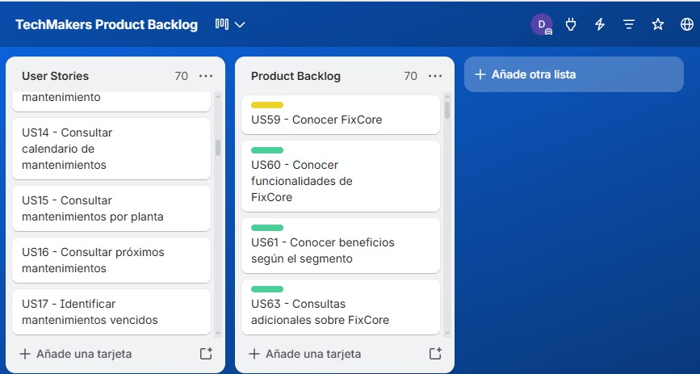

# Capítulo III: Requirements Specification

## 3.1. User Stories.

Las siguientes User Stories representan las principales funcionalidades de FixCore a partir de las necesidades identificadas en los segmentos objetivo. Los criterios de aceptación fueron definidos mediante escenarios Given-When-Then, considerando tanto los casos principales como situaciones alternativas relevantes para cada funcionalidad.

| Story ID | Título | Descripción | Criterios de aceptación | Relacionado con |
| :--- | :--- | :--- | :--- | :--- |
| **US01** | Registrar planta | Como Jefe de Planta, deseo registrar una planta para organizar las máquinas que forman parte de sus operaciones. | **Escenario 1: Registro correcto de una planta.** Dado que el Jefe de Planta cuenta con la información requerida, cuando registra una nueva planta, entonces la planta queda almacenada y disponible para asociar máquinas.  **Escenario 2: Datos obligatorios incompletos.** Dado que falta información obligatoria, cuando intenta registrar la planta, entonces el registro no se completa y se indican los datos que deben ser corregidos. | EP01 |
| **US02** | Editar información de una planta | Como Jefe de Planta, deseo actualizar la información de una planta para mantener sus datos correctos. | **Escenario 1: Actualización correcta.** Dado que la planta se encuentra registrada, cuando el Jefe de Planta modifica sus datos con información válida, entonces los cambios quedan guardados.  **Escenario 2: Información no válida.** Dado que alguno de los datos ingresados no cumple con las condiciones requeridas, cuando intenta guardar los cambios, entonces la información anterior se conserva y se indican los datos que deben corregirse. | EP01 |
| **US03** | Registrar máquina | Como Jefe de Planta, deseo registrar una máquina para llevar un control de los activos que requieren mantenimiento. | **Escenario 1: Registro correcto de una máquina.** Dado que existe una planta registrada, cuando el Jefe de Planta registra una máquina con sus datos obligatorios, entonces la máquina queda registrada y asociada a la planta seleccionada.  **Escenario 2: Datos obligatorios incompletos.** Dado que falta información requerida, cuando intenta registrar la máquina, entonces el registro no se completa.  **Escenario 3: Código de máquina duplicado.** Dado que ya existe una máquina con el mismo código, cuando intenta registrar otra con ese código, entonces el sistema evita crear un registro duplicado. | EP01 |
| **US04** | Editar información de una máquina | Como Jefe de Planta, deseo actualizar los datos de una máquina para mantener su información técnica al día. | **Escenario 1: Actualización correcta.** Dado que la máquina está registrada, cuando el Jefe de Planta modifica sus datos con información válida, entonces los cambios quedan guardados.  **Escenario 2: Información no válida.** Dado que los datos ingresados son incorrectos o incompletos, cuando intenta guardar los cambios, entonces la información anterior se conserva. | EP01 |
| **US05** | Consultar ficha técnica de una máquina | Como Técnico, deseo consultar la ficha técnica de una máquina para conocer sus características antes de realizar un mantenimiento. | **Escenario 1: Consulta de una máquina existente.** Dado que la máquina se encuentra registrada, cuando el Técnico consulta su ficha técnica, entonces visualiza la información disponible como fabricante, modelo, número de serie y demás características registradas.  **Escenario 2: Máquina inexistente.** Dado que la máquina solicitada no existe, cuando intenta consultar su ficha técnica, entonces se informa que el activo no fue encontrado. | EP01 |
| **US06** | Asociar manual técnico a una máquina | Como Jefe de Planta, deseo asociar manuales a una máquina para mantener su documentación técnica centralizada. | **Escenario 1: Asociación correcta de un manual.** Dado que la máquina está registrada y el documento cumple con las condiciones permitidas, cuando el Jefe de Planta agrega el manual, entonces este queda asociado a la máquina.  **Escenario 2: Documento no permitido.** Dado que el documento no cumple con las condiciones establecidas, cuando intenta asociarlo, entonces el manual no queda registrado y se informa el motivo. | EP01 |
| **US07** | Consultar manuales de una máquina | Como Técnico, deseo consultar los manuales de una máquina para tener información de apoyo durante el mantenimiento. | **Escenario 1: Máquina con manuales registrados.** Dado que la máquina tiene documentos asociados, cuando el Técnico consulta sus manuales, entonces puede visualizar los documentos disponibles.  **Escenario 2: Máquina sin manuales.** Dado que la máquina no tiene documentos asociados, cuando realiza la consulta, entonces se informa que todavía no existen manuales registrados. | EP01 |
| **US08** | Consultar estado de una máquina | Como Jefe de Planta, deseo conocer el estado de una máquina para saber si está operativa, en mantenimiento o presenta una falla. | **Escenario 1: Consulta del estado actual.** Dado que la máquina se encuentra registrada, cuando el Jefe de Planta consulta su información, entonces visualiza su estado actual.  **Escenario 2: Estado actualizado.** Dado que la máquina presenta un cambio relacionado con una falla o mantenimiento, cuando vuelve a consultar su información, entonces visualiza el nuevo estado registrado. | EP01 |
| **US09** | Consultar historial de una máquina | Como Jefe de Planta, deseo revisar el historial de una máquina para conocer sus fallas y mantenimientos anteriores. | **Escenario 1: Máquina con historial.** Dado que existen actividades anteriores registradas para la máquina, cuando el Jefe de Planta consulta su historial, entonces obtiene los eventos registrados en orden cronológico.  **Escenario 2: Máquina sin historial.** Dado que la máquina todavía no tiene actividades registradas, cuando consulta su historial, entonces se informa que aún no existen registros. | EP01 |
| **US10** | Programar mantenimiento preventivo | Como Jefe de Planta, deseo programar un mantenimiento preventivo para reducir el riesgo de fallas inesperadas en una máquina. | **Escenario 1: Programación correcta.** Dado que la máquina se encuentra registrada, cuando el Jefe de Planta programa un mantenimiento con la información requerida, entonces la actividad queda registrada para la fecha indicada.  **Escenario 2: Información incompleta.** Dado que faltan datos obligatorios, cuando intenta programar el mantenimiento, entonces la actividad no queda registrada. | EP02 |
| **US11** | Definir frecuencia de mantenimiento | Como Jefe de Planta, deseo establecer cada cuánto debe realizarse un mantenimiento para mantener una planificación preventiva constante. | **Escenario 1: Frecuencia válida.** Dado que existe un plan de mantenimiento preventivo, cuando el Jefe de Planta establece una frecuencia válida, entonces esta queda registrada para calcular las siguientes fechas de mantenimiento.  **Escenario 2: Frecuencia no válida.** Dado que la frecuencia ingresada no cumple con las condiciones permitidas, cuando intenta guardarla, entonces la programación anterior se mantiene sin cambios. | EP02 |
| **US12** | Editar mantenimiento programado | Como Jefe de Planta, deseo modificar los datos de un mantenimiento pendiente para corregir cambios en su planificación. | **Escenario 1: Modificación de mantenimiento pendiente.** Dado que el mantenimiento todavía se encuentra pendiente, cuando el Jefe de Planta modifica información válida, entonces los cambios quedan registrados.  **Escenario 2: Mantenimiento completado.** Dado que el mantenimiento ya fue completado, cuando intenta modificar su planificación, entonces el registro realizado se conserva sin cambios. | EP02 |
| **US13** | Reprogramar mantenimiento | Como Jefe de Planta, deseo cambiar la fecha de un mantenimiento para adaptarlo a cambios en las operaciones de la planta. | **Escenario 1: Reprogramación correcta.** Dado que el mantenimiento se encuentra pendiente, cuando el Jefe de Planta selecciona una nueva fecha válida, entonces el mantenimiento queda reprogramado.  **Escenario 2: Fecha no válida.** Dado que la nueva fecha no cumple con las condiciones de programación, cuando intenta realizar el cambio, entonces se conserva la fecha anterior. | EP02 |
| **US14** | Consultar calendario de mantenimientos | Como Jefe de Planta, deseo consultar los mantenimientos programados para organizar las actividades del equipo técnico. | **Escenario 1: Periodo con mantenimientos.** Dado que existen mantenimientos programados, cuando el Jefe de Planta consulta un periodo determinado, entonces visualiza las actividades correspondientes a dicho periodo.  **Escenario 2: Periodo sin mantenimientos.** Dado que no existen actividades programadas para el periodo consultado, cuando realiza la búsqueda, entonces se informa que no existen mantenimientos registrados. | EP02 |
| **US15** | Consultar mantenimientos por planta | Como Coordinador de Operaciones, deseo consultar los mantenimientos de cada planta atendida para organizar el trabajo de los técnicos entre diferentes clientes. | **Escenario 1: Consulta de una planta con mantenimientos.** Dado que el Coordinador de Operaciones tiene acceso a varias plantas, cuando selecciona una de ellas, entonces visualiza únicamente los mantenimientos correspondientes a esa planta.  **Escenario 2: Planta sin mantenimientos registrados.** Dado que la planta seleccionada no tiene actividades programadas, cuando realiza la consulta, entonces se informa que no existen mantenimientos registrados. | EP02 |
| **US16** | Consultar próximos mantenimientos | Como Técnico, deseo conocer los próximos mantenimientos que debo realizar para prepararme antes de iniciar mis actividades. | **Escenario 1: Técnico con mantenimientos próximos.** Dado que existen mantenimientos próximos asignados al Técnico, cuando consulta sus actividades, entonces visualiza las tareas pendientes ordenadas por fecha.  **Escenario 2: Técnico sin mantenimientos próximos.** Dado que no tiene actividades próximas asignadas, cuando realiza la consulta, entonces se informa que no existen mantenimientos pendientes. | EP02 |
| **US17** | Identificar mantenimientos vencidos | Como Jefe de Planta, deseo identificar los mantenimientos que no fueron realizados a tiempo para tomar acciones antes de que ocurra una falla. | **Escenario 1: Mantenimiento vencido.** Dado que la fecha programada ya pasó y el mantenimiento continúa pendiente, cuando el Jefe de Planta consulta las actividades, entonces el mantenimiento aparece identificado como vencido.  **Escenario 2: Mantenimiento realizado a tiempo.** Dado que el mantenimiento fue completado dentro de la fecha prevista, cuando consulta su estado, entonces no aparece como vencido. | EP02 |
| **US18** | Suspender o reactivar mantenimiento preventivo | Como Jefe de Planta, deseo suspender o reactivar un plan preventivo para adaptarlo al estado actual de una máquina. | **Escenario 1: Suspender un plan activo.** Dado que el plan preventivo se encuentra activo, cuando el Jefe de Planta decide suspenderlo, entonces el plan cambia a estado suspendido y deja de generar nuevas programaciones mientras permanezca en ese estado.  **Escenario 2: Reactivar un plan suspendido.** Dado que el plan preventivo se encuentra suspendido, cuando el Jefe de Planta lo reactiva, entonces vuelve a considerar su programación establecida. | EP02 |
| **US19** | Reportar falla de una máquina | Como Técnico, deseo reportar rápidamente una falla para que pueda ser atendida y no se pierda entre otros medios de comunicación. | **Escenario 1: Registro correcto de una falla.** Dado que la máquina se encuentra registrada, cuando el Técnico reporta una falla con la información requerida, entonces la incidencia queda registrada y disponible para su atención.  **Escenario 2: Información incompleta.** Dado que falta información obligatoria, cuando intenta registrar la falla, entonces la incidencia no se crea y se indican los datos faltantes. | EP03 |
| **US20** | Asignar prioridad a una falla | Como Jefe de Planta, deseo indicar la prioridad de una falla para atender primero las incidencias que generan mayor impacto en la producción. | **Escenario 1: Asignación de prioridad.** Dado que existe una falla registrada, cuando el Jefe de Planta selecciona una prioridad válida, entonces esta queda asociada a la incidencia.  **Escenario 2: Prioridad no válida.** Dado que el valor indicado no corresponde a una prioridad permitida, cuando intenta guardarlo, entonces la prioridad de la falla no se modifica. | EP03 |
| **US21** | Consultar fallas pendientes | Como Jefe de Planta, deseo consultar las fallas pendientes para conocer qué máquinas requieren atención. | **Escenario 1: Existen fallas pendientes.** Dado que existen incidencias que todavía requieren atención, cuando el Jefe de Planta consulta las fallas pendientes, entonces visualiza dichas incidencias.  **Escenario 2: No existen fallas pendientes.** Dado que todas las incidencias fueron atendidas, cuando realiza la consulta, entonces se informa que no existen fallas pendientes. | EP03 |
| **US22** | Consultar detalle de una falla | Como Jefe de Planta, deseo revisar la información de una falla para entender qué ocurrió antes de coordinar su atención. | **Escenario 1: Consulta de una falla existente.** Dado que la incidencia se encuentra registrada, cuando el Jefe de Planta consulta su detalle, entonces visualiza la máquina afectada, descripción, fecha, prioridad y estado.  **Escenario 2: Falla inexistente.** Dado que la incidencia solicitada no existe, cuando intenta consultarla, entonces se informa que no fue encontrada. | EP03 |
| **US23** | Generar orden correctiva desde una falla | Como Jefe de Planta, deseo crear una Orden de Trabajo a partir de una falla para iniciar formalmente su reparación. | **Escenario 1: Generación correcta de una orden.** Dado que existe una falla pendiente sin una Orden de Trabajo activa, cuando el Jefe de Planta genera una orden correctiva, entonces la orden queda registrada y asociada con la falla y la máquina correspondiente.  **Escenario 2: Falla con una orden activa.** Dado que la falla ya tiene una Orden de Trabajo activa, cuando intenta generar otra, entonces no se crea una orden duplicada. | EP03 |
| **US24** | Generar orden de mantenimiento preventivo | Como Jefe de Planta, deseo generar una Orden de Trabajo para un mantenimiento programado para organizar su ejecución. | **Escenario 1: Generación correcta de una orden preventiva.** Dado que existe un mantenimiento preventivo pendiente sin una orden asociada, cuando el Jefe de Planta genera la Orden de Trabajo, entonces ambos registros quedan relacionados.  **Escenario 2: Mantenimiento con orden existente.** Dado que el mantenimiento ya tiene una Orden de Trabajo activa, cuando intenta generar otra, entonces no se crea una orden duplicada. | EP03 |
| **US25** | Asignar técnico a una orden | Como Jefe de Planta, deseo asignar una Orden de Trabajo a un Técnico para definir quién será responsable del mantenimiento. | **Escenario 1: Técnico disponible.** Dado que la Orden de Trabajo se encuentra pendiente y existe un Técnico disponible, cuando el Jefe de Planta realiza la asignación, entonces el Técnico queda registrado como responsable de la orden.  **Escenario 2: Técnico no disponible.** Dado que el Técnico seleccionado no se encuentra disponible para la actividad, cuando intenta asignarlo, entonces la asignación no se completa. | EP03 |
| **US26** | Reasignar orden de trabajo | Como Jefe de Planta, deseo cambiar el Técnico responsable de una orden para responder a cambios de disponibilidad. | **Escenario 1: Reasignación de una orden activa.** Dado que la orden todavía no ha sido completada, cuando el Jefe de Planta selecciona otro Técnico disponible, entonces el responsable de la orden queda actualizado.  **Escenario 2: Orden completada.** Dado que la Orden de Trabajo ya fue completada, cuando intenta reasignarla, entonces el responsable registrado se conserva. | EP03 |
| **US27** | Consultar órdenes asignadas | Como Técnico, deseo consultar mis Órdenes de Trabajo para saber qué actividades debo atender durante mi turno. | **Escenario 1: Técnico con órdenes asignadas.** Dado que existen Órdenes de Trabajo asignadas al Técnico, cuando consulta sus actividades, entonces visualiza únicamente las órdenes que le corresponden.  **Escenario 2: Técnico sin órdenes pendientes.** Dado que no tiene Órdenes de Trabajo pendientes, cuando realiza la consulta, entonces se informa que no existen actividades asignadas. | EP03 |
| **US28** | Iniciar orden de trabajo | Como Técnico, deseo indicar que he comenzado una Orden de Trabajo para registrar desde cuándo se está atendiendo el mantenimiento. | **Escenario 1: Inicio correcto de una orden.** Dado que la Orden de Trabajo se encuentra pendiente y está asignada al Técnico, cuando este inicia la actividad, entonces la orden cambia a estado en progreso y queda registrada la hora de inicio.  **Escenario 2: Orden asignada a otro Técnico.** Dado que la orden no está asignada al Técnico que intenta iniciarla, cuando realiza la acción, entonces el estado de la orden no cambia. | EP03 |
| **US29** | Registrar trabajo realizado | Como Técnico, deseo registrar lo realizado durante el mantenimiento para mantener una evidencia clara del trabajo efectuado. | **Escenario 1: Registro correcto de actividades.** Dado que la Orden de Trabajo se encuentra en progreso, cuando el Técnico registra las actividades realizadas con la información requerida, entonces estas quedan asociadas a la orden.  **Escenario 2: Información incompleta.** Dado que falta información requerida sobre el trabajo realizado, cuando intenta guardar el registro, entonces la actividad no queda registrada. | EP03 |
| **US30** | Cerrar orden de trabajo | Como Técnico, deseo cerrar una Orden de Trabajo cuando termino el mantenimiento para dejar registrada su finalización. | **Escenario 1: Cierre correcto de una orden.** Dado que la Orden de Trabajo está en progreso y contiene la información requerida sobre el mantenimiento realizado, cuando el Técnico la finaliza, entonces cambia a estado completado y queda registrada la fecha de finalización.  **Escenario 2: Información pendiente.** Dado que faltan datos necesarios del mantenimiento, cuando intenta cerrar la orden, entonces esta permanece en progreso y se indican los datos pendientes. | EP03 |
| **US31** | Registrar repuesto | Como Jefe de Planta, deseo registrar un repuesto para controlar los materiales disponibles para los mantenimientos. | **Escenario 1: Registro correcto de un repuesto.** Dado que el Jefe de Planta cuenta con la información requerida, cuando registra un nuevo repuesto, entonces este queda almacenado en el inventario.  **Escenario 2: Información incompleta.** Dado que falta información obligatoria, cuando intenta registrar el repuesto, entonces el registro no se completa.  **Escenario 3: Código duplicado.** Dado que ya existe un repuesto con el mismo código, cuando intenta registrar otro con dicho código, entonces no se crea un registro duplicado. | EP04 |
| **US32** | Editar información de un repuesto | Como Jefe de Planta, deseo actualizar los datos de un repuesto para mantener correcta la información del inventario. | **Escenario 1: Actualización correcta.** Dado que el repuesto se encuentra registrado, cuando el Jefe de Planta modifica sus datos con información válida, entonces los cambios quedan guardados.  **Escenario 2: Información no válida.** Dado que los datos ingresados no cumplen con las condiciones requeridas, cuando intenta guardarlos, entonces se conserva la información anterior. | EP04 |
| **US33** | Consultar stock de repuestos | Como Técnico, deseo consultar la cantidad disponible de un repuesto para saber si puedo utilizarlo durante un mantenimiento. | **Escenario 1: Repuesto con existencias.** Dado que el repuesto está registrado y cuenta con unidades disponibles, cuando el Técnico consulta su stock, entonces visualiza la cantidad existente.  **Escenario 2: Repuesto agotado.** Dado que el repuesto no tiene unidades disponibles, cuando consulta su stock, entonces se indica que se encuentra agotado. | EP04 |
| **US34** | Buscar repuestos | Como Técnico, deseo buscar un repuesto para encontrar rápidamente el material que necesito durante una reparación. | **Escenario 1: Búsqueda con resultados.** Dado que existen repuestos que coinciden con los criterios ingresados, cuando el Técnico realiza la búsqueda, entonces obtiene los resultados correspondientes.  **Escenario 2: Búsqueda sin resultados.** Dado que ningún repuesto coincide con los criterios ingresados, cuando realiza la búsqueda, entonces se informa que no existen resultados. | EP04 |
| **US35** | Definir stock mínimo | Como Jefe de Planta, deseo establecer una cantidad mínima para cada repuesto para saber cuándo es necesario reponerlo. | **Escenario 1: Stock mínimo válido.** Dado que el repuesto está registrado, cuando el Jefe de Planta establece una cantidad mínima válida, entonces el límite queda almacenado.  **Escenario 2: Cantidad no válida.** Dado que la cantidad indicada no es válida, cuando intenta guardarla, entonces el stock mínimo anterior se mantiene sin cambios. | EP04 |
| **US36** | Registrar ingreso de repuestos | Como Jefe de Planta, deseo registrar el ingreso de nuevas unidades para mantener actualizado el inventario. | **Escenario 1: Registro de un ingreso válido.** Dado que el repuesto se encuentra registrado, cuando el Jefe de Planta registra una cantidad mayor a cero, entonces el stock aumenta en la cantidad indicada y se registra el movimiento.  **Escenario 2: Cantidad no válida.** Dado que la cantidad ingresada es igual o menor a cero, cuando intenta registrar el ingreso, entonces las existencias permanecen sin cambios. | EP04 |
| **US37** | Ajustar existencias de inventario | Como Jefe de Planta, deseo corregir las existencias registradas para solucionar diferencias encontradas en el inventario real. | **Escenario 1: Ajuste correcto de existencias.** Dado que se ha comprobado una diferencia entre el inventario registrado y el inventario real, cuando el Jefe de Planta registra una nueva cantidad e indica el motivo del ajuste, entonces las existencias quedan actualizadas.  **Escenario 2: Ajuste sin información requerida.** Dado que no se indica una cantidad válida o el motivo del ajuste, cuando intenta guardar el cambio, entonces las existencias permanecen sin modificaciones. | EP04 |
| **US38** | Registrar repuestos utilizados | Como Técnico, deseo registrar los repuestos utilizados en una Orden de Trabajo para dejar constancia de los materiales consumidos. | **Escenario 1: Registro con stock disponible.** Dado que la Orden de Trabajo se encuentra en progreso y existe stock suficiente, cuando el Técnico registra el repuesto y la cantidad utilizada, entonces el consumo queda asociado a la orden.  **Escenario 2: Stock insuficiente.** Dado que la cantidad indicada supera las existencias disponibles, cuando intenta registrar el consumo, entonces la operación no se completa y se informa que no existe stock suficiente. | EP04 |
| **US39** | Actualizar stock al completar una orden | Como Jefe de Planta, deseo que el inventario considere automáticamente los repuestos utilizados en las Órdenes de Trabajo para mantener actualizado el stock disponible. | **Escenario 1: Orden con repuestos utilizados.** Dado que una Orden de Trabajo contiene repuestos registrados como utilizados, cuando la orden se completa, entonces las cantidades correspondientes son descontadas del inventario.  **Escenario 2: Orden sin repuestos utilizados.** Dado que una Orden de Trabajo no tiene repuestos registrados, cuando se completa, entonces las existencias del inventario permanecen sin cambios. | EP04 |
| **US40** | Consultar historial de inventario | Como Jefe de Planta, deseo consultar los movimientos de los repuestos para conocer cómo han cambiado sus existencias. | **Escenario 1: Repuesto con movimientos registrados.** Dado que existen movimientos de inventario, cuando el Jefe de Planta consulta el historial de un repuesto, entonces visualiza los ingresos, consumos y ajustes registrados.  **Escenario 2: Repuesto sin movimientos.** Dado que no existen movimientos asociados al repuesto, cuando consulta su historial, entonces se informa que todavía no tiene actividad registrada. | EP04 |
| **US41** | Consultar resumen de operaciones | Como Jefe de Planta, deseo consultar un resumen general del mantenimiento para conocer rápidamente la situación de las máquinas de la planta. | **Escenario 1: Planta con información operativa.** Dado que existen registros de máquinas, fallas, mantenimientos y Órdenes de Trabajo, cuando el Jefe de Planta consulta el resumen de operaciones, entonces visualiza la información consolidada disponible.  **Escenario 2: Planta sin información suficiente.** Dado que todavía no existen registros suficientes, cuando consulta el resumen, entonces se muestran únicamente los datos disponibles sin generar información inexistente. | EP05 |
| **US42** | Consultar tiempo muerto de las máquinas | Como Jefe de Planta, deseo conocer el Tiempo Muerto de las máquinas para identificar qué equipos generan mayores interrupciones en la producción. | **Escenario 1: Máquina con periodos de inactividad.** Dado que existen periodos de inactividad registrados, cuando el Jefe de Planta consulta el Tiempo Muerto de la máquina, entonces visualiza el tiempo acumulado correspondiente al periodo seleccionado.  **Escenario 2: Máquina sin inactividad registrada.** Dado que la máquina no registra periodos de inactividad, cuando consulta el indicador, entonces el Tiempo Muerto mostrado es cero. | EP05 |
| **US43** | Consultar MTTR | Como Jefe de Planta, deseo consultar el tiempo medio de reparación para evaluar qué tan rápido son atendidas las fallas. | **Escenario 1: Existen reparaciones completadas.** Dado que existen fallas con tiempos de reparación registrados, cuando el Jefe de Planta consulta el MTTR de un periodo, entonces visualiza el promedio calculado a partir de dichas reparaciones.  **Escenario 2: No existen datos suficientes.** Dado que no existen reparaciones completadas durante el periodo consultado, cuando solicita el MTTR, entonces se informa que todavía no existen datos suficientes para calcularlo. | EP05 |
| **US44** | Consultar cumplimiento preventivo | Como Jefe de Planta, deseo conocer el nivel de cumplimiento de los mantenimientos preventivos para saber si las revisiones se realizan dentro de las fechas planificadas. | **Escenario 1: Periodo con mantenimientos.** Dado que existen mantenimientos preventivos programados y completados, cuando el Jefe de Planta consulta el cumplimiento de un periodo, entonces visualiza el porcentaje correspondiente.  **Escenario 2: Periodo sin mantenimientos.** Dado que no existen mantenimientos programados para el periodo seleccionado, cuando realiza la consulta, entonces se informa que no existen datos para calcular el indicador. | EP05 |
| **US45** | Consultar estado de las órdenes de trabajo | Como Jefe de Planta, deseo conocer cuántas Órdenes de Trabajo están pendientes, en progreso o completadas para supervisar las actividades de mantenimiento. | **Escenario 1: Existen Órdenes de Trabajo.** Dado que existen órdenes registradas, cuando el Jefe de Planta consulta su estado general, entonces visualiza las cantidades agrupadas por estado.  **Escenario 2: No existen Órdenes de Trabajo.** Dado que todavía no existen órdenes registradas, cuando realiza la consulta, entonces se informa que no existen datos disponibles. | EP05 |
| **US46** | Consultar actividad de técnicos | Como Coordinador de Operaciones, deseo consultar las Órdenes de Trabajo realizadas por los técnicos para conocer su actividad y organizar mejor los recursos de la empresa. | **Escenario 1: Técnico con actividad registrada.** Dado que el Técnico tiene Órdenes de Trabajo realizadas durante el periodo seleccionado, cuando el Coordinador de Operaciones consulta su actividad, entonces visualiza los trabajos correspondientes.  **Escenario 2: Técnico sin actividad registrada.** Dado que el Técnico no registra Órdenes de Trabajo durante el periodo seleccionado, cuando se realiza la consulta, entonces se informa que no existen registros. | EP05 |
| **US47** | Generar reporte por cliente | Como Coordinador de Operaciones, deseo generar un reporte de mantenimiento para cada cliente para entregar información clara sobre sus máquinas y servicios realizados. | **Escenario 1: Cliente con información registrada.** Dado que existen registros de mantenimiento del cliente durante el periodo seleccionado, cuando el Coordinador de Operaciones genera el reporte, entonces obtiene información relacionada con sus máquinas, fallas, mantenimientos y Órdenes de Trabajo.  **Escenario 2: Periodo sin información.** Dado que no existen registros del cliente durante el periodo seleccionado, cuando intenta generar el reporte, entonces se informa que no existen datos disponibles. | EP05 |
| **US48** | Recibir alerta de mantenimiento próximo | Como Jefe de Planta, deseo recibir una alerta antes de una fecha de mantenimiento para evitar que una revisión preventiva sea olvidada. | **Escenario 1: Mantenimiento próximo.** Dado que existe un mantenimiento programado próximo a su fecha de ejecución, cuando se alcanza el periodo configurado para el aviso, entonces se genera una alerta para los responsables definidos.  **Escenario 2: Mantenimiento ya completado.** Dado que el mantenimiento fue completado antes de la fecha del aviso, cuando se alcanza el periodo configurado, entonces no se genera una alerta pendiente. | EP06 |
| **US49** | Recibir alerta de falla crítica | Como Jefe de Planta, deseo recibir una alerta cuando se registra una falla crítica para coordinar su atención lo antes posible. | **Escenario 1: Registro de una falla crítica.** Dado que una falla es registrada con prioridad crítica, cuando el registro queda confirmado, entonces se genera una alerta para los responsables configurados.  **Escenario 2: Falla con otra prioridad.** Dado que una falla tiene una prioridad diferente a crítica, cuando queda registrada, entonces no se genera una alerta de falla crítica. | EP06 |
| **US50** | Recibir notificación de orden asignada | Como Técnico, deseo recibir una notificación cuando se me asigna una Orden de Trabajo para conocer que tengo una nueva actividad pendiente. | **Escenario 1: Nueva asignación.** Dado que una Orden de Trabajo es asignada al Técnico, cuando la asignación queda registrada, entonces se genera una notificación para dicho Técnico.  **Escenario 2: Reasignación de una orden.** Dado que una orden es reasignada a otro Técnico, cuando se confirma el cambio, entonces el nuevo responsable recibe la notificación correspondiente. | EP06 |
| **US51** | Recibir alerta de stock bajo | Como Jefe de Planta, deseo recibir una alerta cuando un repuesto alcanza su stock mínimo para poder reponerlo antes de que se agote. | **Escenario 1: Stock igual o inferior al mínimo.** Dado que el stock de un repuesto alcanza o baja del mínimo establecido, cuando se actualizan las existencias, entonces se genera una alerta de stock bajo.  **Escenario 2: Stock superior al mínimo.** Dado que las existencias permanecen por encima del nivel mínimo, cuando se actualiza el inventario, entonces no se genera una alerta de stock bajo. | EP06 |
| **US52** | Configurar destinatarios de alertas | Como Jefe de Planta, deseo definir qué responsables deben recibir cada tipo de alerta para que la información llegue a las personas adecuadas. | **Escenario 1: Agregar destinatario.** Dado que existe un usuario autorizado, cuando el Jefe de Planta lo configura como destinatario de un tipo de alerta, entonces queda asociado a dicha notificación.  **Escenario 2: Retirar destinatario.** Dado que un usuario se encuentra configurado como destinatario, cuando el Jefe de Planta lo retira de la configuración, entonces deja de recibir futuras alertas de ese tipo. | EP06 |
| **US53** | Recibir alertas mediante WhatsApp | Como Jefe de Planta, deseo recibir las alertas importantes mediante WhatsApp para enterarme de situaciones urgentes aunque no esté usando FixCore. | **Escenario 1: Envío correcto de una alerta.** Dado que ocurre un evento configurado para enviar una notificación externa y existe un destinatario definido, cuando FixCore genera la alerta, entonces el mensaje es enviado mediante el servicio de WhatsApp integrado.  **Escenario 2: Servicio de WhatsApp no disponible.** Dado que el servicio externo presenta un error, cuando FixCore intenta enviar la alerta, entonces el fallo queda registrado sin perder la información del evento que originó la notificación. | EP06 |
| **US54** | Iniciar sesión | Como usuario registrado, deseo iniciar sesión en FixCore para acceder a las funciones correspondientes a mi cuenta. | **Escenario 1: Credenciales correctas.** Dado que el usuario tiene una cuenta activa, cuando ingresa credenciales correctas, entonces puede acceder a FixCore y visualizar las funciones correspondientes a su perfil.  **Escenario 2: Credenciales incorrectas.** Dado que las credenciales ingresadas no son correctas, cuando intenta iniciar sesión, entonces el acceso es rechazado.  **Escenario 3: Cuenta inactiva.** Dado que la cuenta del usuario está inactiva, cuando intenta iniciar sesión, entonces no puede acceder al sistema. | EP07 |
| **US55** | Recuperar acceso a la cuenta | Como usuario registrado, deseo recuperar el acceso cuando olvido mi contraseña para volver a utilizar FixCore. | **Escenario 1: Cuenta registrada.** Dado que el usuario tiene una cuenta registrada, cuando solicita recuperar su acceso utilizando los datos asociados a la cuenta, entonces se inicia el proceso de recuperación correspondiente.  **Escenario 2: Datos sin una cuenta asociada.** Dado que los datos ingresados no corresponden a una cuenta registrada, cuando se solicita la recuperación, entonces ninguna cuenta es modificada ni se revela información privada sobre los usuarios registrados. | EP07 |
| **US56** | Registrar técnico | Como Jefe de Planta, deseo registrar Técnicos para poder asignarles las actividades de mantenimiento de la empresa. | **Escenario 1: Registro correcto.** Dado que el Jefe de Planta proporciona la información requerida del Técnico, cuando realiza el registro, entonces el Técnico queda disponible para ser asignado a actividades.  **Escenario 2: Técnico ya registrado.** Dado que ya existe un usuario con los mismos datos de identificación, cuando intenta registrarlo nuevamente, entonces no se crea un registro duplicado. | EP07 |
| **US57** | Editar información de un técnico | Como Jefe de Planta, deseo actualizar la información de un Técnico para mantener sus datos correctamente registrados. | **Escenario 1: Actualización correcta.** Dado que el Técnico se encuentra registrado, cuando el Jefe de Planta modifica sus datos con información válida, entonces los cambios quedan guardados.  **Escenario 2: Información no válida.** Dado que los datos ingresados no cumplen con las condiciones requeridas, cuando intenta actualizar la información, entonces se conservan los datos anteriores. | EP07 |
| **US58** | Asignar acceso según responsabilidad | Como Coordinador de Operaciones, deseo definir a qué plantas puede acceder cada usuario para organizar el trabajo de los técnicos que atienden diferentes clientes. | **Escenario 1: Asignación de acceso.** Dado que el usuario se encuentra registrado, cuando el Coordinador de Operaciones le asigna acceso a una planta, entonces puede consultar la información correspondiente a dicha planta.  **Escenario 2: Acceso no autorizado.** Dado que un usuario no tiene acceso asignado a una planta determinada, cuando intenta consultar su información, entonces la solicitud es rechazada. | EP07 |
| **US59** | Conocer FixCore | Como Visitante, deseo conocer qué es FixCore para entender qué problema de mantenimiento industrial busca resolver. | **Escenario 1: Consulta de la presentación principal.** Dado que el Visitante accede a la Landing Page, cuando visualiza la sección principal, entonces puede identificar el propósito general de FixCore y el problema que busca resolver.  **Escenario 2: Consulta de la propuesta de valor.** Dado que el Visitante continúa recorriendo la Landing Page, cuando revisa la información del producto, entonces puede conocer de manera general cómo FixCore apoya la gestión del mantenimiento industrial. | EP08 |
| **US60** | Conocer funcionalidades de FixCore | Como Visitante, deseo conocer las principales funcionalidades de FixCore para saber cómo puede ayudar a organizar el mantenimiento de una empresa. | **Escenario 1: Consulta de funcionalidades.** Dado que el Visitante se encuentra en la Landing Page, cuando accede a la sección de funcionalidades, entonces puede conocer las principales características ofrecidas por FixCore.  **Escenario 2: Consulta del beneficio de una funcionalidad.** Dado que una funcionalidad se encuentra presentada en la Landing Page, cuando el Visitante revisa su información, entonces puede comprender qué problema o necesidad busca atender. | EP08 |
| **US61** | Conocer beneficios según el segmento | Como Visitante, deseo conocer cómo FixCore puede ayudar a mi tipo de empresa o actividad para determinar si la solución responde a mis necesidades. | **Escenario 1: Pyme de manufactura o producción.** Dado que el Visitante pertenece a una pyme manufacturera, cuando consulta la información dirigida a su segmento, entonces encuentra beneficios relacionados con el control de máquinas, fallas y mantenimientos.  **Escenario 2: Firma consultora o contratista.** Dado que el Visitante pertenece a una firma contratista, cuando consulta la información dirigida a su segmento, entonces encuentra beneficios relacionados con la coordinación de técnicos, clientes y plantas.  **Escenario 3: Técnico u operario.** Dado que el Visitante realiza actividades técnicas de mantenimiento, cuando consulta la información dirigida a su segmento, entonces encuentra beneficios relacionados con el acceso a tareas, información de máquinas y repuestos desde el lugar de trabajo. | EP08 |
| **US62** | Consultar planes de FixCore | Como Visitante, deseo conocer los planes disponibles para evaluar qué alternativa se adapta mejor a mi empresa. | **Escenario 1: Consulta de planes disponibles.** Dado que existen diferentes planes de FixCore, cuando el Visitante accede a la sección de precios, entonces puede comparar sus características principales.  **Escenario 2: Consulta del Plan Freemium.** Dado que existe una opción gratuita, cuando el Visitante revisa sus condiciones, entonces puede conocer las funcionalidades y límites incluidos. | EP08 |
| **US63** | Consultar información adicional de FixCore | Como Visitante, deseo consultar información adicional sobre FixCore para resolver dudas y conocer las condiciones relacionadas con el servicio. | **Escenario 1: Consulta de preguntas frecuentes.** Dado que el Visitante se encuentra en la Landing Page, cuando accede a la sección de preguntas frecuentes y selecciona una pregunta, entonces visualiza la respuesta correspondiente.  **Escenario 2: Consulta de términos y condiciones.** Dado que el Visitante se encuentra en la Landing Page, cuando selecciona el enlace de términos y condiciones, entonces puede acceder a la información legal correspondiente. | EP08 |
| **US64** | Acceder a la Web Application | Como Visitante, deseo acceder a la Web Application desde la Landing Page para comenzar a utilizar FixCore después de conocer la propuesta y sus planes. | **Escenario 1: Acceso mediante el llamado a la acción.** Dado que el Visitante se encuentra en la Landing Page, cuando selecciona el botón principal para comenzar a utilizar FixCore, entonces es dirigido a la Web Application.  **Escenario 2: Acceso desde un plan.** Dado que el Visitante está revisando los planes disponibles, cuando selecciona la opción para comenzar con uno de ellos, entonces es dirigido al punto de acceso o registro correspondiente de la Web Application. | EP08 |

**Technical Stories**

Las siguientes Technical Stories representan capacidades técnicas necesarias para soportar las funcionalidades de la Web Application mediante la RESTful API de FixCore.

| Story ID | Título | Descripción | Criterios de aceptación | Relacionado con |
| :--- | :--- | :--- | :--- | :--- |
| **TS01** | Servicio de autenticación | Como Developer, deseo disponer de servicios RESTful de autenticación para controlar el acceso a los recursos protegidos de FixCore. | **Escenario 1: Autenticación correcta.** Dado un request con credenciales válidas, cuando la API procesa la solicitud de autenticación, entonces responde correctamente con la información necesaria para identificar la sesión del usuario.  **Escenario 2: Credenciales incorrectas.** Dado un request con credenciales incorrectas, cuando la API procesa la solicitud, entonces responde indicando que el acceso no está autorizado.  **Escenario 3: Acceso a un recurso protegido sin autenticación.** Dado un request sin una sesión válida, cuando se intenta acceder a un recurso protegido, entonces la API rechaza la solicitud. | EP09 |
| **TS02** | Servicio de plantas y máquinas | Como Developer, deseo disponer de endpoints para administrar plantas y máquinas para que la Web Application pueda gestionar los activos de FixCore. | **Escenario 1: Creación de un recurso.** Dado un request válido para registrar una planta o máquina, cuando la API procesa la solicitud, entonces el recurso queda creado y se devuelve una respuesta exitosa.  **Escenario 2: Consulta de un recurso existente.** Dado el identificador de una planta o máquina registrada, cuando la API procesa la consulta, entonces devuelve la información correspondiente.  **Escenario 3: Recurso inexistente.** Dado un identificador que no corresponde a un recurso registrado, cuando se realiza la consulta, entonces la API responde indicando que el recurso no fue encontrado. | EP09 |
| **TS03** | Servicio de mantenimiento preventivo | Como Developer, deseo disponer de endpoints para gestionar mantenimientos preventivos para permitir su programación y seguimiento desde la Web Application. | **Escenario 1: Creación de un mantenimiento.** Dado un request válido con la información requerida, cuando la API procesa la solicitud, entonces el mantenimiento preventivo queda registrado.  **Escenario 2: Consulta de mantenimientos.** Dado un request con parámetros de consulta válidos, cuando la API procesa la solicitud, entonces devuelve los mantenimientos correspondientes.  **Escenario 3: Datos de programación no válidos.** Dado un request con información incompleta o no válida, cuando se intenta crear un mantenimiento, entonces la API rechaza la solicitud e informa el problema encontrado. | EP09 |
| **TS04** | Servicio de fallas y órdenes de trabajo | Como Developer, deseo disponer de endpoints para gestionar Fallas y Órdenes de Trabajo para soportar los procesos de mantenimiento correctivo y preventivo. | **Escenario 1: Registro de una falla.** Dado un request válido con la información de una falla, cuando la API procesa la solicitud, entonces la falla queda registrada.  **Escenario 2: Creación de una Orden de Trabajo.** Dado un request válido asociado a una falla o mantenimiento preventivo, cuando la API procesa la solicitud, entonces la Orden de Trabajo queda registrada.  **Escenario 3: Recurso inexistente.** Dado un identificador que no corresponde a una falla u orden registrada, cuando se solicita el recurso, entonces la API responde indicando que no fue encontrado. | EP09 |
| **TS05** | Servicio de inventario | Como Developer, deseo disponer de endpoints para gestionar repuestos y existencias para mantener actualizado el inventario de FixCore. | **Escenario 1: Consulta de un repuesto.** Dado un request válido para consultar un repuesto registrado, cuando la API procesa la solicitud, entonces devuelve su información y existencias disponibles.  **Escenario 2: Actualización de existencias.** Dado un request válido que representa un ingreso, consumo o ajuste de inventario, cuando la API procesa la solicitud, entonces actualiza las existencias y registra el movimiento correspondiente.  **Escenario 3: Cantidad no válida.** Dado un request que contiene una cantidad no permitida, cuando la API intenta procesar la operación, entonces la modificación del inventario es rechazada. | EP09 |
| **TS06** | Servicio de métricas y reportes | Como Developer, deseo disponer de endpoints para consultar indicadores de mantenimiento y reportes para que la Web Application pueda presentar información de seguimiento. | **Escenario 1: Consulta con información disponible.** Dado un request con un periodo válido y registros suficientes, cuando la API procesa la consulta, entonces devuelve los indicadores calculados para dicho periodo.  **Escenario 2: Periodo sin información suficiente.** Dado un periodo en el que no existen registros suficientes para calcular un indicador, cuando la API procesa la consulta, entonces responde indicando que no existen datos disponibles para realizar el cálculo.  **Escenario 3: Consulta de reporte por cliente.** Dado un cliente y un periodo válidos, cuando la API procesa la solicitud, entonces devuelve la información necesaria para elaborar el reporte correspondiente. | EP09 |
| **TS07** | Servicio de notificaciones externas | Como Developer, deseo integrar la API con un servicio externo de notificaciones para enviar alertas relacionadas con eventos importantes de mantenimiento. | **Escenario 1: Envío correcto de una notificación.** Dado que ocurre un evento configurado para generar una alerta externa, cuando la API solicita el envío al servicio de notificaciones, entonces el envío queda registrado correctamente.  **Escenario 2: Error del servicio externo.** Dado que el servicio externo devuelve un error o no se encuentra disponible, cuando la API intenta enviar la notificación, entonces el fallo queda registrado sin perder el evento que originó la alerta.  **Escenario 3: Evento sin notificación externa configurada.** Dado que ocurre un evento que no tiene un envío externo configurado, cuando es procesado por la API, entonces no se solicita el envío de una notificación externa. | EP09 |

**Epics**

| Epic ID | Título | Descripción |
| :--- | :--- | :--- |
| **EP01** | Gestión de Plantas y Activos | Permite registrar, organizar y consultar plantas, máquinas, fichas técnicas, manuales, estados e historiales de mantenimiento de los activos. |
| **EP02** | Mantenimiento Preventivo | Permite programar, reprogramar, consultar y controlar los mantenimientos preventivos de las máquinas y sus frecuencias de ejecución. |
| **EP03** | Gestión de Fallas y Órdenes de Trabajo | Permite reportar y priorizar fallas, generar Órdenes de Trabajo, asignar técnicos y registrar la ejecución de actividades de mantenimiento. |
| **EP04** | Inventario y Repuestos | Permite registrar, consultar y controlar repuestos, existencias, movimientos de inventario y materiales utilizados durante los mantenimientos. |
| **EP05** | Monitoreo, Métricas y Reportes | Permite consultar el estado de las operaciones, tiempos muertos, MTTR, cumplimiento preventivo, desempeño de técnicos y generar reportes de mantenimiento. |
| **EP06** | Alertas y Notificaciones | Permite generar y enviar alertas relacionadas con mantenimientos próximos, fallas críticas, Órdenes de Trabajo asignadas y niveles bajos de stock. |
| **EP07** | Gestión de Usuarios y Accesos | Permite gestionar la autenticación, recuperación de acceso, registro de técnicos y permisos de los usuarios según sus responsabilidades y plantas asignadas. |
| **EP08** | Landing Page | Permite presentar FixCore a los visitantes, mostrando su propósito, funcionalidades, beneficios para los segmentos objetivo, planes disponibles y acceso a la Web Application. |
| **EP09** | RESTful API | Agrupa las Technical Stories necesarias para brindar mediante servicios RESTful las funcionalidades de autenticación, activos, mantenimiento, fallas, Órdenes de Trabajo, inventario, métricas y notificaciones de FixCore. |

## 3.2. Impact Mapping.

  <strong>Impact Mapping - FixCore</strong>  
   
  <em>Fuente: Elaboración propia.</em>

## 3.3. Product Backlog.

El Product Backlog de FixCore reúne los Product Backlog Items definidos para el desarrollo de la solución. Estos incluyen las User Stories relacionadas con las necesidades de los usuarios y las Technical Stories necesarias para implementar las capacidades técnicas de la plataforma.

Los elementos fueron ordenados considerando el valor que aportan a los segmentos objetivo, las funcionalidades principales del producto y las dependencias necesarias para su implementación. Para realizar las estimaciones se utilizaron Story Points siguiendo la escala de 1, 2, 3, 5 y 8.

Enlace del Product Backlog elaborado en Trello: [https://trello.com/b/yJyuiOSO](https://trello.com/b/yJyuiOSO)

  <strong>Tablero del Product Backlog en Trello</strong>  
   
  <em>Fuente: Elaboración propia.</em>

A continuación, se presenta el Product Backlog de FixCore con mayor detalle:

| # Orden | Item ID | Título | Descripción | Story Points |
| :---: | :---: | :--- | :--- | :---: |
| 01 | **US59** | Conocer FixCore | Como Visitante, deseo conocer qué es FixCore para entender qué problema de mantenimiento industrial busca resolver. | 2 |
| 02 | **US60** | Conocer funcionalidades de FixCore | Como Visitante, deseo conocer las principales funcionalidades de FixCore para saber cómo puede ayudar a organizar el mantenimiento de una empresa. | 1 |
| 03 | **US61** | Conocer beneficios según el segmento | Como Visitante, deseo conocer cómo FixCore puede ayudar a mi tipo de empresa o actividad para determinar si la solución responde a mis necesidades. | 1 |
| 04 | **US63** | Consultar información adicional de FixCore | Como Visitante, deseo consultar información adicional sobre FixCore para resolver dudas y conocer las condiciones relacionadas con el servicio. | 1 |
| 05 | **US62** | Consultar planes de FixCore | Como Visitante, deseo conocer los planes disponibles para evaluar qué alternativa se adapta mejor a mi empresa. | 2 |
| 06 | **US64** | Acceder a la Web Application | Como Visitante, deseo acceder a la Web Application desde la Landing Page para comenzar a utilizar FixCore después de conocer la propuesta y sus planes. | 2 |
| 07 | **US03** | Registrar máquina | Como Jefe de Planta, deseo registrar una máquina para llevar un control de los activos que requieren mantenimiento. | 5 |
| 08 | **US05** | Consultar ficha técnica de una máquina | Como Técnico, deseo consultar la ficha técnica de una máquina para conocer sus características antes de realizar un mantenimiento. | 3 |
| 09 | **US19** | Reportar falla de una máquina | Como Técnico, deseo reportar rápidamente una falla para que pueda ser atendida y no se pierda entre otros medios de comunicación. | 3 |
| 10 | **US21** | Consultar fallas pendientes | Como Jefe de Planta, deseo consultar las fallas pendientes para conocer qué máquinas requieren atención. | 3 |
| 11 | **US23** | Generar orden correctiva desde una falla | Como Jefe de Planta, deseo crear una Orden de Trabajo a partir de una falla para iniciar formalmente su reparación. | 5 |
| 12 | **US25** | Asignar técnico a una orden | Como Jefe de Planta, deseo asignar una Orden de Trabajo a un Técnico para definir quién será responsable del mantenimiento. | 3 |
| 13 | **US27** | Consultar órdenes asignadas | Como Técnico, deseo consultar mis Órdenes de Trabajo para saber qué actividades debo atender durante mi turno. | 3 |
| 14 | **US28** | Iniciar orden de trabajo | Como Técnico, deseo indicar que he comenzado una Orden de Trabajo para registrar desde cuándo se está atendiendo el mantenimiento. | 2 |
| 15 | **US29** | Registrar trabajo realizado | Como Técnico, deseo registrar lo realizado durante el mantenimiento para mantener una evidencia clara del trabajo efectuado. | 3 |
| 16 | **US30** | Cerrar orden de trabajo | Como Técnico, deseo cerrar una Orden de Trabajo cuando termino el mantenimiento para dejar registrada su finalización. | 5 |
| 17 | **US10** | Programar mantenimiento preventivo | Como Jefe de Planta, deseo programar un mantenimiento preventivo para reducir el riesgo de fallas inesperadas en una máquina. | 5 |
| 18 | **US14** | Consultar calendario de mantenimientos | Como Jefe de Planta, deseo consultar los mantenimientos programados para organizar las actividades del equipo técnico. | 5 |
| 19 | **US16** | Consultar próximos mantenimientos | Como Técnico, deseo conocer los próximos mantenimientos que debo realizar para prepararme antes de iniciar mis actividades. | 3 |
| 20 | **US17** | Identificar mantenimientos vencidos | Como Jefe de Planta, deseo identificar los mantenimientos que no fueron realizados a tiempo para tomar acciones antes de que ocurra una falla. | 3 |
| 21 | **US48** | Recibir alerta de mantenimiento próximo | Como Jefe de Planta, deseo recibir una alerta antes de una fecha de mantenimiento para evitar que una revisión preventiva sea olvidada. | 3 |
| 22 | **US33** | Consultar stock de repuestos | Como Técnico, deseo consultar la cantidad disponible de un repuesto para saber si puedo utilizarlo durante un mantenimiento. | 2 |
| 23 | **US38** | Registrar repuestos utilizados | Como Técnico, deseo registrar los repuestos utilizados en una Orden de Trabajo para dejar constancia de los materiales consumidos. | 5 |
| 24 | **US39** | Actualizar stock al completar una orden | Como Jefe de Planta, deseo que el inventario considere automáticamente los repuestos utilizados en las Órdenes de Trabajo para mantener actualizado el stock disponible. | 5 |
| 25 | **US35** | Definir stock mínimo | Como Jefe de Planta, deseo establecer una cantidad mínima para cada repuesto para saber cuándo es necesario reponerlo. | 2 |
| 26 | **US51** | Recibir alerta de stock bajo | Como Jefe de Planta, deseo recibir una alerta cuando un repuesto alcanza su stock mínimo para poder reponerlo antes de que se agote. | 3 |
| 27 | **US41** | Consultar resumen de operaciones | Como Jefe de Planta, deseo consultar un resumen general del mantenimiento para conocer rápidamente la situación de las máquinas de la planta. | 5 |
| 28 | **US42** | Consultar tiempo muerto de las máquinas | Como Jefe de Planta, deseo conocer el Tiempo Muerto de las máquinas para identificar qué equipos generan mayores interrupciones en la producción. | 5 |
| 29 | **US44** | Consultar cumplimiento preventivo | Como Jefe de Planta, deseo conocer el nivel de cumplimiento de los mantenimientos preventivos para saber si las revisiones se realizan dentro de las fechas planificadas. | 5 |
| 30 | **US45** | Consultar estado de las órdenes de trabajo | Como Jefe de Planta, deseo conocer cuántas Órdenes de Trabajo están pendientes, en progreso o completadas para supervisar las actividades de mantenimiento. | 3 |
| 31 | **US47** | Generar reporte por cliente | Como Coordinador de Operaciones, deseo generar un reporte de mantenimiento para cada cliente para entregar información clara sobre sus máquinas y servicios realizados. | 5 |
| 32 | **US53** | Recibir alertas mediante WhatsApp | Como Jefe de Planta, deseo recibir las alertas importantes mediante WhatsApp para enterarme de situaciones urgentes aunque no esté usando FixCore. | 5 |
| 33 | **US49** | Recibir alerta de falla crítica | Como Jefe de Planta, deseo recibir una alerta cuando se registra una falla crítica para coordinar su atención lo antes posible. | 3 |
| 34 | **US50** | Recibir notificación de orden asignada | Como Técnico, deseo recibir una notificación cuando se me asigna una Orden de Trabajo para conocer que tengo una nueva actividad pendiente. | 2 |
| 35 | **US09** | Consultar historial de una máquina | Como Jefe de Planta, deseo revisar el historial de una máquina para conocer sus fallas y mantenimientos anteriores. | 5 |
| 36 | **US08** | Consultar estado de una máquina | Como Jefe de Planta, deseo conocer el estado de una máquina para saber si está operativa, en mantenimiento o presenta una falla. | 3 |
| 37 | **US06** | Asociar manual técnico a una máquina | Como Jefe de Planta, deseo asociar manuales a una máquina para mantener su documentación técnica centralizada. | 3 |
| 38 | **US07** | Consultar manuales de una máquina | Como Técnico, deseo consultar los manuales de una máquina para tener información de apoyo durante el mantenimiento. | 2 |
| 39 | **US01** | Registrar planta | Como Jefe de Planta, deseo registrar una planta para organizar las máquinas que forman parte de sus operaciones. | 3 |
| 40 | **US02** | Editar información de una planta | Como Jefe de Planta, deseo actualizar la información de una planta para mantener sus datos correctos. | 2 |
| 41 | **US04** | Editar información de una máquina | Como Jefe de Planta, deseo actualizar los datos de una máquina para mantener su información técnica al día. | 3 |
| 42 | **US15** | Consultar mantenimientos por planta | Como Coordinador de Operaciones, deseo consultar los mantenimientos de cada planta atendida para organizar el trabajo de los técnicos entre diferentes clientes. | 3 |
| 43 | **US11** | Definir frecuencia de mantenimiento | Como Jefe de Planta, deseo establecer cada cuánto debe realizarse un mantenimiento para mantener una planificación preventiva constante. | 3 |
| 44 | **US13** | Reprogramar mantenimiento | Como Jefe de Planta, deseo cambiar la fecha de un mantenimiento para adaptarlo a cambios en las operaciones de la planta. | 2 |
| 45 | **US12** | Editar mantenimiento programado | Como Jefe de Planta, deseo modificar los datos de un mantenimiento pendiente para corregir cambios en su planificación. | 3 |
| 46 | **US18** | Suspender o reactivar mantenimiento preventivo | Como Jefe de Planta, deseo suspender o reactivar un plan preventivo para adaptarlo al estado actual de una máquina. | 2 |
| 47 | **US20** | Asignar prioridad a una falla | Como Jefe de Planta, deseo indicar la prioridad de una falla para atender primero las incidencias que generan mayor impacto en la producción. | 2 |
| 48 | **US22** | Consultar detalle de una falla | Como Jefe de Planta, deseo revisar la información de una falla para entender qué ocurrió antes de coordinar su atención. | 2 |
| 49 | **US24** | Generar orden de mantenimiento preventivo | Como Jefe de Planta, deseo generar una Orden de Trabajo para un mantenimiento programado para organizar su ejecución. | 5 |
| 50 | **US26** | Reasignar orden de trabajo | Como Jefe de Planta, deseo cambiar el Técnico responsable de una orden para responder a cambios de disponibilidad. | 2 |
| 51 | **US31** | Registrar repuesto | Como Jefe de Planta, deseo registrar un repuesto para controlar los materiales disponibles para los mantenimientos. | 3 |
| 52 | **US32** | Editar información de un repuesto | Como Jefe de Planta, deseo actualizar los datos de un repuesto para mantener correcta la información del inventario. | 2 |
| 53 | **US34** | Buscar repuestos | Como Técnico, deseo buscar un repuesto para encontrar rápidamente el material que necesito durante una reparación. | 2 |
| 54 | **US36** | Registrar ingreso de repuestos | Como Jefe de Planta, deseo registrar el ingreso de nuevas unidades para mantener actualizado el inventario. | 3 |
| 55 | **US37** | Ajustar existencias de inventario | Como Jefe de Planta, deseo corregir las existencias registradas para solucionar diferencias encontradas en el inventario real. | 3 |
| 56 | **US40** | Consultar historial de inventario | Como Jefe de Planta, deseo consultar los movimientos de los repuestos para conocer cómo han cambiado sus existencias. | 3 |
| 57 | **US43** | Consultar MTTR | Como Jefe de Planta, deseo consultar el tiempo medio de reparación para evaluar qué tan rápido son atendidas las fallas. | 5 |
| 58 | **US46** | Consultar actividad de técnicos | Como Coordinador de Operaciones, deseo consultar las Órdenes de Trabajo realizadas por los técnicos para conocer su actividad y organizar mejor los recursos de la empresa. | 5 |
| 59 | **US52** | Configurar destinatarios de alertas | Como Jefe de Planta, deseo definir qué responsables deben recibir cada tipo de alerta para que la información llegue a las personas adecuadas. | 3 |
| 60 | **US56** | Registrar técnico | Como Jefe de Planta, deseo registrar Técnicos para poder asignarles las actividades de mantenimiento de la empresa. | 3 |
| 61 | **US57** | Editar información de un técnico | Como Jefe de Planta, deseo actualizar la información de un Técnico para mantener sus datos correctamente registrados. | 2 |
| 62 | **US58** | Asignar acceso según responsabilidad | Como Coordinador de Operaciones, deseo definir a qué plantas puede acceder cada usuario para organizar el trabajo de los técnicos que atienden diferentes clientes. | 5 |
| 63 | **US54** | Iniciar sesión | Como usuario registrado, deseo iniciar sesión en FixCore para acceder a las funciones correspondientes a mi cuenta. | 3 |
| 64 | **US55** | Recuperar acceso a la cuenta | Como usuario registrado, deseo recuperar el acceso cuando olvido mi contraseña para volver a utilizar FixCore. | 5 |
| 65 | **TS01** | Servicio de autenticación | Como Developer, deseo disponer de servicios RESTful de autenticación para controlar el acceso a los recursos protegidos de FixCore. | 5 |
| 66 | **TS02** | Servicio de plantas y máquinas | Como Developer, deseo disponer de endpoints para administrar plantas y máquinas para que la Web Application pueda gestionar los activos de FixCore. | 8 |
| 67 | **TS03** | Servicio de mantenimiento preventivo | Como Developer, deseo disponer de endpoints para gestionar mantenimientos preventivos para permitir su programación y seguimiento desde la Web Application. | 8 |
| 68 | **TS04** | Servicio de fallas y órdenes de trabajo | Como Developer, deseo disponer de endpoints para gestionar Fallas y Órdenes de Trabajo para soportar los procesos de mantenimiento correctivo y preventivo. | 8 |
| 69 | **TS05** | Servicio de inventario | Como Developer, deseo disponer de endpoints para gestionar repuestos y existencias para mantener actualizado el Inventario de FixCore. | 8 |
| 70 | **TS06** | Servicio de métricas y reportes | Como Developer, deseo disponer de endpoints para consultar indicadores de mantenimiento y reportes para que la Web Application pueda presentar información de seguimiento. | 8 |
| 71 | **TS07** | Servicio de notificaciones externas | Como Developer, deseo integrar la API con un servicio externo de notificaciones para enviar alertas relacionadas con eventos importantes de mantenimiento. | 8 |

**Total estimado del Product Backlog: 258 Story Points.**
