# Capítulo IV: Product Design

## 4.1. Style Guidelines.

### 4.1.1. General Style Guidelines.

#### 4.1.1.1 Branding

El branding de FixCore se fundamenta en la misión de erradicar el caos operativo y reducir los altos costos por tiempos muertos (downtime) en el sector industrial. La marca busca transmitir solidez, agilidad tecnológica y pragmatismo, posicionándose como una herramienta robusta para la gerencia, pero sin fricción para el técnico de planta. A continuación se detallan los elementos fundamentales de la identidad de FixCore.

**Nombre de la Marca**
FixCore es una marca compuesta que transmite resolución y centralización. El prefijo "Fix" (reparar o solucionar en inglés) hace referencia directa a la acción principal del mantenimiento y la corrección de fallas. Por su parte, "Core" (núcleo o centro en inglés) representa el corazón de la operación industrial, centralizando los datos, reportes y métricas. La combinación transmite el mensaje de que el mantenimiento no es un gasto secundario, sino el núcleo vital para que la maquinaria y la rentabilidad de la empresa nunca se detengan.

**Logotipo**
El logotipo de FixCore consiste en un isotipo geométrico combinado con el nombre de la marca. El ícono principal es un hexágono delineado que forma un cubo isométrico, representando la estructura, la maquinaria y la industria manufacturera. En el centro de este cubo (el core), se encuentra un círculo sólido que simboliza el control centralizado y el motor del sistema. El diseño utiliza una paleta de azules eléctricos y degradados sobre un fondo oscuro, evocando tecnología moderna y precisión. La tipografía es limpia, sin serifas, dividiendo visualmente la palabra: "FIX" en color blanco para destacar la acción, y "CORE" en azul brillante, unificando el texto con el isotipo.

<div align="center">
  <strong>Gráfico: Logo de FixCore</strong><br><br>
  <br>
  <em>Fuente: Elaboración propia.</em>
</div>

**Eslogan**
El eslogan principal de FixCore es "El núcleo de tu mantenimiento industrial". Esta frase refleja el objetivo de la plataforma de convertirse en el eje central donde convergen operarios, gerentes y maquinaria. Transmite la promesa de dejar atrás la dispersión de los mensajes de WhatsApp y los Excel, consolidando toda la operación en un solo motor digital.

**Valores de Marca**
FixCore se basa en los siguientes valores fundamentales que guían todas las decisiones de diseño arquitectónico y de interfaz:

**1. Baja Fricción:** La plataforma entiende que el usuario tiene las manos ocupadas o sucias; por ello, la interfaz prioriza el minimalismo y permite reportar fallas en menos de 3 clics, asegurando la adopción por parte del técnico.

**2. Trazabilidad:** Cada orden de trabajo, repuesto y tiempo muerto queda registrado con precisión. El diseño transmite exactitud, permitiendo a la gerencia auditar y tomar decisiones basadas en datos reales.

**3. Agilidad:** FixCore valora el tiempo. La integración con automatizaciones (webhooks a WhatsApp) refleja una marca que reacciona en tiempo real ante las emergencias de la planta.

**4. Pragmatismo:** La plataforma se adapta a la realidad del sector industrial. Evita flujos de trabajo sobre-teorizados y se enfoca directamente en solucionar el problema de la máquina detenida.

**Personalidad de Marca**
La personalidad de FixCore se define en el espectro entre varios ejes comunicacionales:

Robusto pero Intuitivo: La arquitectura backend maneja lógicas complejas de mantenimiento, pero la cara visible para el operario es extremadamente sencilla. Es una herramienta seria de grado industrial, pero no requiere capacitaciones tediosas.

Estructurado sin ser Burocrático: A diferencia de los sistemas tradicionales (CMMS) que obligan a llenar formularios interminables, FixCore ordena la información de manera inteligente y automatizada, pidiendo solo los datos estrictamente necesarios al usuario.

Tecnológico pero Centrado en el Humano: Aunque es un sistema digital basado en la nube, la marca se comunica en el lenguaje del técnico. Entiende sus frustraciones y utiliza canales que ya domina, presentándose como un aliado en su turno, no como un auditor vigilante.

#### 4.1.1.2. Typography

El sistema tipográfico de FixCore establece una jerarquía técnica y estructurada que permite a operarios y gerentes escanear rápidamente datos críticos (como el estado de una máquina o los códigos de repuestos), manteniendo la claridad absoluta incluso en condiciones de poca iluminación o pantallas móviles sucias en la planta industrial.

**Familia Tipográfica Principal**

FixCore utiliza dos familias tipográficas complementarias que equilibran la estética de un software industrial (robusto y técnico) con la legibilidad necesaria para el trabajo operativo diario:

*   **Roboto (Sans-serif):** Utilizada para títulos, métricas en los dashboards (KPIs) y números de órdenes de trabajo. Es una fuente neo-grotesca, altamente legible y estructurada, desarrollada específicamente para pantallas móviles. Su versión Bold transmite la solidez y precisión mecánica que requiere el sector de mantenimiento industrial.
*   **Open Sans (Sans-serif):** Utilizada para el cuerpo de texto, descripciones de fallas e instrucciones técnicas. Su diseño abierto y neutral reduce la fatiga visual del operario al leer manuales o historiales largos de maquinaria, complementando perfectamente el peso estructurado de Roboto.

<div align="center">
  <strong>Gráfico: Tipografía utilizada en FixCore (Ejemplo Roboto)</strong><br><br>
  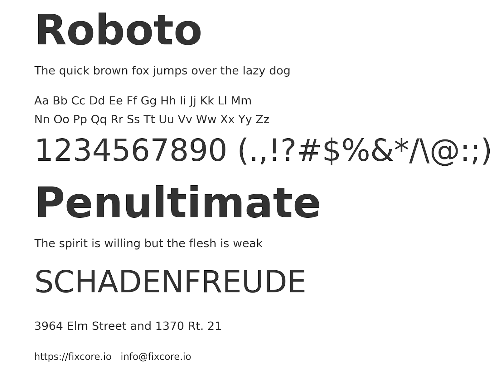<br>
  <em>Fuente: Elaboración propia.</em>
</div>

**Jerarquía Tipográfica**

La jerarquía tipográfica de FixCore está optimizada para la lectura rápida (escaneo) y la visualización de datos numéricos en los tableros de control:

*   **Métricas y KPIs (Display):** Roboto Bold, 48-56px. Utilizado en los dashboards gerenciales para mostrar datos críticos de impacto inmediato (Ej. "Downtime Total", "MTTR").
*   **H1 (Títulos de página):** Roboto Bold, 32px. Utilizado para los títulos principales de los módulos, como "Inventario de Repuestos" o "Órdenes de Trabajo".
*   **H2 (Subtítulos y Tarjetas):** Roboto Medium, 24px. Utilizado para dividir la información técnica dentro de un activo o máquina específica.
*   **H3 (Títulos menores):** Roboto Medium, 18-20px. Ideal para agrupar detalles técnicos (ej. "Especificaciones del motor").
*   **Cuerpo (Texto general):** Open Sans Regular, 16px con interlineado de 1.5. Utilizado para la descripción de fallas reportadas y notas de los técnicos.
*   **Cuerpo pequeño (Metadatos):** Open Sans Regular, 14px. Utilizado para fechas, horas de reporte y nombres de operarios asignados.
*   **Botones y Acciones (CTAs):** Roboto Medium, 16px. Utilizado en botones críticos de la interfaz ("Reportar Falla", "Cerrar OT").
*   **Etiquetas y Badges (Labels):** Roboto Bold, 12px. Utilizado para mostrar estados codificados por colores en mayúsculas (ej. "OPERATIVO", "EN FALLA", "MANTENIMIENTO").

**Espaciado y Ritmo Tipográfico**

El sistema tipográfico de FixCore sigue un ritmo diseñado para evitar el desorden visual (clutter) común en los softwares industriales tradicionales:

*   El espaciado entre líneas (interlineado) en el cuerpo de texto es generoso (1.5x) para facilitar la lectura en movimiento dentro de la planta.
*   El espaciado debajo de los H1 y H2 es amplio (24px) para separar claramente los módulos de información técnica.
*   Los números utilizados en tablas e inventarios utilizan tabulación monoespaciada automática (tabular lining) para que los códigos de repuestos y los precios se alineen perfectamente en columnas.
*   Las etiquetas de estado (badges) utilizan un incremento de espaciado entre letras (tracking de +0.05em) y van siempre en mayúsculas para asegurar visibilidad a distancia.

#### 4.1.1.3. Color Palette

La paleta de colores de FixCore está diseñada para comunicar solidez técnica y agilidad operativa, manteniendo una legibilidad extrema para entornos industriales donde la iluminación puede ser deficiente o las pantallas pueden tener brillo reducido. Cada color tiene un propósito específico en el flujo de reporte y gestión de mantenimiento.

**Esquema de Color Primario**

El esquema de color primario de FixCore transmite tecnología, precisión y control centralizado:

*   **Core Blue (#38bdf8 - Sky 400):** El azul eléctrico de FixCore representa el núcleo del sistema, la conectividad y la eficiencia tecnológica. Es el color principal utilizado para botones de acción primarios (ej. "Crear Orden de Trabajo"), enlaces de navegación, estados activos y elementos centrales del dashboard. Su tono brillante garantiza un alto contraste sobre fondos oscuros, evocando un panel de control moderno.
*   **Core Dark (#0284c7 - Sky 600):** Una versión más profunda del azul primario, utilizada para estados *hover* (al pasar el cursor) y para dar énfasis estructural en las tarjetas de información de las máquinas, manteniendo la jerarquía sin saturar la vista.
*   **Core Light (#7dd3fc - Sky 300):** Una versión más clara utilizada para fondos sutiles, selección de pestañas o para resaltar filas específicas dentro del inventario de repuestos.

**Esquema de Color Secundario**

El esquema secundario se centra en el estado de salud de la maquinaria y la finalización de tareas:

*   **Operational Green (#10b981 - Emerald 500):** El verde en FixCore representa máquinas operativas, salud de los activos y éxito. Se utiliza exclusivamente para:
    *   Estado "Operativo" en el panel de maquinaria.
    *   Órdenes de Trabajo (OT) marcadas como "Completadas".
    *   Indicadores de mantenimiento preventivo al día.
*   **Operational Green Dark (#047857 - Emerald 700):** Versión más oscura para estados *hover* en botones de confirmación o cierre de tareas.

**Esquema de Color de Alerta**

En el mantenimiento industrial, las alertas equivalen a dinero y tiempo, por lo que estos colores comunican urgencia de forma inequívoca:

*   **Warning Amber (#f59e0b - Amber 500):** Naranja/Ámbar para advertencias de nivel medio y programación pendiente. Utilizado para:
    *   Mantenimientos preventivos próximos a vencer.
    *   Stock bajo de repuestos en el inventario.
    *   Máquinas operando con advertencias de rendimiento.
*   **Downtime Red (#ef4444 - Red 500):** Rojo para fallas críticas, inactividad y pérdidas de producción. Su uso es estricto y llama a la acción inmediata:
    *   Estado "Falla" o "Tiempo Muerto" (Downtime) de una máquina.
    *   Alertas críticas enviadas por webhook al WhatsApp del Jefe de Planta.
    *   Acciones destructivas (ej. "Eliminar activo").

**Paleta de Colores Neutral**

Los colores neutrales (basados en tonos fríos/pizarra) construyen la estructura visual, permitiendo un modo oscuro eficiente y un modo claro de alto contraste para las fábricas:

*   **White (#ffffff):** Color de fondo primario para tarjetas de información y formularios en el modo claro.
*   **Slate 50 (#f8fafc):** Fondo general de la aplicación para reducir el cansancio visual frente al blanco puro.
*   **Slate 100 (#f1f5f9):** Fondo para barras de navegación laterales y separadores de secciones de maquinaria.
*   **Slate 200 (#e2e8f0):** Bordes sutiles en tablas de historiales y divisiones de celdas.
*   **Slate 300 (#cbd5e1):** Bordes de campos de entrada (inputs) en los formularios de reporte.
*   **Slate 400 (#94a3b8):** Iconos secundarios y texto de apoyo (ej. "Última revisión hace 2 días").
*   **Slate 500 (#64748b):** Texto descriptivo en las tarjetas de inventario y manuales.
*   **Slate 700 (#334155):** Cuerpo de texto principal, descripciones de fallas y detalles técnicos.
*   **Slate 900 (#0f172a):** Texto de máxima jerarquía, títulos de máquinas y métricas clave en fondos claros; utilizado también como fondo principal para la interfaz en Modo Oscuro.

**Uso de Color en la Interfaz**

El sistema de color de FixCore obedece a estrictas normativas de seguridad industrial y accesibilidad:

*   El color **nunca** es el único indicador de una falla (las alertas rojas siempre van acompañadas del texto "FALLA" y un icono de advertencia).
*   Se prioriza el contraste ultra-alto (superando el estándar WCAG AA) debido a que los operarios utilizan las pantallas bajo luces fluorescentes industriales o luz solar directa.
*   Los estados interactivos responden de forma evidente (cambio de color + sombra + elevación) para confirmar las acciones táctiles rápidas del técnico en planta.

#### 4.1.1.4. Spacing System

El sistema de espaciado de FixCore establece una cuadrícula consistente que prioriza la usabilidad y precisión en entornos industriales. Está diseñado específicamente para evitar toques accidentales en pantallas táctiles (considerando operarios con guantes o en movimiento) y para estructurar visualmente la alta densidad de datos en los paneles de control gerenciales.

**Base de Espaciado**

El sistema de espaciado de FixCore utiliza una escala basada en múltiplos de 4 y 8 (estándar de 8pt grid) para mantener un ritmo vertical y horizontal matemático:

*   **4px (0.25rem):** Espaciado mínimo, utilizado para agrupaciones estrechas (ej. un icono junto a su texto).
*   **8px (0.5rem):** Espaciado pequeño para separar elementos relacionados dentro de una misma tarjeta o fila de datos.
*   **12px (0.75rem):** Espaciado intermedio para inputs y etiquetas.
*   **16px (1rem):** Espaciado base estándar. Margen interno mínimo de seguridad para evitar toques accidentales en dispositivos móviles.
*   **24px (1.5rem):** Espaciado principal entre componentes (ej. entre dos tarjetas de maquinaria).
*   **32px (2rem):** Espaciado para separar grupos lógicos de contenido en los dashboards.
*   **48px (3rem):** Área táctil mínima (Touch Target) recomendada para botones de acción crítica en la planta.
*   **64px (4rem):** Espaciado mayor para separar grandes módulos o secciones de la plataforma.

**Sistema de Grid**

FixCore utiliza un sistema de grillas flexible que se adapta desde las computadoras de la oficina hasta los teléfonos de los operarios:

*   **Grid de 12 columnas (Desktop):** Utilizado para los dashboards del Jefe de Planta, permitiendo dividir módulos analíticos y tablas de mantenimiento.
*   **Grid de 4 a 6 columnas (Tablet/Mobile):** Optimizado para la vista del técnico, priorizando tarjetas apiladas y botones de ancho completo.
*   **Gutter (Medianil) de 24px:** Separación estándar entre columnas para mantener el aire visual entre gráficas y tablas.
*   **Container máximo de 1440px:** Ancho máximo en escritorio para aprovechar monitores amplios sin perder la proporción de lectura.

**Espaciado en Componentes**

Cada componente de la interfaz tiene un espaciado interno (*padding*) definido para maximizar la legibilidad y la interacción:

*   **Botones (CTAs):** Padding vertical de 12-16px y horizontal de 24px. Garantiza un área interactiva robusta para operarios en la planta.
*   **Tarjetas (Activos/Máquinas):** Padding de 24px en desktop y 16px en móvil, conteniendo claramente los detalles técnicos y el estado del equipo.
*   **Campos de Formulario (Inputs):** Padding de 12px vertical y 16px horizontal, facilitando el ingreso de datos al reportar fallas.
*   **Tablas de Inventario/Historial:** Padding de 12px por celda para asegurar que los códigos de repuestos no se amontonen visualmente.

**Espaciado Responsivo**

La interfaz de FixCore muta drásticamente según el contexto de uso y el dispositivo:

*   **Desktop (>1024px - Vista Gerencial):** Se utiliza la escala de espaciado completa. Se aprovechan los márgenes de 32px a 48px para separar módulos analíticos y mantener un tablero limpio.
*   **Tablet (768-1024px - Vista de Supervisor):** Reducción de los márgenes externos a 24px para priorizar el contenido de las órdenes de trabajo.
*   **Mobile (<768px - Vista de Técnico de Planta):** Los márgenes externos se reducen a 16px, pero **se mantiene el tamaño de los botones (48px de alto)** y el espaciado interno de las áreas táctiles para asegurar una fricción cero al reportar fallas desde la fábrica.

### 4.1.2. Web Style Guidelines.

#### 4.1.2.1. Responsive Design Principles

Los principios de diseño responsivo de FixCore garantizan que la plataforma sea una herramienta de alta precisión tanto para el gerente en su oficina como para el técnico que se desplaza por la planta industrial.

**Mobile-First Approach (Enfoque Técnico-Primero)**
FixCore adopta un diseño mobile-first riguroso, asumiendo que el reporte de fallas ocurrirá en condiciones adversas (de pie, con prisa o usando guantes). Este enfoque asegura que:
* El contenido esencial (botones de reporte y estado de la máquina) sea hiper-visible.
* Las áreas táctiles tengan un tamaño industrial (mínimo 48x48px).
* La versión móvil (app/PWA) esté centrada en la acción táctica, mientras que la versión de escritorio se expande hacia el análisis estratégico (dashboards y tablas complejas).

**Breakpoints Established**
FixCore define los siguientes puntos de quiebre para adaptar su interfaz:
* **Mobile (0-767px):** Optimizado para operarios en planta. Navegación simplificada, tarjetas apiladas verticalmente y CTAs de ancho completo.
* **Tablet (768-1023px):** Utilizado por supervisores de área en movimiento. Permite ver columnas duales y vistas previas de órdenes de trabajo.
* **Desktop (1024-1440px):** Vista analítica para la Gerencia. Tableros de control de 12 columnas, tablas de inventario extendidas y gráficos de mantenimiento predictivo.

**Fluid Typography**
La tipografía (Roboto y Open Sans) escala mediante *viewport units* y funciones `clamp()`, asegurando que las alertas de "MÁQUINA DETENIDA" sean legibles desde la distancia en un móvil, sin verse desproporcionadas en un monitor ultrawide.

#### 4.1.2.2. Web Component States

Los componentes de FixCore comunican sus estados de forma inconfundible para evitar errores críticos en la gestión de mantenimiento:

**Estados Interactivos**
* **Default:** Estado base. Tarjetas en *Slate 800* (modo oscuro) o *White* con bordes sutiles en *Slate 200*.
* **Hover (Escritorio):** El color de fondo se oscurece ligeramente (ej. de *Core Blue* a *Core Dark*), el cursor cambia a puntero y la tarjeta se eleva para indicar interactividad a los gerentes.
* **Active/Pressed (Móvil):** Estado crítico en planta. Al presionar, el botón reduce su escala al 95% instantáneamente y oscurece su fondo, brindando retroalimentación táctil visual de que la falla fue reportada.
* **Focus (Teclado):** Anillo de enfoque de 3px en *Core Blue*. Vital para el personal administrativo que ingresa inventarios rápidamente usando tabulación.
* **Disabled:** Botones opacos (50%) con cursor bloqueado. Utilizado para evitar reportes duplicados cuando una máquina ya está en estado de "Falla".

#### 4.1.2.3. Form Elements

Los formularios en FixCore están diseñados para requerir menos de 3 clics y minimizar la fricción cognitiva del operario.

**Input Fields (Campos de Entrada)**
* Altura mínima de 48px para facilitar el toque rápido.
* Bordes de alto contraste y tipografía grande (16px mínimo) para evitar zoom automático en móviles.
* Mensajes de error en *Downtime Red* ubicados explícitamente debajo del campo fallido.

**Buttons (Botones)**
* **Primary:** Fondo *Core Blue*, texto blanco. Para acciones de avance (ej. "Crear Orden", "Guardar").
* **Danger:** Fondo *Downtime Red*, texto blanco. Restringido a acciones críticas (ej. "Reportar Parada de Máquina", "Eliminar Activo").
* **Secondary:** Borde gris y texto *Slate 700*. Para acciones cancelatorias o filtros.
* Todos los botones móviles ocupan el 100% del ancho del contenedor.

**Selects y Dropdowns**
* Optimizados para búsquedas rápidas. Los selectores de maquinaria incluyen barras de búsqueda integradas para evitar el scroll infinito en listas de 100+ equipos.

#### 4.1.2.4. Navigation Patterns

**Global Navigation (Navegación Principal)**
* **Desktop:** Barra lateral izquierda (Sidebar) oscura, expandible/colapsable, mostrando todos los módulos (Dashboard, Activos, Órdenes, Inventario).
* **Mobile:** Barra de navegación inferior (Bottom Tab Bar) anclada a la pantalla para que el operario alcance los botones "Inicio", "Escanear QR" y "Alertas" con el dedo pulgar.

**Secondary Navigation (Breadcrumbs)**
* Vital para la estructura jerárquica industrial. Rastrea la ubicación exacta: `Planta Lima > Área de Empaque > Faja Transportadora B > Motor Eléctrico`.

#### 4.1.2.5. Accessibility Guidelines

FixCore cumple con el estándar WCAG AA, priorizando las realidades del trabajo físico.

**Visual Accessibility (Visibilidad en Planta)**
* Contraste ultra-alto (> 4.5:1). El sistema debe ser legible bajo la luz solar intensa o la luz fluorescente parpadeante de una fábrica.
* Las alertas de estado no dependen solo del color: una luz roja siempre va acompañada de la palabra en negrita "**FALLA CRÍTICA**" y un icono triangular de advertencia.

**Keyboard Navigation & Screen Readers**
* Soporte total de teclado (Tab, Enter, Space) y etiquetas ARIA para garantizar que el software sea utilizable por personal de oficina con limitaciones motrices o de visión.

#### 4.1.2.6. Animation Guidelines

En un entorno industrial, la velocidad supera a la estética. Las animaciones en FixCore son pragmáticas y utilitarias.

**Purpose of Animations (Propósito)**
* **Feedback inmediato:** Confirmar que un toque fue registrado para que el técnico no presione múltiples veces.
* **Carga de datos:** Usar *Skeleton Loaders* (esquemas grises parpadeantes) en lugar de spinners para que la interfaz se sienta más rápida, crucial cuando el Wi-Fi de la fábrica es inestable.

**Animation Principles**
* **Ultrarrápidas:** 150ms-200ms como máximo. El software debe sentirse instantáneo y mecánico, no flotante ni lento.
* Sin efectos de rebote (bounces) innecesarios; se utilizan curvas *ease-out* directas.
* Compatibilidad total con la preferencia del sistema operativo de reducción de movimiento (*prefers-reduced-motion*).

## 4.2. Information Architecture.

### 4.2.1. Organization Systems.

#### 4.2.1.1. Organización del Landing Page

El Landing Page de FixCore sirve como el punto de entrada principal para tomadores de decisión (Jefes de Planta, Gerentes de Operaciones) que buscan modernizar su gestión de mantenimiento. Su organización está diseñada para guiar al usuario a través de un recorrido de conversión altamente profesional y enfocado en el retorno de inversión (ROI) industrial.

**Estructura Jerárquica en el Landing Page**

La organización del Landing Page sigue una jerarquía visual clara que refleja el proceso lógico de evaluación B2B:
* **Nivel 1 - Header de Impacto:** El *hero section* presenta el valor principal de FixCore de manera inmediata ("El núcleo de tu mantenimiento industrial"). El visitante entiende en menos de 3 segundos que la plataforma reduce tiempos muertos. Incluye el título principal, subtítulo explicativo, una previsualización de la interfaz móvil/dashboard, y botones de llamada a la acción primarios ("Probar Gratis" / "Solicitar Demo").
* **Nivel 2 - Beneficios Clave:** Inmediatamente después, se presentan los diferenciadores principales en una cuadrícula de tarjetas (Baja Fricción, Trazabilidad, Alertas por WhatsApp). Responde a la pregunta: ¿Cómo FixCore elimina el caos de los reportes en papel?
* **Nivel 3 - Módulos y Flujo de Trabajo:** Las secciones siguientes explican la funcionalidad paso a paso (1. Escanea QR, 2. Reporta Falla, 3. Reparación Rápida) y profundizan en los módulos principales (Órdenes de Trabajo, Inventario, Dashboard).
* **Nivel 4 - Footer y Navegación Adicional:** El *footer* proporciona navegación secundaria, enlaces a políticas de privacidad, soporte técnico y opciones de contacto organizadas por función empresarial.

**Principios de Organización Aplicados**

La organización del Landing Page de FixCore aplica los siguientes principios:
* **Jerarquía visual estricta:** El usuario escanea naturalmente de arriba abajo, siendo guiado desde el problema (tiempos muertos) hacia la solución (software) y la acción (demo).
* **Progresión pragmática:** La narrativa avanza desde la promesa de valor gerencial hacia la facilidad de uso operativo, mitigando la objeción clásica de "mis técnicos no usarán un sistema complejo".
* **Agrupación por función:** Características similares (funcionalidades de campo vs. análisis gerencial) comparten secciones visualmente delimitadas.

#### 4.2.1.2. Organización de la Aplicación Web (Dashboard y Área Principal)

La aplicación web de FixCore posee una estructura dual, ya que debe satisfacer a dos perfiles de usuario con necesidades diametralmente opuestas: la urgencia táctica del técnico en planta y la necesidad analítica del gerente.

**Sistema de Organización Principal**

La aplicación utiliza un sistema matricial que combina los siguientes enfoques:

**1. Organización por audiencia (Roles de usuario):**
* **Técnico/Operario:** El usuario que está en la fábrica reportando y solucionando fallas. Su vista (mobile-first) se organiza en torno a la inmediatez: Escanear QR, Órdenes Asignadas Hoy, Reportar Falla.
* **Gerente/Supervisor:** El usuario que gestiona recursos y analiza datos. Su vista (desktop-first) se organiza en torno a métricas generales, aprobación de compras, control de inventario y tiempos medios de reparación (MTTR).

**2. Organización por función principal (Áreas del software):**
* **Mantenimiento:** Centro de operaciones para Órdenes de Trabajo (OTs), asignación de tareas y reportes de falla.
* **Activos:** El catálogo completo de maquinaria, especificaciones técnicas y manuales.
* **Inventario:** Control de repuestos, stock mínimo y valoración económica.
* **Analítica:** Dashboards, reportes exportables en PDF/Excel y auditoría de tiempos muertos.

**3. Organización cronológica y de urgencia:**
* **Órdenes de Trabajo:** Ordenadas por prioridad (Crítica, Alta, Media) y fecha de vencimiento.
* **Historial de Fallas:** Lista cronológica en orden inverso (más reciente primero) dentro del perfil de cada máquina.
* **Alertas:** Registro cronológico de notificaciones automatizadas enviadas.

**Esquemas de Categorización para Activos (Maquinaria)**

La maquinaria en FixCore se organiza para reflejar la realidad física de la planta:
* **Por Ubicación/Línea de Producción:** (Ej. Planta Lima > Área de Empaque > Línea 2).
* **Por Criticidad:** (Alta, Media, Baja) para determinar qué máquina recibe atención prioritaria en caso de fallas simultáneas.
* **Por Estado Operativo:** Operativo (Verde), En Falla (Rojo), Mantenimiento Preventivo (Ámbar).

**Esquemas de Categorización para el Inventario (Repuestos)**

El almacén de repuestos se organiza utilizando:
* **Por Familia/Categoría:** Eléctricos, Mecánicos, Neumáticos, Consumibles, Hidráulicos.
* **Por Compatibilidad:** Repuestos filtrados automáticamente según la máquina que se está reparando.
* **Por Nivel de Stock:** Stock Crítico (requiere compra inmediata), Stock Óptimo, Exceso.

#### 4.2.1.3. Estrategia de Organización para Búsqueda y Acceso Rápido

En el mantenimiento industrial, el tiempo de búsqueda es tiempo de inactividad (downtime). FixCore implementa una arquitectura orientada al acceso ultrarrápido:

**Accesos Directos Basados en Contexto**
* **Para el Técnico (Planta):** Escaneo de código QR pegado en la máquina física, que abre instantáneamente el formulario de reporte de esa máquina específica sin tener que buscarla en el sistema.
* **Para el Gerente (Oficina):** Tarjetas de KPI dinámicas en el dashboard que funcionan como filtros rápidos (ej. hacer clic en "3 Máquinas Detenidas" redirige automáticamente a la lista filtrada de esas 3 máquinas).

**Colecciones y Agrupaciones Predictivas**
* **Kits de Mantenimiento Previos (Bundles):** Agrupación de repuestos que siempre se consumen juntos (ej. "Kit de cambio de aceite: Filtro + Aceite 5W + Empaquetadura"). Al generar la Orden de Trabajo, el operario puede retirar todo el bloque con un solo clic.
* **Autocompletado de Búsqueda:** Buscadores globales que reconocen códigos de serie parciales (SKU) o nombres coloquiales con los que los operarios llaman a las herramientas.

### 4.2.2. Labeling Systems.

Aquí el equipo explica de qué maneras se representarán los datos, priorizando la agilidad operativa y buscando evitar la confusión o fricción para los técnicos en planta y gerentes. En esta sección se especifican las etiquetas (con el mínimo número de palabras) a utilizar para representar los conjuntos de información y las asociaciones directas entre las mismas.

#### 4.2.2.1. Principios de Etiquetado

FixCore sigue principios específicos para todas las etiquetas utilizadas en la plataforma, enfocándose en la jerga industrial estandarizada:

*   **Mínimo número de palabras:** Las etiquetas son cortas, directas y accionables. Máximo 2 palabras para botones tácticos (ej. "Cerrar OT") y 3 para navegación.
*   **Lenguaje de planta (Común):** Se utilizan los términos que los técnicos e ingenieros ya emplean en su día a día. El sistema se adapta a la fábrica, no al revés.
*   **Consistencia estricta:** Un concepto tiene una única etiqueta en todo el software. "Maquinaria" siempre se etiqueta como "Activos" para evitar duplicidad conceptual con "Equipos" o "Sistemas".
*   **Diferenciación clara:** Las etiquetas de emergencia visualmente y textualmente se separan de las rutinarias ("Falla Crítica" vs. "Mantenimiento Preventivo").
*   **Orientación a la acción:** Los botones utilizan verbos imperativos claros para no generar dudas en situaciones de estrés ("Reportar", "Escanear", "Cerrar").

#### 4.2.2.2. Etiquetas de Navegación Principal

Las etiquetas del menú principal de navegación (Sidebar y Bottom Bar):

| Etiqueta | Descripción |
| :--- | :--- |
| **Dashboard** | Panel principal con KPIs, resumen operativo y alertas de planta |
| **Activos** | Inventario y jerarquía de toda la maquinaria y equipos físicos |
| **Órdenes (OTs)** | Centro de gestión de Órdenes de Trabajo (preventivas y correctivas) |
| **Inventario** | Control de almacén, repuestos y stock de consumibles |
| **Reportes** | Área de analítica, exportación de datos y auditoría de tiempos |
| **Configuración** | Ajustes de perfil, permisos de usuario y estructura de la planta |

#### 4.2.2.3. Etiquetas de Mantenimiento y Activos

Etiquetas utilizadas para estructurar la información técnica de las máquinas:

| Etiqueta | Descripción |
| :--- | :--- |
| **Falla / Parada** | Evento inesperado que detiene la producción (Downtime) |
| **OT Preventiva** | Tarea de mantenimiento programada por calendario o uso |
| **OT Correctiva** | Tarea de reparación en respuesta a una falla reportada |
| **Downtime** | Tiempo total acumulado de inactividad de una máquina |
| **Manuales** | Documentación técnica y diagramas adjuntos al activo |

#### 4.2.2.4. Etiquetas de Inventario

Etiquetas utilizadas para la gestión del almacén y repuestos:

| Etiqueta | Descripción |
| :--- | :--- |
| **SKU** | Código único de identificación del repuesto en almacén |
| **Stock Actual** | Cantidad física disponible del repuesto en tiempo real |
| **Stock Mínimo** | Nivel de alerta que indica la necesidad de reabastecer |
| **Consumibles** | Materiales de desgaste rápido (aceites, filtros, trapos) |
| **Solicitud de Compra** | Requerimiento formal para adquirir repuestos agotados |

#### 4.2.2.5. Etiquetas de Acciones de Usuario

Etiquetas para los botones y flujos de interacción:

| Etiqueta | Descripción |
| :--- | :--- |
| **Reportar Falla** | Acción de alta prioridad para alertar sobre una máquina detenida |
| **Escanear QR** | Acción móvil para identificar un activo físicamente en planta |
| **Iniciar OT** | Registrar el inicio del tiempo de reparación (marca el reloj) |
| **Cerrar OT** | Finalizar la tarea, documentar la solución y consumo de repuestos |
| **Asignar Técnico** | Acción gerencial para delegar una OT a un operario específico |
| **Exportar PDF** | Descargar el historial o reporte de la máquina para auditorías |

#### 4.2.2.6. Reglas de Asociación entre Etiquetas

Las etiquetas en FixCore se relacionan de manera predecible y jerárquica:

*   **Ruta Espacial (Breadcrumbs):** La navegación refleja la ubicación física real en la fábrica. *Planta > Área > Línea de Producción > Activo* (ej. Planta Lima > Empaque > Línea 2 > Faja Transportadora).
*   **Color a Estado:** Las etiquetas de estado siempre están vinculadas a la paleta de colores. "Operativo" (Verde), "Preventivo" (Ámbar), "En Falla" (Rojo).
*   **Botón a Acción Relacionada:** El título del formulario modal o la pantalla siguiente refleja exactamente el texto del botón presionado (Si presiona "Asignar Técnico", la ventana que se abre se titula "Asignar Técnico").

### 4.2.3. SEO Tags and Meta Tags

En esta sección se incluyen los SEO Tags y Meta Tags, junto con los valores que se asignarán en las principales páginas de FixCore, abarcando tanto el sitio web estático (Landing Page) desplegado en Vercel como la estructura de la Web Application. Se definen Title, Meta Description, Keywords, Author y esquemas de datos clave.

#### 4.2.3.1. Configuración SEO General

FixCore implementa una configuración SEO robusta gestionada a través del enrutador y el archivo `app/layout.tsx` para maximizar su visibilidad en buscadores B2B.

**Nombre del Sitio**
FixCore - El núcleo de tu mantenimiento industrial

**Dominio Principal**
https://fixcore-eta.vercel.app/

#### 4.2.3.2. Landing Page SEO Tags

El Landing Page (`app/page.tsx`) es el punto de entrada más importante para la captación de leads y conversiones comerciales.

**Title Tag**
FixCore | El núcleo de tu mantenimiento industrial - Software CMMS

**Meta Description**
Erradica el caos operativo y reduce los tiempos muertos con la plataforma líder en gestión de activos y órdenes de trabajo. ¡Moderniza tu mantenimiento industrial hoy!

**Meta Keywords**
mantenimiento industrial, gestión de activos, órdenes de trabajo, reducir tiempos muertos, software CMMS, SaaS B2B, mantenimiento predictivo, control de inventario

**Meta Author**
FixCore Team

**Open Graph Tags (para redes sociales)**
*   `og:title` = FixCore | El núcleo de tu mantenimiento industrial
*   `og:description` = Erradica el caos operativo y reduce los tiempos muertos en tu planta. Diseñado para Gerentes, Supervisores y Técnicos.
*   `og:image` = https://fixcore-eta.vercel.app/favicon.ico
*   `og:url` = https://fixcore-eta.vercel.app/
*   `og:type` = website
*   `og:site_name` = FixCore

**Twitter Card Tags**
*   `twitter:card` = summary_large_image
*   `twitter:title` = FixCore | El núcleo de tu mantenimiento industrial
*   `twitter:description` = Erradica el caos operativo y reduce los tiempos muertos con la plataforma líder.
*   `twitter:image` = https://fixcore-eta.vercel.app/favicon.ico

#### 4.2.3.3. Web Application - Dashboard SEO Tags

El dashboard es la página principal (escritorio gerencial) a la que accede el usuario después de iniciar sesión en la aplicación.

**Title Tag**
Dashboard Ejecutivo - FixCore

**Meta Description**
Tu espacio de control industrial. Maximiza el ROI, audita tiempos muertos (MTTR) y supervisa el estado de tu planta en tiempo real.

**Meta Robots**
`noindex, nofollow`
*(El dashboard contiene información confidencial de la planta y no debe ser indexado por los motores de búsqueda).*

#### 4.2.3.4. Página de Detalles por Rol SEO Tags

Corresponde a la ruta dinámica `app/detalles/[rol]/page.tsx` diseñada para explicar el valor del software según el perfil del usuario.

**Title Tag**
Soluciones para [Gerencia / Supervisión / Técnicos] - FixCore

**Meta Description**
Descubre cómo FixCore optimiza la operación para tu rol. Accede a paneles analíticos, asignación de OTs sin fricción o reportes de fallas rápidos.

#### 4.2.3.5. Página de Gestión de Activos / Inventario SEO Tags

Sección transaccional de la aplicación enfocada en el control de almacén y la jerarquía de maquinaria.

**Title Tag**
Gestión de Activos e Inventario - FixCore

**Meta Description**
Controla el inventario de repuestos y la jerarquía física de tus activos. Mantén la trazabilidad total de tu fábrica y evita quiebres de stock.

#### 4.2.3.6. Página de Perfil de Activo Individual SEO Tags

**Title Tag**
[Nombre o Código del Activo / Máquina] - FixCore

**Meta Description**
[Descripción específica del estado operativo del activo, MTTR, ubicación en planta y fallas reportadas recientes de 150-160 caracteres]

#### 4.2.3.7. Página de Reporte de Fallas (OTs) SEO Tags

**Title Tag**
Reporte de Fallas y OTs - FixCore

**Meta Description**
Practica una respuesta ágil ante paradas de máquina. Reporta fallas en 3 clics, asigna técnicos y gestiona Órdenes de Trabajo desde cualquier dispositivo móvil.

### 4.2.3.8. Estructura de Datos Schema Markup

FixCore implementa `Schema.org` (en formato JSON-LD) para optimizar su presentación en motores de búsqueda como una solución de software empresarial B2B:

**Organization Schema**

```json
{
  "@context": "[https://schema.org](https://schema.org)",
  "@type": "Organization",
  "name": "FixCore",
  "url": "[https://fixcore-eta.vercel.app/](https://fixcore-eta.vercel.app/)",
  "logo": "[https://fixcore-eta.vercel.app/favicon.ico](https://fixcore-eta.vercel.app/favicon.ico)",
  "description": "Plataforma B2B para la gestión integral del mantenimiento industrial y reducción de tiempos muertos.",
  "sameAs": [
    "[https://www.linkedin.com/company/FixCore](https://www.linkedin.com/company/FixCore)"
  ]
}
```

**SoftwareApplication Schema (Para la Landing Page y SaaS)**

```json
{
  "@context": "[https://schema.org](https://schema.org)",
  "@type": "SoftwareApplication",
  "name": "FixCore",
  "applicationCategory": "BusinessApplication",
  "operatingSystem": "Web, iOS, Android",
  "description": "Software integral de gestión de mantenimiento (CMMS) con paneles gerenciales y aplicación de baja fricción para técnicos.",
  "offers": {
    "@type": "Offer",
    "priceCurrency": "USD",
    "price": "0",
    "description": "Demostración técnica gratuita para plantas industriales."
  }
}
```

### 4.2.3.9. Directrices SEO Generales

FixCore sigue las siguientes directrices estructurales para mantener un SEO técnico optimizado en toda la plataforma:

*   **URLs descriptivas:** Se utilizan rutas semánticas dinámicas generadas por el App Router de Next.js, como `/detalles/[rol]`.
*   **Un H1 por página:** Restricción estricta de un solo título principal por vista, típicamente alojado dentro del componente `HeroSection.tsx`.
*   **Jerarquía de encabezados correcta:** Uso escalonado y lógico de etiquetas H1 > H2 > H3, implementado modularmente en componentes como `AudienceSection.tsx` y `SolutionsSection.tsx`.
*   **Etiquetas alt significativas:** Todas las representaciones de interfaz y recursos visuales ubicados en `/components/mockups/` (como `DesktopMockup.tsx` o `MobileMockup.tsx`) cuentan con texto alternativo que describe exactamente la función que se está mostrando.
*   **Links con anchor text descriptivo:** Se evita el uso de frases genéricas como "clic aquí". Los enlaces generados en `Navbar.tsx` y `BottomCTA.tsx` utilizan textos de acción claros como "Solicitar Demostración" o "Ver Funcionamiento".

### 4.2.4. Searching Systems.

En esta sección el equipo explica qué medios de ayuda se brindará al usuario para la búsqueda de datos dentro de la plataforma web y móvil de FixCore. Dichas decisiones sobre los sistemas de búsqueda tratan de evitar que los usuarios se sientan perdidos entre el volumen de información industrial y operativa. Aquí se especifican qué opciones de búsqueda ofrecerá la aplicación, con qué filtros contará el usuario en cada módulo y cómo lucirán los datos después de la búsqueda.

#### 4.2.4.1. Sistema de Búsqueda General

FixCore implementa un sistema de búsqueda integral que permite a los usuarios encontrar rápidamente activos, personal o tickets de mantenimiento en toda la plataforma.

**Componentes de Búsqueda**
*   **Barra de búsqueda global:** Accesible de forma persistente desde el *header* (cabecera) en todas las vistas principales de la aplicación web. Permite la búsqueda rápida mediante códigos alfanuméricos exactos (ej. código de máquina o número de Orden de Trabajo).
*   **Escáner QR integrado (Móvil):** Para el uso en planta, la búsqueda principal física se realiza activando la cámara del dispositivo para escanear el código QR adherido a la maquinaria, lo cual redirige automáticamente al perfil detallado del activo en el sistema.
*   **Búsqueda predictiva:** El sistema muestra sugerencias instantáneas en un menú desplegable mientras el usuario escribe (ej. al teclear "Inyec...", sugiere opciones como "Inyectora 01", "Inyectora 02").

**Características de la Búsqueda**
*   **Autocomplete:** Autocompleta términos populares y coincidencias parciales de nombres de técnicos, maquinarias o repuestos registrados en la base de datos.
*   **Tolerancia a errores:** Maneja errores tipográficos comunes para no arrojar resultados vacíos ante faltas ortográficas leves.
*   **Resultados por categoría:** La interfaz agrupa los resultados encontrados bajo etiquetas visuales (ej. "Activos", "Órdenes de Trabajo", "Usuarios/Técnicos").

---

#### 4.2.4.2. Sistema de Búsqueda de Órdenes de Trabajo (OTs) y Fallas

El módulo central de mantenimiento cuenta con un sistema de búsqueda optimizado para gestionar el flujo de tickets diarios.

**Opciones de Búsqueda**
*   **Buscar por ID:** Localizar un ticket exacto ingresando su correlativo (ej. OT-1045).
*   **Buscar por Activo:** Visualizar todas las fallas o tickets asociados a un equipo específico.
*   **Buscar por Asignación:** Filtrar los tickets asignados a un técnico o equipo de trabajo particular.

**Filtros Disponibles**

| Filtro | Descripción | Opciones |
| :--- | :--- | :--- |
| **Tipo de Mantenimiento** | Naturaleza de la intervención | Preventivo, Correctivo, Predictivo |
| **Prioridad** | Nivel de urgencia del ticket | Crítica (Parada de línea), Alta, Media, Baja |
| **Estado de la OT** | Fase del flujo de trabajo | Pendiente, En curso, En pausa (falta repuesto), Cerrada |
| **Rango de Fechas** | Periodo de reporte de la falla | Hoy, Última semana, Último mes, Personalizado |

**Presentación de Resultados**
*   Los resultados se renderizan en un *DataGrid* (Tabla interactiva) con opciones de paginación o en una vista *Kanban* (Tarjetas desplazables).
*   Uso de *badges* (etiquetas) de colores semánticos (rojo, amarillo, verde, gris) para identificar visualmente la "Prioridad" y el "Estado".
*   Inclusión de botones de acción rápida en cada fila/tarjeta para "Ver detalles", "Editar" o "Asignar".

---

#### 4.2.4.3. Sistema de Búsqueda en Inventario y Gestión de Activos

El módulo de infraestructura y almacén tiene un sistema de búsqueda especializado para controlar el stock de repuestos y el catálogo de maquinaria.

**Opciones de Búsqueda**
*   **Búsqueda por nombre/SKU:** Coincidencia con nombres descriptivos de piezas o códigos de inventario (SKU).
*   **Búsqueda por categoría:** Filtrar el catálogo según el tipo de componente.
*   **Búsqueda por ubicación (Arquitectura Multi-Tenant):** Permite a los usuarios administradores filtrar en qué planta física, cliente o almacén específico se encuentra el repuesto o la máquina.

**Filtros Disponibles en Inventario**

| Filtro | Descripción | Opciones |
| :--- | :--- | :--- |
| **Categoría** | Familia del componente | Mecánico, Eléctrico, Neumático, Herramientas, EPPs |
| **Disponibilidad (Stock)** | Nivel de inventario en tiempo real | En stock, Stock crítico (Mínimo), Agotado |
| **Ubicación / Planta** | Sede donde se aloja el activo | Planta Principal, Almacén Externo, [Sede Seleccionable] |

**Orden de Resultados**
*   **Estado de Stock:** Ordenamiento ascendente/descendente para priorizar decisiones de compra.
*   **Alfabético (A-Z):** Orden estándar por nombre de repuesto o equipo.
*   **Rotación:** Componentes con mayor frecuencia de uso histórico.

**Presentación de Resultados de Búsqueda**
*   Interfaz en formato de lista o cuadrícula que expone: Nombre del ítem, SKU, ubicación designada y cantidad exacta disponible.
*   Alertas visuales automatizadas (íconos de advertencia en rojo/naranja) adheridas a los ítems que han alcanzado su umbral de stock crítico.

---

#### 4.2.4.4. Sistema de Búsqueda en Historial y Auditoría

Este sistema está diseñado para la extracción de datos analíticos, generación de reportes y auditoría del rendimiento general de la planta.

**Tipos de Búsqueda en Historial**
*   **Historial de Intervenciones:** Búsqueda del registro completo de mantenimientos pasados de un equipo para análisis de ciclo de vida.
*   **Registro de Tiempos Muertos (Downtime):** Búsqueda de eventos específicos de parada de línea.
*   **Auditoría de Rendimiento:** Búsqueda del historial de tickets resueltos por usuario/técnico.

**Filtros por Tipo de Historial**
*   **Historial de Activos:**
    *   Filtrado por rango temporal (ej. *Date picker* para seleccionar un trimestre específico).
    *   Filtrado por componentes o repuestos reemplazados durante la reparación.
*   **Historial de Tiempos Muertos:**
    *   Filtrado por rangos de duración de la parada (ej. > 2 horas).
    *   Filtrado por turno operativo u horario de ocurrencia.
*   **Presentación:** Los resultados alimentan un Dashboard analítico con gráficos interactivos. Incluye controles directos para exportar la data mostrada y filtrada a formatos estándar (PDF con branding personalizable o tablas Excel/CSV), visualizando métricas clave como el MTTR (Tiempo Medio de Reparación).

### 4.2.5. Navigation Systems.

En esta sección el equipo explica cuáles serán las acciones y técnicas que guiarán a los usuarios (Jefes de Planta, Contratistas y Técnicos) a través del Landing Page y las aplicaciones de FixCore, permitiéndoles cumplir sus metas e interactuar de forma satisfactoria con el producto. Aquí se detalla de qué maneras los usuarios irán recorriendo los distintos módulos operativos y gerenciales.

#### 4.2.5.1. Sistema de Navegación Global

FixCore implementa un sistema de navegación global consistente, adaptado tanto para la gestión en oficina como para el trabajo en planta.

**Elementos de Navegación Principal**
*   **Header fijo (Desktop):**
    *   Logo de FixCore (redirecciona siempre al Dashboard principal).
    *   Selector de Tenant/Planta (Crucial para el perfil Contratista como Víctor).
    *   Barra de búsqueda global (para OTs, activos o repuestos).
    *   Acciones de usuario (Centro de notificaciones, perfil, configuración).
*   **Header colapsable (Mobile):**
    *   Hamburger menu con panel deslizable lateral.
    *   Logo reducido.
    *   Campana de notificaciones de alertas críticas.
*   **Sidebar (Aplicación Web):**
    *   Navegación principal de módulos.
    *   Acceso rápido a OTs urgentes o pendientes.
    *   Estado de conexión y sincronización de datos.

**Comportamiento de Navegación**
*   Transiciones rápidas e instantáneas (arquitectura SPA con Next.js).
*   Indicador visual (highlight) de la página actual en el menú.
*   Persistencia de estado en tablas y filtros al cambiar de vista y regresar.

---

#### 4.2.5.2. Navegación del Landing Page

El Landing Page corporativo tiene una navegación optimizada para la conversión B2B de PYMEs y firmas consultoras.

**Navegación Principal**
*   **Sticky header:** Se mantiene visible en la parte superior al hacer scroll.
*   **Links de anclaje (Smooth scroll):** Dirigen a secciones clave (Soluciones, Beneficios, Precios).
*   **CTA principal:** Botones prominentes de "Prueba Gratis" (para el modelo freemium) o "Solicitar Demo".
*   **Login:** Acceso directo al entorno de la aplicación para usuarios registrados.

**Navegación Footer**
*   Enlaces a casos de éxito y recursos (guías de mantenimiento).
*   Redes sociales corporativas (LinkedIn, Twitter).
*   Información legal (Términos de servicio, Política de privacidad B2B).
*   Datos de contacto y soporte técnico.

---

#### 4.2.5.3. Navegación de la Aplicación Web

La aplicación web, orientada a Jefes de Planta y Consultores, cuenta con una navegación estructurada para manejar altos volúmenes de datos.

**Tipos de Navegación**
*   **Navegación principal (Sidebar):**
    *   Dashboard (Vista general y KPIs)
    *   Órdenes de Trabajo (OTs)
    *   Inventario (Repuestos)
    *   Activos (Catálogo de maquinaria)
    *   Reportes
    *   Equipo (Usuarios y Roles)
*   **Navegación contextual:**
    *   Breadcrumbs para rastrear la ubicación en jerarquías profundas (ej. Plantas > Zonas > Máquinas).
    *   Tabs (Pestañas) para alternar vistas dentro del perfil de una máquina (ej. Info General, Historial de OTs, Manuales).
*   **Navegación de Retroceso:**
    *   Botón "Atrás" integrado en la cabecera de las vistas de detalle.
    *   Breadcrumbs interactivos para saltar a niveles superiores.

---

#### 4.2.5.4. Sistema de Breadcrumbs

FixCore implementa breadcrumbs para facilitar la navegación profunda en la jerarquía de activos e inventario.

**Estructura de Breadcrumbs (Ejemplo)**
*   FixCore > Planta San Miguel > Activos > Inyectoras > Inyectora 01 > OT-1045

**Reglas de Breadcrumbs**
*   Máximo 4 a 5 niveles de profundidad mostrados.
*   El elemento actual (el último de la derecha) no es enlazable y aparece en texto neutral.
*   Los niveles superiores son siempre hipervínculos navegables.
*   Separador consistente (ej. un ícono de flecha `>` o un *slash* `/`).

---

#### 4.2.5.5. Navegación Mobile

La navegación móvil está diseñada con un enfoque de "baja fricción" exclusivo para los operarios y técnicos en piso de planta.

**Patrón de Navegación Mobile**
*   **Bottom navigation bar (Barra inferior):** Acceso a un toque a las 4 secciones vitales: Inicio, Mis OTs, Inventario, Perfil.
*   **Botón de Acción Flotante (FAB):** Un botón central prominente para la acción principal: "Escanear QR / Reportar Falla".
*   **Hamburger menu:** Para configuraciones secundarias o cierre de sesión.
*   **Zonas táctiles amplias:** Navegación adaptada para ser usada con guantes de seguridad o pantallas industriales.

---

#### 4.2.5.6. Navegación Operativa (Flujo de Trabajo)

El flujo de atención de mantenimiento tiene una navegación guiada para evitar errores en campo.

**Flujo de Creación / Cierre de OT**
*   **Asistente paso a paso (Wizard):** Navegación lineal para reporte de fallas (Paso 1: Escanear, Paso 2: Seleccionar problema, Paso 3: Confirmar).
*   **Indicador de progreso:** Barra visual al llenar el checklist de mantenimiento preventivo.
*   **Prevención de pérdida de datos:** Modal de advertencia ("¿Estás seguro de salir?") si un técnico intenta abandonar el formulario de cierre de OT sin guardar los cambios.

---

#### 4.2.5.7. Accesibilidad en Navegación

FixCore asegura una navegación inclusiva y adaptada a entornos industriales de alta demanda visual.

**Características de Accesibilidad**
*   **Alto contraste:** Uso de colores de estado (Rojo para máquina parada, Verde para operativa) con contraste suficiente para lectura en pantallas móviles bajo luz natural.
*   **Navegación por teclado:** Soporte completo para que los usuarios administrativos puedan navegar por las tablas (DataGrids) usando flechas y tabulador.
*   **Labels descriptivos:** Textos claros en botones e íconos (ej. el ícono de llave inglesa siempre acompañado del texto "Reparar" en *tooltips*).

---

#### 4.2.5.8. Feedback de Navegación

FixCore proporciona respuestas visuales inmediatas para confirmar que las acciones críticas del mantenimiento han sido registradas.

**Indicadores Visuales**
*   **Estados Activos:** Resaltado claro (*active state highlighted*) de la sección actual en el menú lateral.
*   **Cambio de estados:** Transiciones de color inmediatas cuando una máquina pasa de "Operativa" a "Falla" en el Dashboard.
*   **Toasts/Snackbars:** Mensajes emergentes breves confirmando acciones (ej. "OT-1045 creada exitosamente", "Alerta enviada a Jefatura").

**Estados de Carga**
*   **Skeleton screens:** Para simular el diseño mientras cargan los grandes volúmenes de datos del inventario o el historial de OTs, evitando saltos visuales.
*   **Spinners:** Para procesamientos de botones (ej. al hacer clic en "Guardar Reporte").

## 4.3. Landing Page UI Design.

### 4.3.1. Landing Page Wireframe.

#### 4.3.1.1. Introducción al Wireframe del Landing Page

El wireframe del Landing Page de FixCore establece la estructura fundamental y el flujo de persuasión B2B antes de la aplicación de la interfaz gráfica final (UI). Este esquema sirve como plano arquitectónico para definir la jerarquía de la información, guiando al visitante desde la propuesta de valor inicial en el *Hero Section* centrada en la reducción de tiempos muertos, pasando por la validación técnica (métricas de impacto y características del sistema), hasta los planes de suscripción y el llamado a la acción final (CTA).

Aunque el diseño adopta un enfoque responsivo indispensable para su eventual visualización en el entorno operativo, la estructura del wireframe prioriza una lectura analítica y detallada en resolución *desktop*. Esto responde directamente al perfil del comprador objetivo (Jefaturas de Planta y Gerencias de Operaciones), quienes evalúan, comparan y toman decisiones de adquisición de software SaaS principalmente desde equipos de oficina. La distribución en bloques modulares —como la grilla de beneficios y la segmentación por perfiles de usuario— garantiza que el recorrido de navegación sea intuitivo, escalable y esté optimizado para maximizar la conversión hacia el modelo *Freemium* o la solicitud de demostraciones.

#### 4.3.1.2. Wireframe Desktop
El wireframe desktop del Landing Page se estructura en las siguientes regiones principales:

Estructura General Desktop

<div align="center">
  <strong>Gráfico: Wireframe desktop del Landing de FixCore</strong><br><br>
  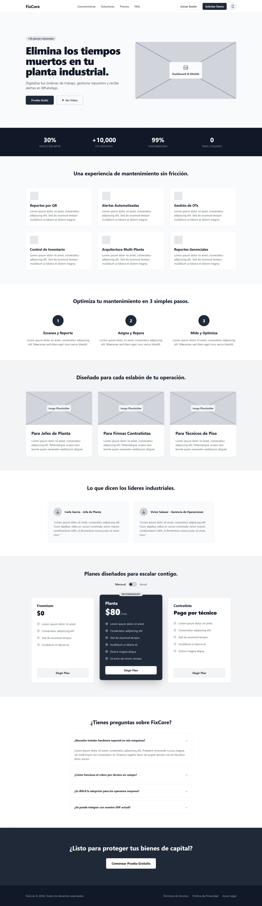<br>
  <em>Fuente: Elaboración propia.</em>
</div>

#### 4.3.1.3. Wireframe Mobile
El wireframe mobile adapta la estructura desktop a formatos verticales:

<div align="center">
  <strong>Wireframe mobile del Landing de FixCore</strong><br><br>
  <br>
  <em>Fuente: Elaboración propia.</em>
</div>

#### 4.3.1.1. Introducción al Wireframe del Landing Page

El wireframe del Landing Page de FixCore establece la estructura fundamental y el flujo de persuasión B2B antes de la aplicación de la interfaz gráfica final (UI). Este esquema sirve como plano arquitectónico para definir la jerarquía de la información, guiando al visitante desde la propuesta de valor inicial en el *Hero Section* centrada en la reducción de tiempos muertos, pasando por la validación técnica (métricas de impacto y características del sistema), hasta los planes de suscripción y el llamado a la acción final (CTA).

El diseño del wireframe sigue el principio de "mobile-first" adaptando el flujo en una sola columna para operarios en campo, pero prioriza la presentación analítica en desktop, dado que el Landing Page busca maximizar conversiones corporativas. Los compradores objetivos (Jefaturas de Planta y Gerencias de Operaciones) evalúan y toman decisiones de adquisición de software SaaS principalmente desde pantallas grandes. El wireframe está diseñado para ser escalable, modular y mantener su efectividad en ambos formatos.

---

#### 4.3.1.4. Regiones del wireframe y su Función

A continuación se detalla cada región de los wireframes (Desktop y Mobile) según su función en el recorrido de conversión del usuario B2B:

**A. Header (Navegación Global)**
El header contiene la identidad de FixCore y las vías rápidas de contacto. En desktop es una barra horizontal persistente; en mobile se colapsa en un menú hamburguesa para ahorrar espacio en pantalla.
*   **Elementos:**
    *   Logo de FixCore (enlace al inicio).
    *   Navegación principal: Características, Soluciones, Precios, FAQ.
    *   Botones de acción (CTAs): "Iniciar Sesión" (Ghost button) y "Solicitar Demo" / "Prueba Gratis" (Botón sólido).
*   **Principios aplicados:** Posicionamiento estándar SaaS (login a la derecha) y máxima prominencia visual para el botón de conversión principal.

**B. Hero Section**
Es la primera impresión. Diseñado para enganchar inmediatamente al tomador de decisión mediante la promesa de valor central y apoyo visual de la plataforma.
*   **Elementos:**
    *   Badge superior de validación (ej. "+50 plantas industriales").
    *   Título principal (H1) orientado a la reducción de tiempos muertos.
    *   Subtítulo descriptivo sobre la digitalización de OTs.
    *   Bloque central inferior para un mockup de alta fidelidad (Dashboard de métricas + celular escaneando QR).
*   **Principios aplicados:** Estructura en "Z" invertida o bloque central para dirigir la mirada desde el texto directamente hacia la previsualización del producto y los botones de acción.

**C. Stats Section (Barra de Impacto)**
Una franja horizontal oscura que contrasta fuertemente para mostrar métricas duras.
*   **Elementos:** 4 bloques cuantitativos (ej. 30% reducción MTTR, +10,000 OTs, 99% disponibilidad, 0 papel). En mobile se apilan en formato 2x2 o 1x4.
*   **Principios aplicados:** Scaneo rápido de información, uso de números grandes para generar confianza inmediata y justificar el ROI del producto.

**D. Features Section (Características Principales)**
Desglosa el "cómo" lo hace a través de una grilla de funcionalidades de la plataforma.
*   **Elementos:** Grilla de 6 tarjetas (3x2 en desktop, 1x6 scrollable en mobile). Cada una incluye un placeholder para ícono, título (ej. "Reportes por QR", "Control de Inventario") y un texto breve.
*   **Principios aplicados:** Uniformidad visual, lectura en patrón de "F" y uso de iconografía para romper la monotonía del texto técnico.

**E. How It Works Section (Paso a Paso)**
Explica el flujo operativo del mantenimiento de forma simplificada.
*   **Elementos:** 3 columnas numeradas secuencialmente (1. Escanea y Reporta, 2. Asigna y Repara, 3. Mide y Optimiza).
*   **Principios aplicados:** Reducción de la carga cognitiva. Transformar un proceso industrial complejo en 3 pasos digeribles.

**F. Use Cases / Solutions Section (Soluciones por Perfil)**
Segmenta la propuesta de valor para los diferentes actores (Jefes de Planta vs. Contratistas).
*   **Elementos:** 3 tarjetas de gran tamaño. En desktop se distribuyen 2 arriba y 1 centrada abajo; en mobile se apilan verticalmente. Contienen placeholders para ilustraciones complejas.
*   **Principios aplicados:** *Targeting* visual. Permite que cada *User Persona* (Carla o Víctor) encuentre rápidamente la solución a sus dolores específicos.

**G. Pricing Section (Planes de Suscripción)**
Presenta el modelo de negocio (*Freemium*, *Planta*, *Contratista*).
*   **Elementos:** Un *toggle switch* superior (Mensual/Anual) y 3 tarjetas de precios. La tarjeta central es ligeramente más grande y destacada.
*   **Principios aplicados:** Efecto "Señuelo" (Decoy effect) y anclaje de precios. Destacar el plan intermedio o más rentable como la opción por defecto.

**H. FAQ Section (Preguntas Frecuentes)**
Resolución de objeciones B2B comunes antes del cierre.
*   **Elementos:** Lista tipo acordeón (collapsible) con preguntas sobre implementación, hardware, adopción de operarios y cobro por licencias.
*   **Principios aplicados:** Diseño expansible para mantener la página limpia y retener a los usuarios que buscan respuestas técnicas específicas.

**I. Bottom CTA & Footer**
El último esfuerzo de conversión y navegación secundaria.
*   **Elementos:**
    *   Franja oscura con un título persuasivo ("¿Listo para proteger tus activos?").
    *   Botón central ("Comienza tu Prueba Gratuita").
    *   Footer: Logo, enlaces legales (Privacidad, Términos B2B), redes y soporte.
*   **Principios aplicados:** Contraste de fondo para "despertar" al usuario al final del scroll y aislar la decisión de compra.

---

#### 4.3.1.5. Principios de Diseño Aplicados en los Wireframes

El esquema estructural de FixCore se sostiene en los siguientes fundamentos UX/UI:

*   **Jerarquía Visual y Contraste:** Uso de bloques con fondos oscuros (Stats y Bottom CTA) intercalados con fondos claros para crear "cortes" naturales en la lectura y evitar la fatiga visual.
*   **Modularidad (Grid System):** Aplicación de un sistema de grillas estricto (12 columnas en desktop) que permite que los bloques de 3 (Features, How it works) y 2 (Testimonios) se redistribuyan perfectamente al hacer reflow en pantallas móviles (1 columna).
*   **Diseño Orientado a la Conversión (CRO):** Los llamados a la acción (CTAs) mantienen una ubicación estratégica y constante a lo largo de todo el recorrido (Header, Hero, Pricing, Bottom), reduciendo la fricción para solicitar la demo.
*   **Escalabilidad Mobile-First:** Elementos como el acordeón de FAQs y la barra de navegación se transforman en patrones nativos móviles (hamburguesa, menús desplegables) asegurando áreas táctiles de mínimo 44x44px.

### 4.3.2. Landing Page Mock-up.

Esta sección presenta y explica los Mock-ups (prototipos de alta fidelidad) del Landing Page de FixCore, tanto en su versión para Desktop Web Browser como Mobile Web Browser. En esta propuesta se evidencia la aplicación de los principios de diseño visual, accesibilidad y la arquitectura de información validada previamente en los wireframes, consolidando el Design System corporativo orientado al sector B2B (Mantenimiento Industrial).

#### 4.3.2.1. Introducción al Mock-up

El mock-up del Landing Page representa la implementación visual final del producto. Transforma el esquema estructural (Lo-Fi) aplicando los colores corporativos, tipografías, iconografía y espaciados definidos para crear una experiencia visual coherente que transmita confianza, modernidad y eficiencia operativa, valores centrales de FixCore.

#### 4.3.2.2. Mock-up Desktop

El mock-up desktop del Landing Page aplica los siguientes elementos del Design System para maximizar la conversión en pantallas grandes:

**Paleta de Colores Aplicada**
*   **Primary (Azul Brillante):** `#0ea5e9` (Aprox.)
    *   Utilizado en botones primarios principales (Hero Section, Iniciar Sesión), enlaces activos e iconografía clave.
*   **Corporate Dark (Azul Marino/Navy):** `#0f172a` (Aprox.)
    *   Utilizado para crear contrastes fuertes en secciones de alto impacto: Barra de Estadísticas (Stats), Tarjeta de Precio destacada ("Planta") y el Bottom CTA.
*   **Success Accent (Verde):** `#16a34a` (Aprox.)
    *   Utilizado estratégicamente en el botón final de conversión ("Comenzar Prueba Gratuita") y en los *checkmarks* de los planes de precios para indicar beneficios activos.
*   **Escala de Grises y Fondos:**
    *   Fondos principales: Blanco (White) y Gris muy claro (Gray-50) para separar secciones sutilmente.
    *   Texto: Gray-900 para títulos de alta jerarquía y Gray-600 para legibilidad en párrafos descriptivos.

**Tipografía Aplicada**
*   **Headings (Ej. Inter o Poppins)**
    *   H1: 48-64px ExtraBold - Título principal del Hero ("Elimina los tiempos muertos...").
    *   H2: 36-40px Bold - Títulos de sección centrados.
    *   H3: 20-24px SemiBold - Nombres de características y títulos de tarjetas.
*   **Body Text**
    *   Body: 16px Regular - Descripciones y párrafos.
    *   Small: 14px Regular - Elementos secundarios, navegación y *footers*.

**Componentes Visuales**
*   **Tarjetas (Cards):**
    *   Fondo: Blanco sólido para características y testimonios. Fondo oscuro degradado para los Casos de Uso.
    *   Bordes y Radio: Esquinas redondeadas (aprox. 12px a 16px) para suavizar la estética industrial.
    *   Sombra: Sombras sutiles (`shadow-sm` y `shadow-md`) para crear profundidad y separar los elementos del fondo gris claro.
*   **Botones:**
    *   Primario: Relleno azul, texto blanco, esquinas redondeadas.
    *   Secundario (Ghost): Texto gris oscuro, fondo transparente y borde sutil.
    *   Call to Action Final: Relleno verde vibrante para atraer la vista al final del recorrido.

#### 4.3.2.3. Mock-up Mobile

El mock-up mobile mantiene una estricta consistencia visual con la versión desktop, adaptando la experiencia de lectura y navegación a pantallas pequeñas (Mobile-first adaptativo):

**Adaptaciones Mobile**
*   **Diseño Responsive (Reflow):**
    *   El grid de contenido colapsa de 3 o 2 columnas a **1 sola columna vertical** (Features, Casos de Uso, Pricing).
    *   La barra de navegación horizontal desaparece y se condensa en un menú hamburguesa (Hamburger menu) ubicado en la esquina superior derecha.
    *   La barra de estadísticas (Stats) adapta sus 4 métricas a un grid de 2x2 para no hacer el scroll excesivamente largo y mantener los números legibles.
*   **Touch Targets (Zonas Táctiles):**
    *   Botones expandidos al 100% del ancho del contenedor (`w-full`) para facilitar el toque con una sola mano.
    *   Espaciado (padding) aumentado en el menú desplegable de las FAQs para evitar toques accidentales entre preguntas.
*   **Optimización Visual:**
    *   El mockup del Dashboard y el celular en el Hero Section se escala proporcionalmente y se centra debajo del texto principal.

#### 4.3.2.4. Vistas Detalladas por Sección

*   **Hero Section:** Fondo blanco limpio. Título alineado a la izquierda (en desktop) con fuerte contraste. Los botones de acción están agrupados ("Prueba Gratis" sólido y "Ver Video" con ícono). A la derecha, una composición gráfica en alta fidelidad de la plataforma.
*   **Stats Section:** Franja horizontal azul oscuro que rompe el fondo blanco. Números enormes en color blanco con subtítulos en azul brillante para rápida lectura de métricas clave (MTTR, OTs).
*   **Features Section:** Grilla limpia (3x2 en desktop). Cada tarjeta incluye un ícono azul minimalista en la parte superior izquierda, seguido de un título en negrita y un párrafo gris.
*   **Use Cases Section:** Tres tarjetas oscuras con ilustraciones integradas que rompen el patrón claro de la página, llamando la atención de los tres perfiles de comprador (Jefes, Contratistas, Técnicos).
*   **Pricing Section:** Destaca por el efecto anclaje. La tarjeta central (Plan Planta) es más alta y tiene fondo azul oscuro con texto blanco, forzando la atención visual hacia ella frente a las dos tarjetas blancas laterales.
*   **FAQ y Bottom CTA:** Preguntas frecuentes limpias con divisores grises delgados. El recorrido culmina en un bloque azul oscuro masivo que contiene un único botón verde brillante, creando el punto de mayor contraste de toda la página para forzar el clic final.

#### 4.3.2.5. Aplicación del Design System y Accesibilidad

El mock-up evidencia una aplicación madura de los principios de diseño para productos SaaS:
*   **Jerarquía y "Scannability":** Los usuarios pueden escanear la página leyendo solo los H2 (Títulos de sección centrados) y entender toda la propuesta de valor sin leer los párrafos pequeños.
*   **Diseño Inclusivo y Contraste:** El uso de texto blanco puro sobre los fondos azul oscuro (Navy) supera holgadamente los estándares de contraste WCAG AA, asegurando legibilidad incluso en monitores industriales con bajo brillo.
*   **Consistencia:** Los radios de los botones, las sombras de las tarjetas y los grosores de línea se repiten uniformemente a través de todas las secciones, generando confianza institucional.

#### 4.3.2.6. Referencias Visuales
Las siguiente referencias muestran el mock-up final:

**Desktop Homepage Mock-up**

<div align="center">
  <strong>Gráfico: Mock-up desktop del Landing de Fixcore</strong><br><br>
  <br>
  <em>Fuente: Elaboración propia.</em>
</div>

El mockup desktop muestra:

*   Hero section completo con mockup de la plataforma (Dashboard en monitor y escáner en móvil)
*   Barra de estadísticas oscura con 4 métricas clave
*   6 features cards en grid (distribución 3x2)
*   3 steps visuales numerados (Paso a paso)
*   3 tarjetas oscuras de casos de uso por perfil (distribución 2x1)
*   2 tarjetas de testimonios con avatares
*   3 tarjetas de planes de precios (con el plan central destacado)
*   Sección FAQ en formato acordeón
*   Bottom CTA section oscuro con botón de conversión final y footer

**Mobile Homepage Mock-up**

<div align="center">
  <strong>Gráfico: Mock-up mobile del Landing de Fixcore</strong><br><br>
  <br>
  <em>Fuente: Elaboración propia.</em>
</div>

El mockup mobile muestra:

*   Menú de navegación colapsado (Hamburger menu) para maximizar el espacio de visualización.
*   Hero section adaptado a formato vertical, priorizando la lectura (Texto > Botones CTA > Mockup de la plataforma).
*   Barra de estadísticas (Stats) reestructurada en un bloque apilado para lectura rápida sin scroll horizontal.
*   Grilla de 6 *Features cards* colapsada a una lista vertical de 1 columna.
*   Tarjetas de "Casos de Uso" y "Pasos" alineadas verticalmente ocupando el ancho completo (`w-full`) de la pantalla.
*   Tarjetas de "Planes de Precios" apiladas en scroll vertical, manteniendo el plan "Planta" con fondo oscuro visualmente destacado.
*   Sección FAQ optimizada para interacción táctil en formato acordeón de 1 columna.
*   Bottom CTA adaptado a la pantalla móvil con el botón verde de conversión principal centrado.

---

#### 4.3.2.7. Estados Interactivos en el Mock-up

Los mock-ups móviles también definen los estados interactivos de los componentes principales para asegurar un *feedback* táctil adecuado:

**Estados de Botón (CTAs)**
*   **Default:** Color de relleno sólido (Azul corporativo o Verde para el CTA final), con sombra sutil (`shadow-sm`).
*   **Touch/Hover:** Oscurecimiento leve del fondo y aumento de la sombra (`shadow-md`) para indicar interactividad.
*   **Active (Tap):** Escala ligeramente reducida (ej. `scale-95`) para proporcionar respuesta táctil inmediata al usuario al pulsar en la pantalla.
*   **Disabled:** Opacidad reducida al 50% e inhabilitación de eventos táctiles.

**Estados de Tarjeta (Features, Pricing y Casos de Uso)**
*   **Default:** Borde sutil o sombra media (`shadow-md`), esquinas redondeadas.
*   **Tap/Focus:** Sombra incrementada (`shadow-lg`) y leve elevación visual (`translateY(-4px)`).
*   **Transición:** Suave de `300ms ease-in-out` para evitar saltos bruscos en la interfaz móvil.

**Estados de Acordeón (FAQ)**
*   **Collapsed (Cerrado):** Pregunta visible, ícono de cruz (+) o flecha hacia abajo.
*   **Expanded (Abierto):** Ícono cambia a menos (-) o flecha hacia arriba, la respuesta se despliega con una animación suave, el título adopta un color azul activo para indicar su estado.

---

#### 4.3.2.8. Diseño Responsivo General

El mock-up aplica los principios de diseño responsivo *Mobile-First* a través de las siguientes configuraciones:

**Breakpoints Aplicados**
*   **Mobile:** 320px - 639px (Vista actual representada en el mock-up).
*   **Tablet:** 640px - 1023px.
*   **Desktop:** 1024px+.

**Comportamiento en Mobile (Reflow y Adaptación)**
*   **Stacking de Grids:** Todos los contenedores que en desktop eran de 2 o 3 columnas (Características, Casos de uso, Precios) se colapsan a 1 sola columna vertical.
*   **Ajuste Tipográfico:** Reducción proporcional de los tamaños de fuente (ej. el H1 del Hero baja de 56px a 36px o 40px) para evitar la fragmentación excesiva de palabras y mantener la legibilidad.
*   **Touch Targets (Zonas táctiles):** Expansión de los botones principales y enlaces del menú para que cumplan con la altura mínima recomendada de 44px a 48px, facilitando el uso con el pulgar.
*   **Alineación:** Transición de alineación izquierda (Desktop) a alineación centrada o de ancho completo (Mobile) para equilibrar el peso visual.

**Imágenes Responsivas y Rendimiento**
*   Uso de atributos `srcset` para cargar versiones reducidas de las ilustraciones y mockups en redes móviles.
*   Implementación de *Lazy Loading* (carga diferida) para las imágenes de las secciones inferiores (Casos de Uso, Testimonios) que se encuentran por debajo del *fold* (primera pantalla visual).

## 4.4. Web Applications UX/UI Design.

En esta sección se detalla el diseño visual e interactivo de la plataforma web y móvil de FixCore, un sistema open-source diseñado para optimizar y centralizar el mantenimiento industrial. La propuesta se fundamenta en las necesidades de los usuarios, criterios de usabilidad y la estructura de información planificada previamente, asegurando armonía con la identidad visual del proyecto.

El desarrollo se divide en cuatro apartados principales: los Wireframes, que establecen la distribución y jerarquía visual de los elementos en cada pantalla; los Wireflow Diagrams, que muestran la secuencia de navegación según los propósitos de cada usuario; los Mock-ups, que reflejan el diseño gráfico final aplicando la paleta de estilos; y los User Flow Diagrams, que conectan las interfaces con el recorrido ideal y las posibles rutas ante errores o imprevistos.

Los perfiles clave contemplados son el Jefe de Planta, quien administra los recursos y la planificación; el Técnico, enfocado en la ejecución y reporte directo desde la zona de operaciones; y el Gerente de Operaciones, que supervisa el rendimiento general a nivel ejecutivo.

### 4.4.1. Web Applications Wireframes.

Esta sección presenta los wireframes de baja fidelidad de FixCore, diseñados en Figma. La plataforma se estructuró bajo un enfoque responsivo, adaptándose a los tres roles principales del sistema (Jefe de Planta, Técnico y Gerente de Operaciones).

**Wireframes Mobile**

<div align="center">
  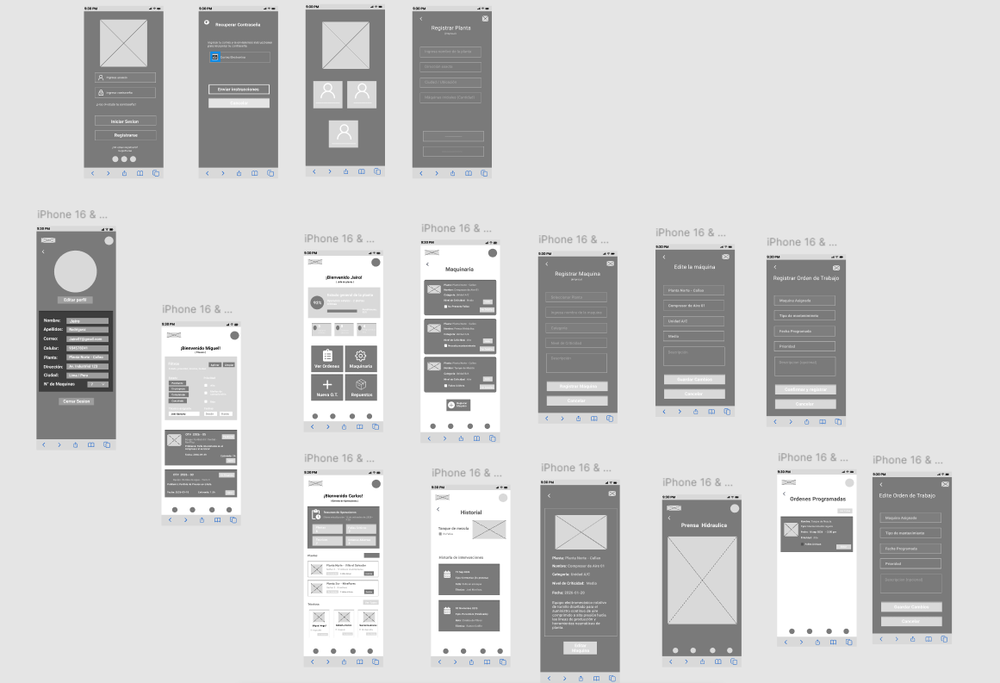<br>
</div>

**Wireframes Desktop**

<div align="center">
  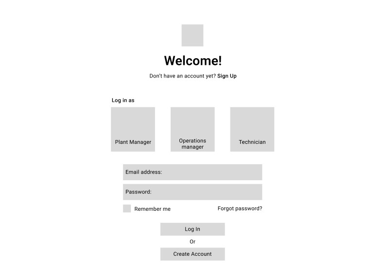<br>
</div>

<div align="center">
  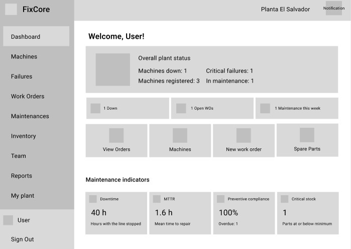<br>
</div>

<div align="center">
  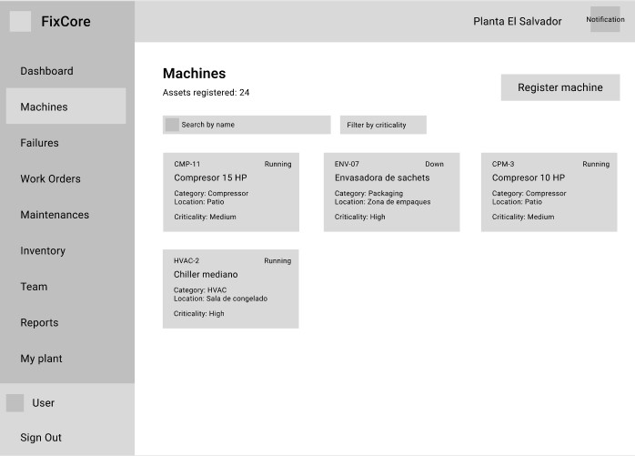<br>
</div>

<div align="center">
  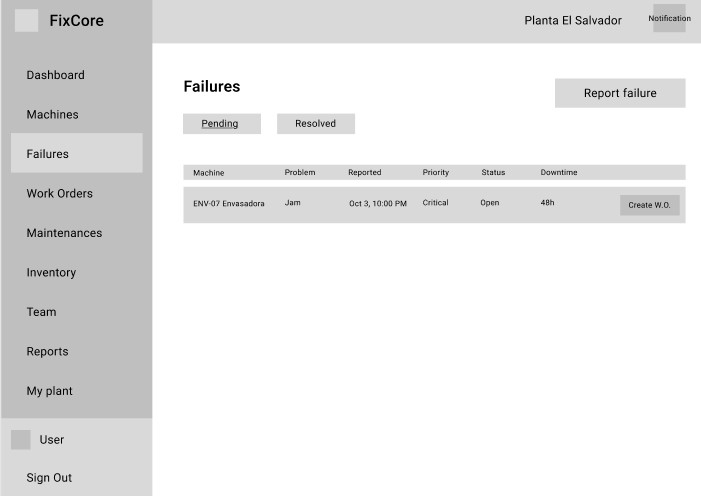<br>
</div>

<div align="center">
  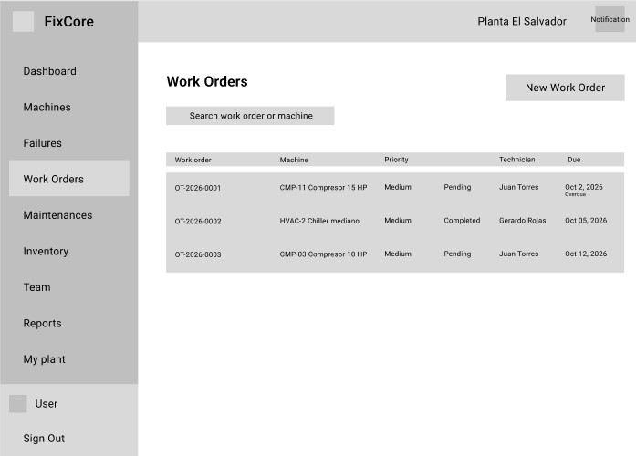<br>
</div>

<div align="center">
  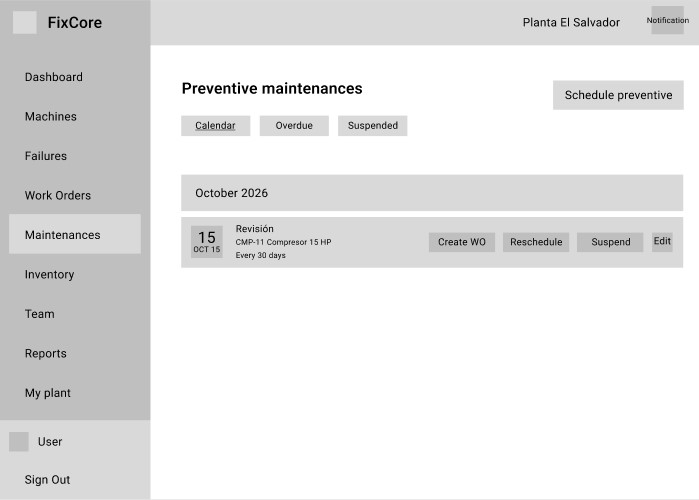<br>
</div>

<div align="center">
  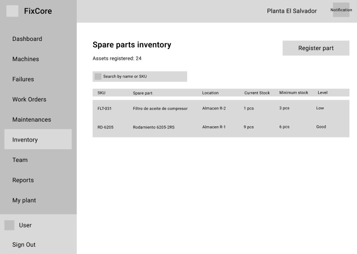<br>
</div>

<div align="center">
  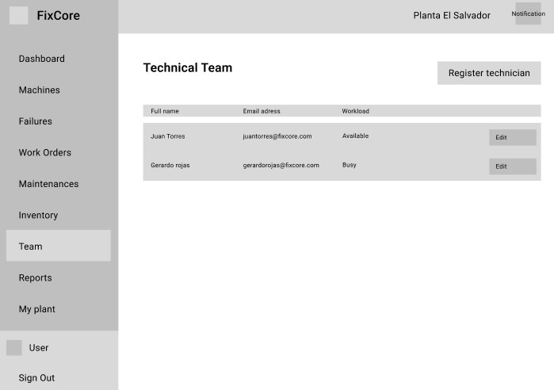<br>
</div>

<div align="center">
  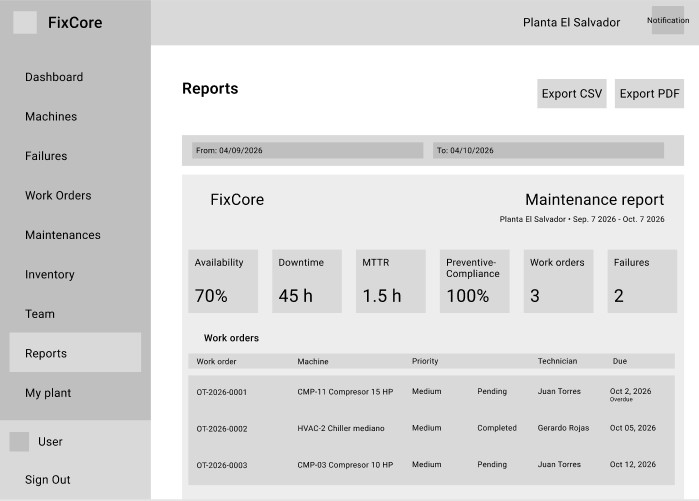<br>
</div>

<div align="center">
  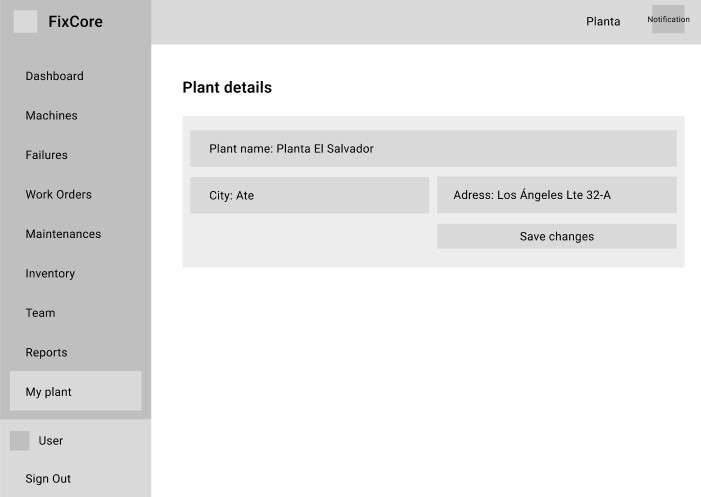<br>
</div>


Explicación de la propuesta:

* Estructura consistente: Se utilizaron tarjetas (cards), barras de navegación fijas y botones grandes para asegurar una lectura rápida y evitar errores operativos en la planta.

* Jerarquía visual: Al tratarse de wireframes estructurales, la jerarquía se estableció mediante tipografías escalonadas, líneas divisorias y bloques de contenido delimitados, utilizando variaciones de tono en lugar de color para diferenciar campos y contenedores.

* Diseño inclusivo: Se priorizaron áreas táctiles amplias y formularios sencillos para que los técnicos puedan reportar fallas y gestionar tareas rápidamente desde el campo.

### 4.4.2. Web Applications Wireflow Diagrams.

En esta sección presentamos los Wireflows diseñados para FixCore, los cuales enlazan la estructura visual de nuestros wireframes de baja fidelidad con los recorridos interactivos que realiza cada rol para alcanzar sus objetivos principales. A diferencia de un flujo de tareas tradicional, este enfoque nos permite visualizar simultáneamente el diseño de cada pantalla y la secuencia de transiciones ante las acciones del usuario, mostrando los cambios de estado mediante la incorporación progresiva de los wireframes correspondientes.

Para construir estos diagramas, previamente analizamos las rutas típicas de interacción de nuestros usuarios. El desarrollo se centró en los perfiles principales que definimos para el sistema: el Jefe de Planta (enfocado en la administración de activos y la planificación), el Técnico (responsable de la ejecución y el reporte directo en campo) y el Gerente de Operaciones (orientado a la supervisión macro y la revisión de métricas).

#### 4.4.2.1. Wireflow 01 — Jefe de Planta registra su cuenta y maquinas.

Usuario: Jefe de planta
Obetivo de usuario: Como Jefe de Planta, deseo registrarme con una cuenta y a la vez las máquina en el sistema indicando sus datos técnicos y ubicación para llevar un control centralizado de los activos que requieren mantenimiento preventivo y correctivo.

<div align="center">
  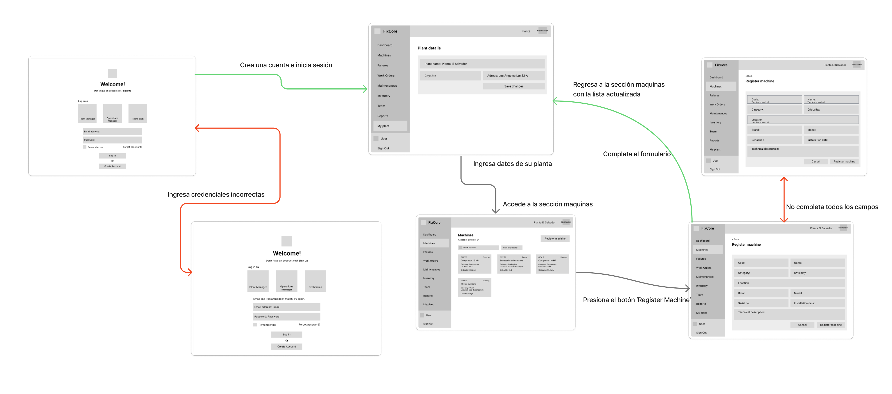<br>
</div>

Explicación del flujo: Nuestro flujo arranca en la pantalla principal de acceso, donde ingresamos el usuario y la contraseña. Al presionar el botón de inicio de sesión, el sistema valida las credenciales y nos lleva  hacia el panel de bienvenida adaptado específicamente al perfil del usuario (ya sea el tablero del Jefe de Planta, la vista operativa del Técnico o el resumen ejecutivo del Gerente de Operaciones). Una vez en el panel principal del Jefe de Planta, desde donde accedemos al módulo de maquinaria para agregar un nuevo equipo, lo que nos dirige hacia el formulario de registro en su estado inicial. Ingresamos los datos obligatorios, como nombre, planta, categoría y nivel de criticidad. Al confirmar la acción, el sistema valida los datos y nos redirige al listado general de activos actualizado. Con esto logramos automatizar el registro y dejamos atrás los controles en papel o Excel.

#### 4.4.2.2. Wireflow 02 — Técnico accede a la informacion de maquinas.

Usuario: Técnico
Obetivo de usuario: Como Técnico de campo, deseo observar los fallos de las maquinas y dirigirme a la planta asignada, reportarme para que la incidencia quede registrada formalmente y pueda ser atendida sin retrasos.

<div align="center">
  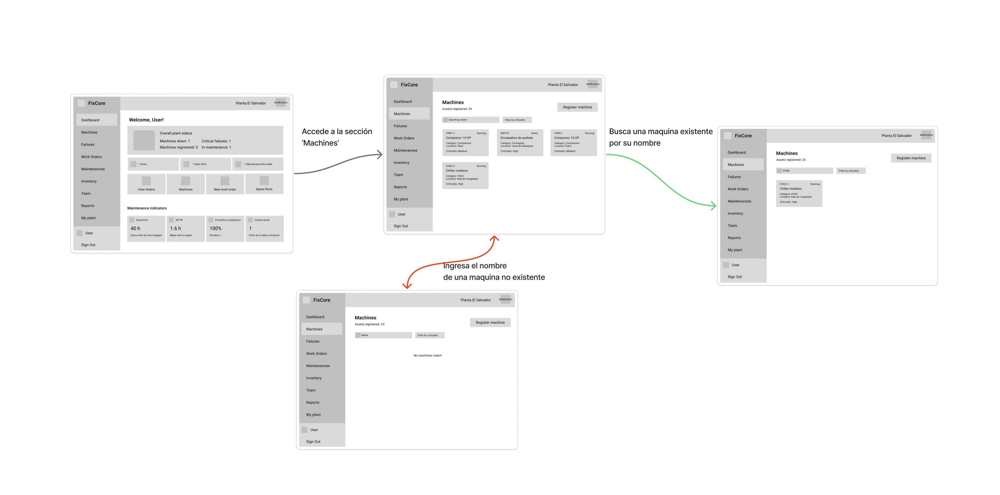<br>
</div>

Explicación del flujo: En este recorrido, luego de haber iniciado sesión y estar en una planta industrial, se accede a la sección de maquinas donde se verá un listado de todas las maquinas pertenecientes a la planta actual. El técnico luego puede buscar la información de una maquina en especifico por su nombre. En caso se introduzca un nombre que no pertenezca a alguna maquina, no se mostrarán resultados.

#### 4.4.2.3. Wireflow 03 — Gerente de Operaciones crea una orden de trabajo

Usuario: Gerente de Operaciones
Obetivo de usuario: Como Gerente de Operaciones, deseo ser capaz de generar ordenes de trabajo dentro de la plataforma FixCore para así facilitar la asignación de tareas a los tecnicos de una planta industrial.

<div align="center">
  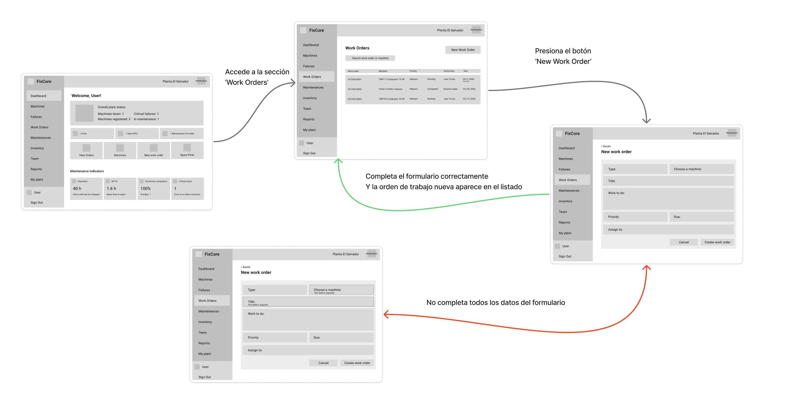<br>
</div>

Explicación del flujo: El flujo comienza en el panel de inicio, donde luego se ingresa a la sección de ordenes de trabajo. Dentro de alli se presiona el botón de crear una nueva orden de trabajo para abrir un formulario donde se deberá colocar información como la maquina que se va a atender, el tipo de trabajo que se va a realizar o el técnico encargado. En caso algunos datos no sean colocados, tales como la maquina o el titulo de la orden de trabajo, no se continuará con la creación. Una vez los datos estén validados, e usuario regresará al listado de ordenes de trabajo.

#### 4.4.2.4. Wireflow 04 — Integrante de una planta reporta una falla

Usuario: Integrante en general de una planta industrial
Obetivo de usuario: Como miembro de una planta industrial, deseo ser capaz de reportar fallos presentes en las maquinas de la planta industrial a la que pertenezco para así facilitar su identificación y atención oportuna por parte de los otros técnicos dentro de la planta.

<div align="center">
  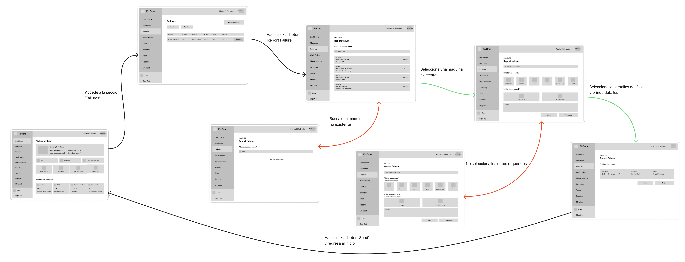<br>
</div>

Explicación del flujo: El flujo comienza en el panel de inicio, donde luego se ingresa a la sección de fallas. Una vez alli, se presiona el botón de reportar una falla. Durante el reporte primero se pedirá elegir la maquina que está fallando, intentar buscar el nombre de una maquina que no existe dentro de la planta no dará resultados. Siguiente, se pedirán datos sobre la falla, tales como su tipo, si ha detenido la linea de producción, así como otros detalles opcionales. Una vez completado el proceso se mostrará una tarjeta de confirmación antes del envío del reporte.

### 4.4.3. Web Applications Mock-ups.

En esta sección presentamos los Mock-ups de alta fidelidad, los cuales materializan visualmente los wireframes que definimos previamente para FixCore. Para su desarrollo en Figma, aplicamos de manera rigurosa los lineamientos de nuestro Design System, integrando la paleta de colores corporativa, la jerarquía tipográfica, el sistema de espaciados y los componentes de interfaz estandarizados, garantizando así total coherencia gráfica de nuestro proyecto.

**Mockups Mobile**

<div align="center">
  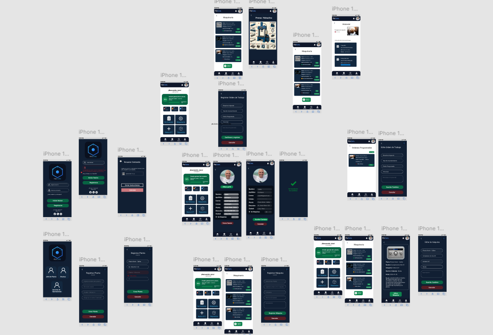<br>
</div>

**Mockups Desktop**

<div align="center">
  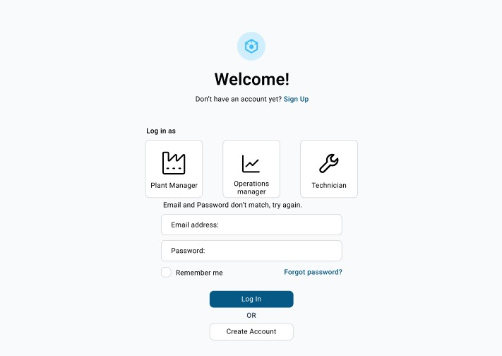<br>
</div>

<div align="center">
  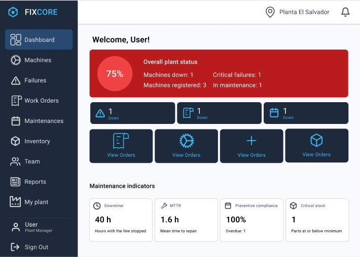<br>
</div>

<div align="center">
  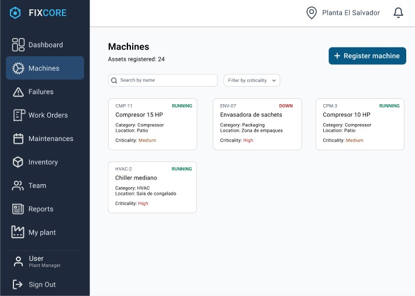<br>
</div>

<div align="center">
  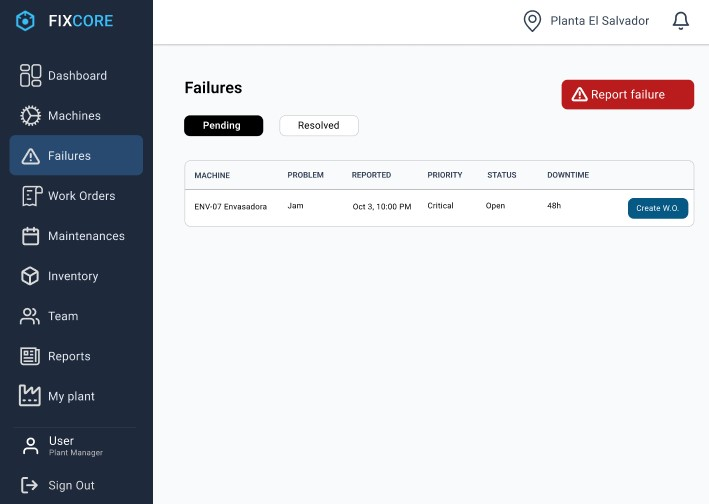<br>
</div>

<div align="center">
  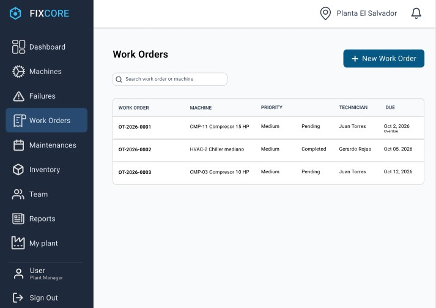<br>
</div>

<div align="center">
  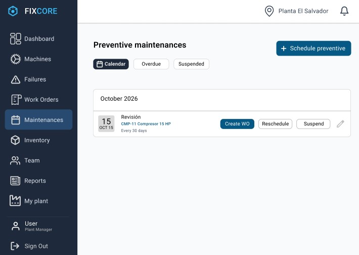<br>
</div>

<div align="center">
  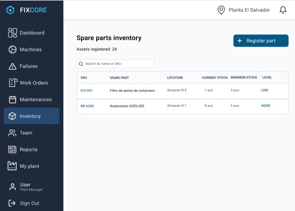<br>
</div>

<div align="center">
  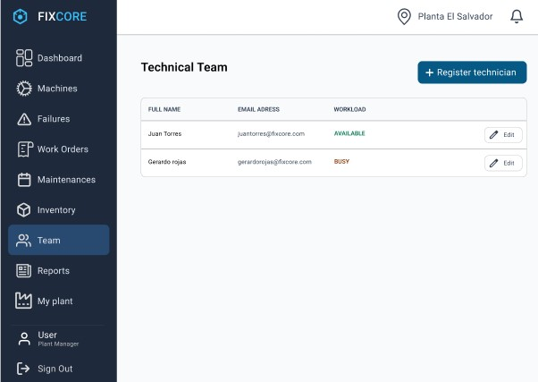<br>
</div>

<div align="center">
  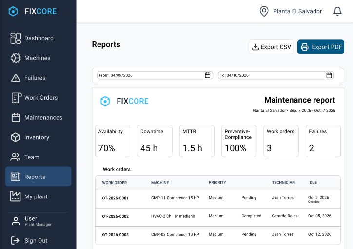<br>
</div>

<div align="center">
  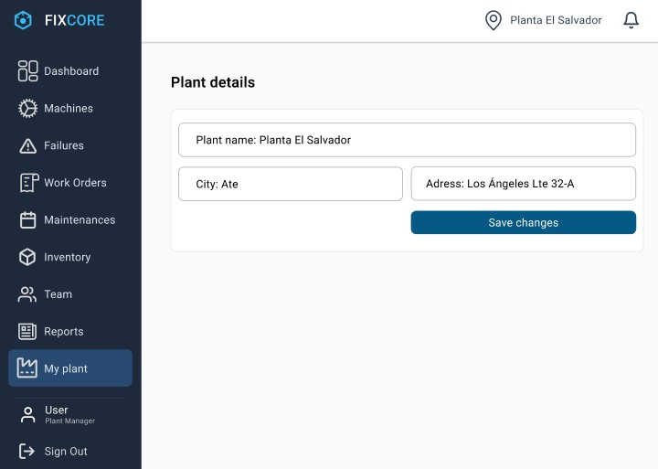<br>
</div>

Explicación de la propuesta:
Los mock-ups reflejan fielmente el diseño visual definitivo de la plataforma. Implementamos una interfaz limpia y estructurada mediante tarjetas (cards), barras de navegación intuitivas y contenedores claramente delimitados que reducen la fatiga visual y facilitan la lectura rápida de los datos. La selección cromática prioriza contrastes óptimos para asegurar una legibilidad excelente tanto en monitores de oficina como en las pantallas móviles utilizadas por los técnicos en la fábrica.

Asimismo, cuidamos la accesibilidad y el diseño inclusivo en cada componente. Los elementos interactivos —como botones de acción primaria y campos de formulario— cuentan con áreas táctiles amplias y estados visuales definidos (hover, active, disabled), permitiendo que los operarios interactúen con la aplicación sin errores accidentales. De este modo, logramos una interfaz moderna, profesional y altamente funcional para la gestión del mantenimiento industrial.

### 4.4.4. Web Applications User Flow Diagrams.

Los diagramas de flujo de usuario que documentamos en esta sección representan la evolución de alta fidelidad de los Wireflows que presentamos previamente. Mientras que los wireflows operan con representaciones esquemáticas de baja fidelidad, los User Flows integran los mock-ups finales de FixCore junto con el detalle completo de las trayectorias que nuestros usuarios pueden recorrer dentro del sistema: tanto el camino ideal u esperado (happy path) como los caminos alternativos (unhappy paths) que se activan ante errores, validaciones fallidas o decisiones operativas que se apartan del flujo principal.

Estos flujos de usuario mantienen una total consistencia con los wireflows que definimos en esta sección, lo que garantiza una trazabilidad de extremo a extremo en todo nuestro proceso de diseño de software. Cada uno de los diagramas detalla con precisión los puntos de decisión, las condiciones lógicas de validación y las transiciones de pantallas, todo ello complementado con anotaciones que explican con claridad el comportamiento exacto del sistema ante cada bifurcación. Diseñamos estas rutas alternativas considerando rigurosamente los escenarios reales de mantenimiento industrial que identificamos durante las entrevistas con los representantes de nuestros segmentos objetivo (Jefes de Planta, Técnicos y Gerentes de Operaciones).


#### 4.4.4.1. Userflow 01 — Jefe de Planta registra su cuenta y maquinas.

Usuario: Jefe de planta
Obetivo de usuario: Como Jefe de Planta, deseo registrarme con una cuenta y a la vez las máquina en el sistema indicando sus datos técnicos y ubicación para llevar un control centralizado de los activos que requieren mantenimiento preventivo y correctivo.

<div align="center">
  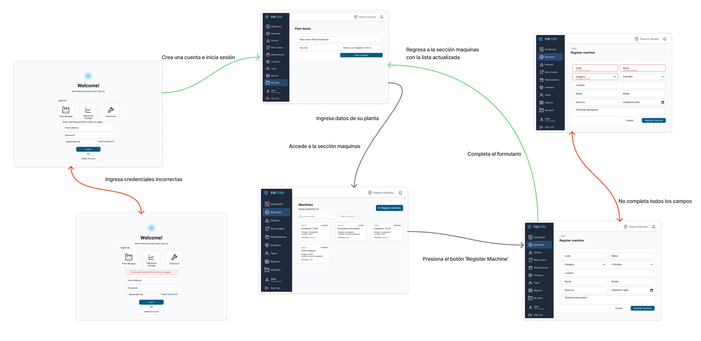<br>
</div>

Explicación del flujo: Nuestro flujo arranca en la pantalla principal de acceso, donde ingresamos el usuario y la contraseña. Al presionar el botón de inicio de sesión, el sistema valida las credenciales y nos lleva  hacia el panel de bienvenida adaptado específicamente al perfil del usuario (ya sea el tablero del Jefe de Planta, la vista operativa del Técnico o el resumen ejecutivo del Gerente de Operaciones). Una vez en el panel principal del Jefe de Planta, desde donde accedemos al módulo de maquinaria para agregar un nuevo equipo, lo que nos dirige hacia el formulario de registro en su estado inicial. Ingresamos los datos obligatorios, como nombre, planta, categoría y nivel de criticidad. Al confirmar la acción, el sistema valida los datos y nos redirige al listado general de activos actualizado. Con esto logramos automatizar el registro y dejamos atrás los controles en papel o Excel.

#### 4.4.4.2. Userflow 02 — Técnico accede a la informacion de maquinas.

Usuario: Técnico
Obetivo de usuario: Como Técnico de campo, deseo observar los fallos de las maquinas y dirigirme a la planta asignada, reportarme para que la incidencia quede registrada formalmente y pueda ser atendida sin retrasos.

<div align="center">
  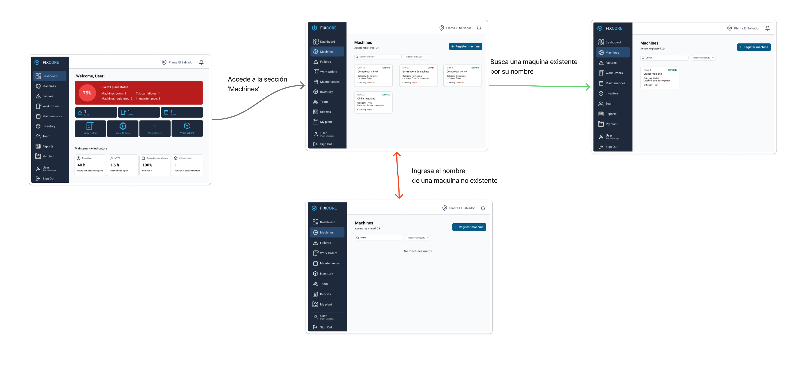<br>
</div>

Explicación del flujo: En este recorrido, luego de haber iniciado sesión y estar en una planta industrial, se accede a la sección de maquinas donde se verá un listado de todas las maquinas pertenecientes a la planta actual. El técnico luego puede buscar la información de una maquina en especifico por su nombre. En caso se introduzca un nombre que no pertenezca a alguna maquina, no se mostrarán resultados.

#### 4.4.4.3. Userflow 03 — Gerente de Operaciones crea una orden de trabajo

Usuario: Gerente de Operaciones
Obetivo de usuario: Como Gerente de Operaciones, deseo ser capaz de generar ordenes de trabajo dentro de la plataforma FixCore para así facilitar la asignación de tareas a los tecnicos de una planta industrial.

<div align="center">
  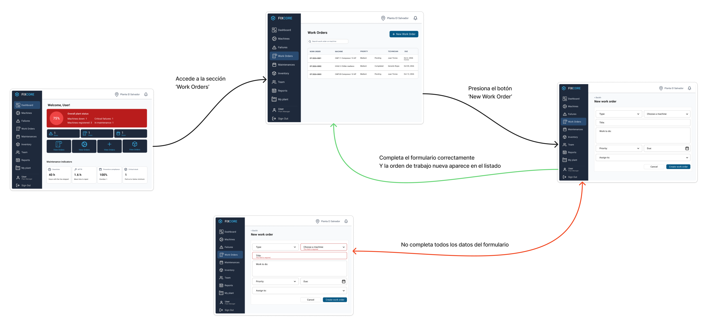<br>
</div>

Explicación del flujo: El flujo comienza en el panel de inicio, donde luego se ingresa a la sección de ordenes de trabajo. Dentro de alli se presiona el botón de crear una nueva orden de trabajo para abrir un formulario donde se deberá colocar información como la maquina que se va a atender, el tipo de trabajo que se va a realizar o el técnico encargado. En caso algunos datos no sean colocados, tales como la maquina o el titulo de la orden de trabajo, no se continuará con la creación. Una vez los datos estén validados, e usuario regresará al listado de ordenes de trabajo.

#### 4.4.4.4. Userflow 04 — Integrante de una planta reporta una falla

Usuario: Integrante en general de una planta industrial
Obetivo de usuario: Como miembro de una planta industrial, deseo ser capaz de reportar fallos presentes en las maquinas de la planta industrial a la que pertenezco para así facilitar su identificación y atención oportuna por parte de los otros técnicos dentro de la planta.

<div align="center">
  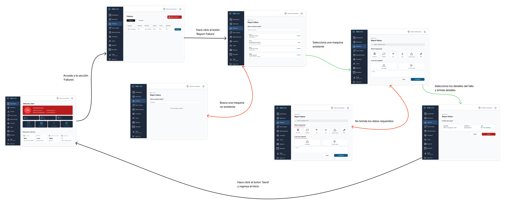<br>
</div>

## 4.5. Web Applications Prototyping.

Con los Mockups realizados hemos elaborado un prototipo en Figma que muestre una versión preliminar de nuestra aplicación web. En este prototipo se consideraron procesos presentes en los Userflows, además de otras vistas generales de las secciones que puede ofrecer la plataforma.

Enlace al prototipo realizado en Figma: [https://www.figma.com/proto/VbkpyP5gwR4Orgl1eNsB7a/Figma-basics?node-id=2449-1168&t=Va1SHaV7XPbK0ZlF-1&scaling=scale-down&content-scaling=fixed&page-id=2439%3A2&starting-point-node-id=2449%3A1168](https://www.figma.com/proto/VbkpyP5gwR4Orgl1eNsB7a/Figma-basics?node-id=2449-1168&t=Va1SHaV7XPbK0ZlF-1&scaling=scale-down&content-scaling=fixed&page-id=2439%3A2&starting-point-node-id=2449%3A1168)

Enlace al video de presentación del prototipo: [https://upcedupe-my.sharepoint.com/:v:/g/personal/u202423973_upc_edu_pe/IQDYMFuJ7lLVR70eP-ZT_VL8AQQDJFn8kAVoKRjQeePpziU?e=0tnbiI&nav=eyJyZWZlcnJhbEluZm8iOnsicmVmZXJyYWxBcHAiOiJTdHJlYW1XZWJBcHAiLCJyZWZlcnJhbFZpZXciOiJTaGFyZURpYWxvZy1MaW5rIiwicmVmZXJyYWxBcHBQbGF0Zm9ybSI6IldlYiIsInJlZmVycmFsTW9kZSI6InZpZXcifX0%3D](https://upcedupe-my.sharepoint.com/:v:/g/personal/u202423973_upc_edu_pe/IQDYMFuJ7lLVR70eP-ZT_VL8AQQDJFn8kAVoKRjQeePpziU?e=0tnbiI&nav=eyJyZWZlcnJhbEluZm8iOnsicmVmZXJyYWxBcHAiOiJTdHJlYW1XZWJBcHAiLCJyZWZlcnJhbFZpZXciOiJTaGFyZURpYWxvZy1MaW5rIiwicmVmZXJyYWxBcHBQbGF0Zm9ybSI6IldlYiIsInJlZmVycmFsTW9kZSI6InZpZXcifX0%3D)

<div align="center">
  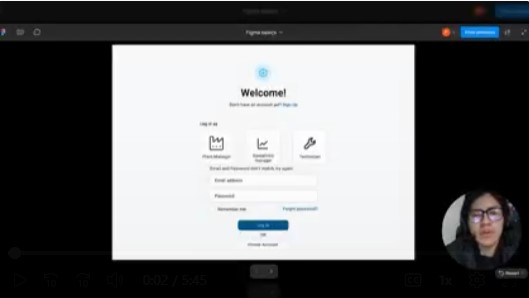<br>
</div>

## 4.6. Domain-Driven Software Architecture.

### 4.6.1. Design-Level EventStorming.

Realizamos una sesión de Design-Level EventStorming tomando como punto de partida los resultados obtenidos en el Big Picture EventStorming. En esta etapa profundizamos en los principales procesos identificados del dominio de FixCore, detallamos los eventos, actores, comandos, politicas y otros aspectos involucrados en cada flujo. Esto nos ayudo a mejorar el modelo inicial, delimitar las responsabilidades del sistema y establecer una primera definición de los Bounded Contexts, buscando que cada uno mantenga una responsabilidad clara dentro de la arquitectura de la plataforma. Para la elaboración del tablero, se siguieron siete pasos.


<div align="center">
  <strong>1. Agregar eventos del dominio</strong><br><br>
  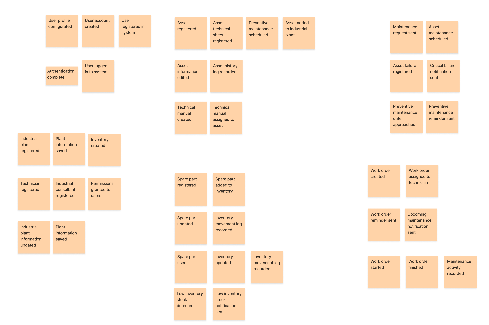<br>
</div>


<div align="center">
  <strong>2. Agregar comandos</strong><br><br>
  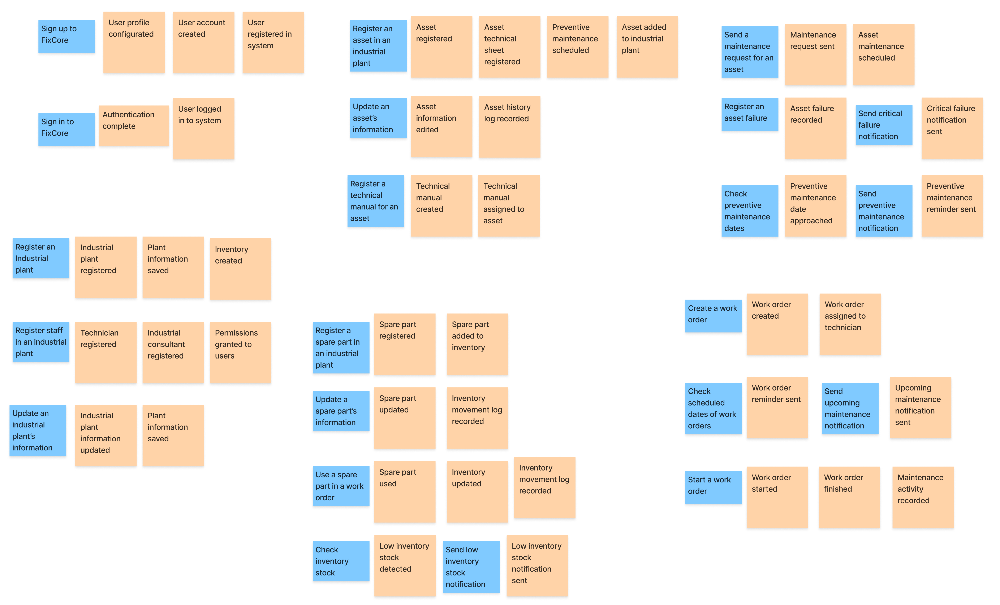<br>
</div>


<div align="center">
  <strong>3. Agregar actores y politicas</strong><br><br>
  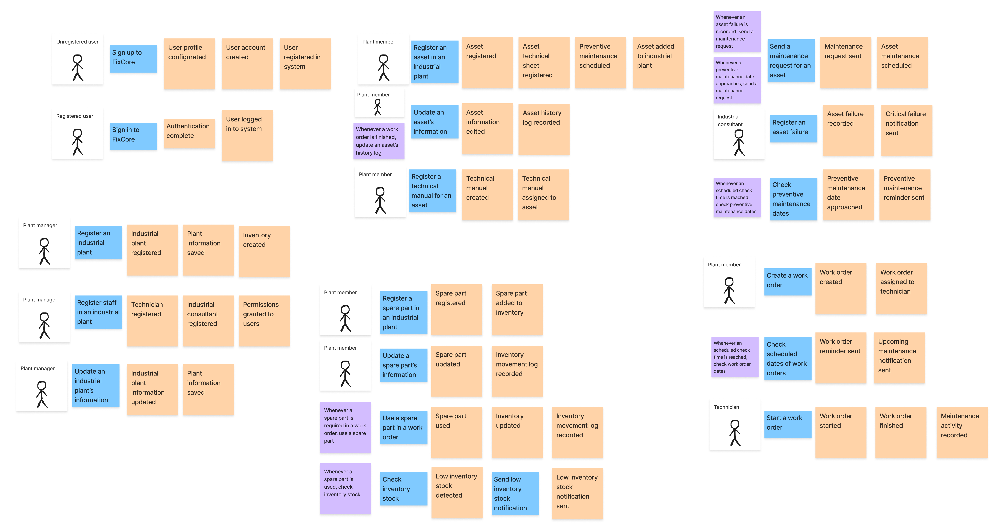<br>
</div>


<div align="center">
  <strong>4. Agregar Read Models</strong><br><br>
  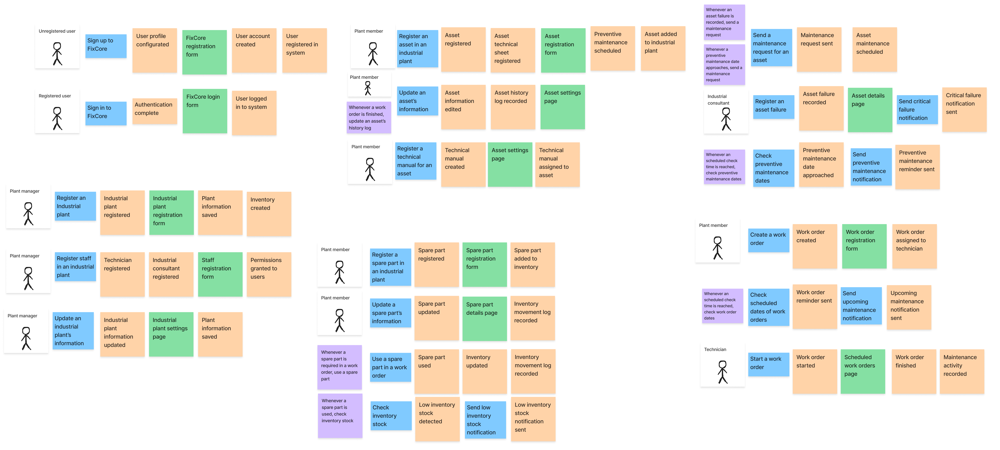<br>
</div>


<div align="center">
  <strong>5. Agregar sistemas externos</strong><br><br>
  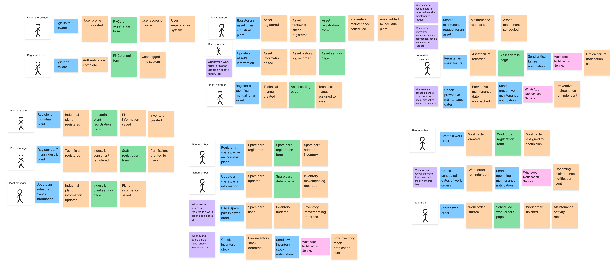<br>
</div>


<div align="center">
  <strong>6. Agregar reglas de negocio</strong><br><br>
  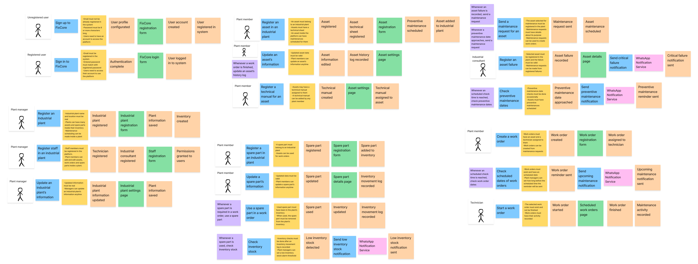<br>
</div>


<div align="center">
<strong>7. Agrupar reglas de negocio</strong><br><br>
  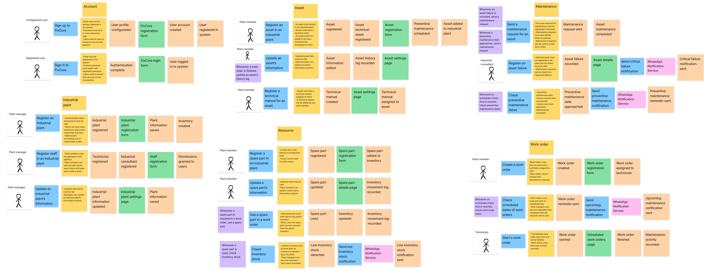<br>
  <em>Fuente: Elaboración propia.</em>
</div>

### 4.6.2. Software Architecture Context Diagram.

En esta sección se presenta el Diagrama de Contexto de FixCore, con el fin de mostrar el sistema desde una perspectiva general y su relación con los principales usuarios y sistemas externos. El diagrama permite identificar quiénes interactúan con FixCore y cuál es el propósito general de estas interacciones.Este diagrama muestra a FixCore como el sistema central para la gestión del mantenimiento industrial. El administrador de planta utiliza la plataforma para gestionar plantas, activos, actividades de mantenimiento y órdenes de trabajo.El tecnico la usa para reportar fallas, ejecutar ordenes y registrar actividades de mantenimiento,por ultimo qel Consultor Industrial coordina los servicios de mantenimiento y técnicos en las plantas. Además, FixCore se comunica con el Servicio de Notificaciones WhatsApp, un sistema externo encargado de enviar alertas y notificaciones importantes relacionadas con el mantenimiento.


<div align="center">
  <strong></strong><br><br>
  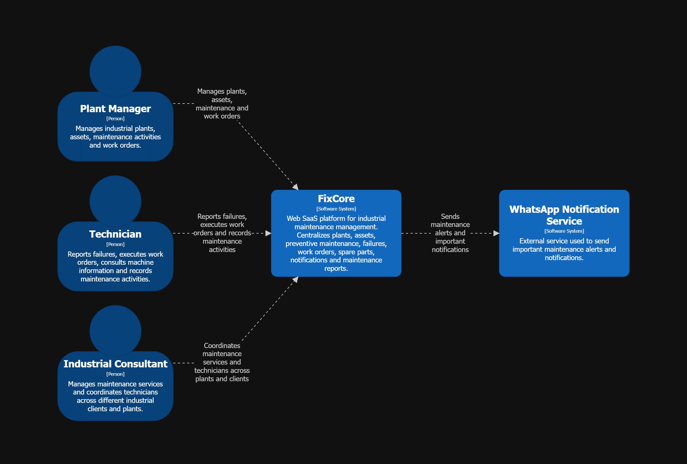<br>
  <em>Fuente: Elaboración propia.</em>
</div>

### 4.6.3. Software Architecture Container Diagrams.

En esta sección se presenta el Container Diagram de FixCore, elaborado bajo el C4 Model donde intentamos mostrar los elementos principales de la arquitectura y como se distribuyen las responsabilidades entre ellos. El diagrama incluye la Aplicación Web, API REST, servicios especializados y sus respectivas bases de datos,tambien incluimos el servicio externo de notificaciones.Por ultimo,en el diagrama indicamos las principales decisiones tecnológicas y las formas de comunicación entre los containers mediante HTTPS, REST y JSON. Cada container representa una unidad de despliegue independiente, permitiendo organizar las funcionalidades de FixCore de acuerdo con sus responsabilidades.

<div align="center">
  <strong></strong><br><br>
  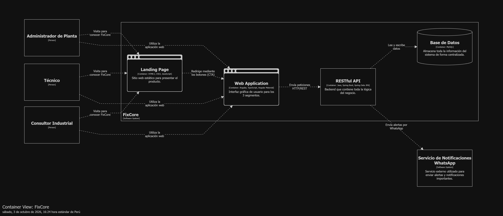<br>
  <em>Fuente: Elaboración propia.</em>
</div>

### 4.6.4. Software Architecture Components Diagrams.

Ahora presentamos los Diagramas de Componentes de FixCore, desarrollados a partir de los containers definidos apartado anterior. Estos diagramas permiten profundizar en la estructura interna de cada container, identificando sus principales componentes, responsabilidades, relaciones e implementación tecnológica,estos nos ayuda a obtener una vision más detallada de como se organiza cada parte de la plataforma y como es que sus componentes colaboran para cumplir con las funcionalidades definidas para FixCore.

* **1.Diagrama de Componentes – Aplicación Web**

Este diagrama muestra la estructura visual de la plataforma. Contiene los componentes responsables de la autenticación, gestión de plantas, activos, mantenimiento, inventario, reportes y notificaciones, los cuales envían las peticiones al backend.

<div align="center">
  <strong></strong><br><br>
  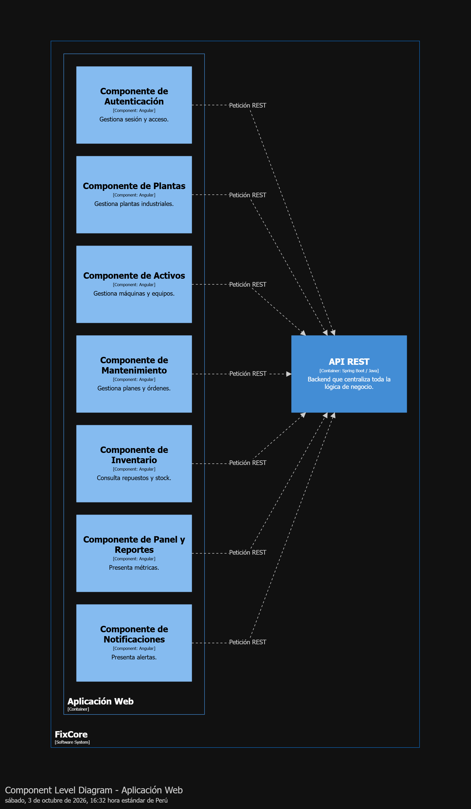<br>
  <em>Fuente: Elaboración propia.</em>
</div>


* **2.Diagrama de Componentes – API REST**

Este diagrama representa la capa principal de entrada del backend. Se muestran los controladores encargados de recibir las peticiones de la web, apoyados por el componente de seguridad y el manejador de errores.
<div align="center">
  <strong></strong><br><br>
  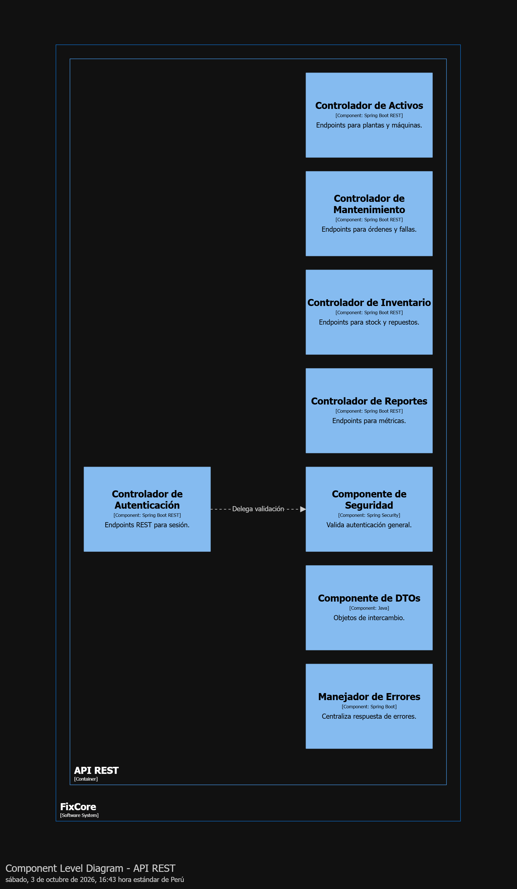<br>
  <em>Fuente: Elaboración propia.</em>
</div>

* **3.Diagrama de Componentes – Identidad y Acceso**

Este diagrama detalla los componentes internos encargados de la seguridad. Muestra cómo se gestionan las cuentas de usuarios, roles, sesiones activas y la validación de credenciales directamente con la base de datos.

<div align="center">
  <strong></strong><br><br>
  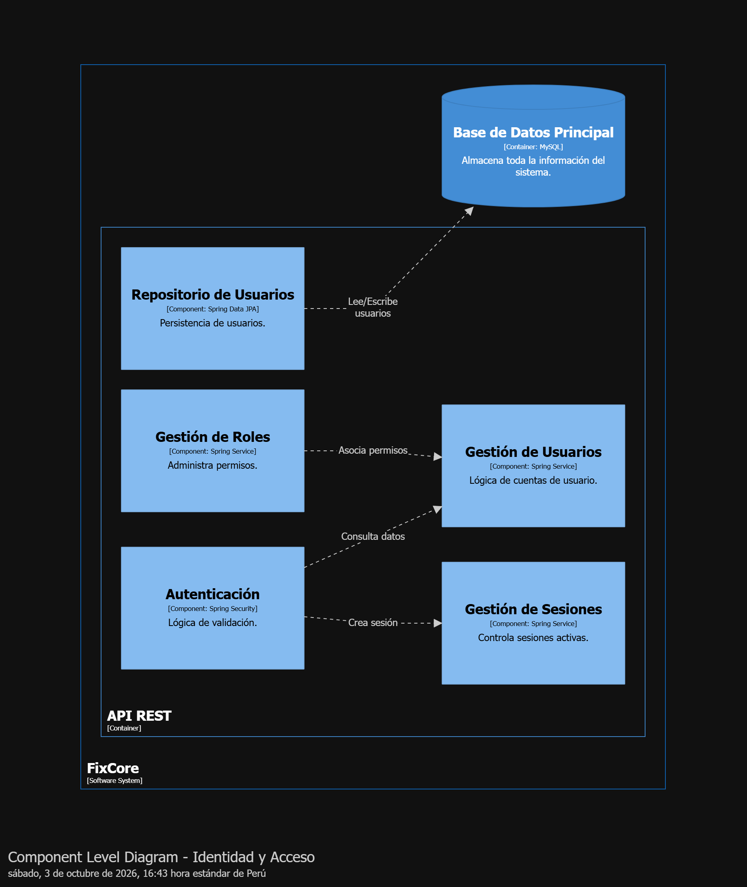<br>
  <em>Fuente: Elaboración propia.</em>
</div>


* **4.Diagrama de Componentes – Recursos y Activos**

Este diagrama presenta la lógica interna para la administración de las instalaciones. Incluye los componentes que gestionan las plantas industriales, las máquinas, las fichas técnicas y el historial de mantenimiento.

<div align="center">
  <strong></strong><br><br>
  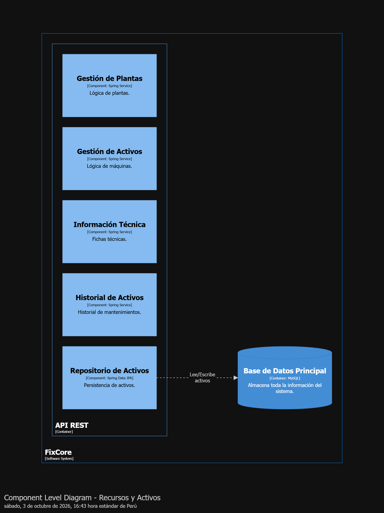<br>
  <em>Fuente: Elaboración propia.</em>
</div>

* **5.Diagrama de Componentes – Ejecución y Monitoreo**

Este diagrama describe el flujo de trabajo operativo diario. Presenta los componentes para el registro de fallas, creación de órdenes de trabajo, asignación de técnicos, registro de tareas y el envío de alertas por WhatsApp.

<div align="center">
  <strong></strong><br><br>
  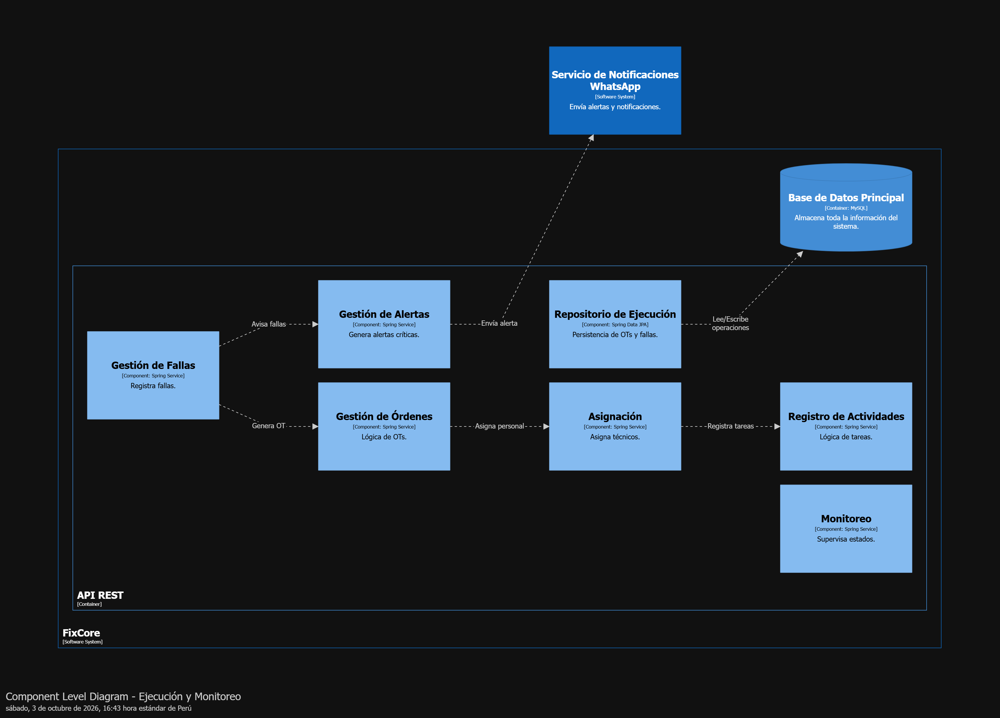<br>
  <em>Fuente: Elaboración propia.</em>
</div>

* **6.Diagrama de Componentes – Inventario y Repuestos**

Este diagrama muestra los componentes enfocados en el control del almacén. Incluye la administración del inventario, catálogo de repuestos, control de cantidades disponibles (stock), registro de movimientos y las alertas de escasez.

<div align="center">
  <strong></strong><br><br>
  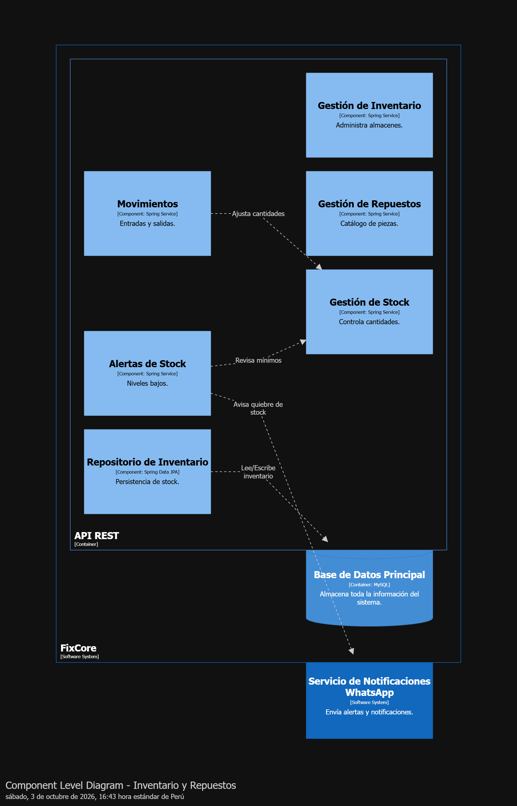<br>
  <em>Fuente: Elaboración propia.</em>
</div>


## 4.7. Software Object-Oriented Design.

En esta sección se presenta el diseño orientado a objetos de FixCore, detallando la estructura de sus principales elementos de software y su organización dentro de los bounded contexts que se definieron.

### 4.7.1. Class Diagrams.

Se presentan los diagramas de clases UML de cada bounded context, mostrando sus clases, interfaces, enumeraciones, atributos, métodos, visibilidad y relaciones, con el fin de representar con mayor detalle la estructura del sistema.

#### 4.7.1.1. Class Diagram – Identity & Access Management

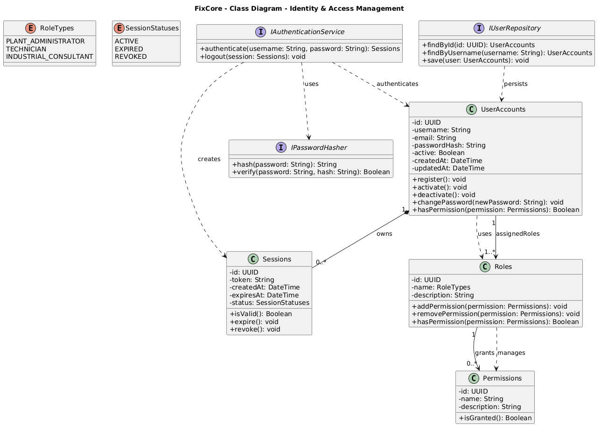

#### 4.7.1.2. Class Diagram – Resource & Asset Management

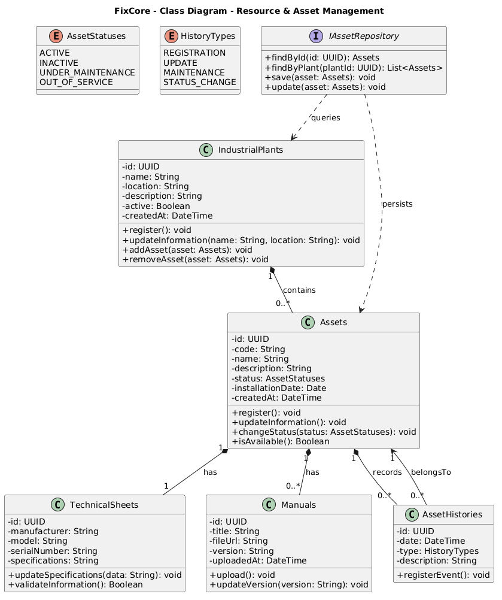
#### 4.7.1.3. Class Diagram – Service Design & Planning


#### 4.7.1.4. Class Diagram – Service Execution & Monitoring


#### 4.7.1.5. Class Diagram – Inventory & Spare Parts Management


## 4.8. Database Design.

En esta sección presentamos el diseño de las bases de datos de FixCore para cada Bounded Context, considerando la estructura necesaria para la persistencia de la información. Los diagramas muestran las principales tablas, columnas, claves primarias, claves foráneas, restricciones y relaciones entre las entidades de cada contexto.

### 4.8.1. Database Diagrams.

En este apartado mostramos los Database Diagrams correspondientes a cada Bounded Context, detallando las tablas y sus relaciones para representar como se almacenara y organizara la informacion de FixCore en una base de datos relacional.

#### 4.8.1.1. Database Diagram – Identity & Access Management

<div align="center">
  <strong></strong><br><br>
  
  <em>Fuente: Elaboración propia.</em>
</div>

#### 4.8.1.2. Database Diagram – Resource & Asset Management

<div align="center">
  <strong></strong><br><br>
  <br>
  <em>Fuente: Elaboración propia.</em>
</div>

#### 4.8.1.3. Database Diagram – Service Design & Planning

<div align="center">
  <strong></strong><br><br>
  <br>
  <em>Fuente: Elaboración propia.</em>
</div>

#### 4.8.1.4. Database Diagram – Service Execution & Monitoring

<div align="center">
  <strong></strong><br><br>
  <br>
  <em>Fuente: Elaboración propia.</em>
</div>

#### 4.8.1.5. Database Diagram – Inventory & Spare Parts Management

<div align="center">
  <strong></strong><br><br>
  <br>
  <em>Fuente: Elaboración propia.</em>
</div>


<div style="page-break-after: always;"></div>
