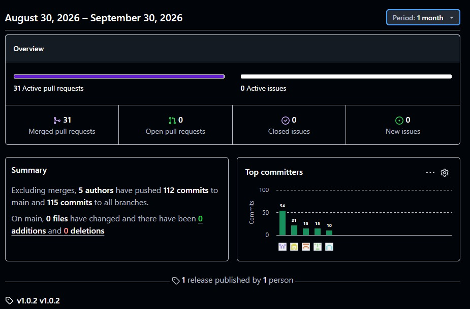
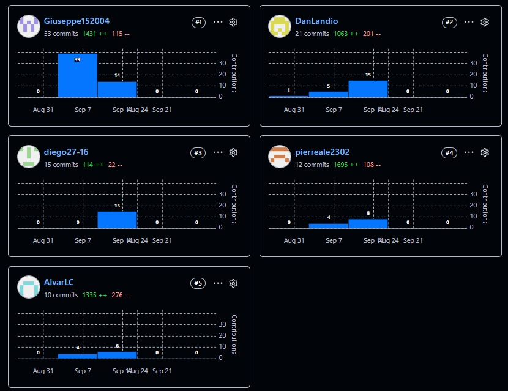

Universidad Peruana de Ciencias Aplicadas

Carrera de Ingenieria de Software

 

**1ASI0729**

**Desarrollo de Aplicaciones Open Source**

NRC

**16692**

**Informe de Trabajo Final**

Docente

**Ángel Augusto Velásquez Núñez**

 

Equipo

**TechMakers**

Proyecto

**FixCore**

**Integrantes**

| Código      | Apellidos y nombres                     |
|:------------|:----------------------------------------|
|u202324461   |Alvar Lucas Córdova                      |
|u202423973   |Sunio Danilo Landa Sánchez               |
|u20221c554   |Giuseppe Adrián Villanueva Rodríguez     |
|u20241E096   |Diego Rances Rojas Huaranga              |
|u202320973   |Pierre Alessandro Mendoza Boluarte       |

 

**Periodo 202620**

**Octubre 2026**

# Registro de Versiones del Informe

<table style="width: 100%; border-collapse: collapse;">
  <thead>
    <tr>
      <th style="border: 1px solid black; padding: 6px; text-align: center;">Versión</th>
      <th style="border: 1px solid black; padding: 6px; text-align: center;">Fecha</th>
      <th style="border: 1px solid black; padding: 6px;">Autor</th>
      <th style="border: 1px solid black; padding: 6px;">Descripción de modificación</th>
    </tr>
  </thead>
  <tbody>
    <tr>
      <td style="border: 1px solid black; text-align: center;">1</td>
      <td style="border: 1px solid black; text-align: center;">06/09/2026</td>
      <td style="border: 1px solid black;">Pierre Alessandro Mendoza Boluarte</td>
      <td style="border: 1px solid black;">Primera versión del informe: Redacción e incorporación del Capítulo I (Introducción, Antecedentes y Perfiles de Usuario).</td>
    </tr>
    <tr>
      <td style="border: 1px solid black; text-align: center;">2</td>
      <td style="border: 1px solid black; text-align: center;">06/09/2026</td>
      <td style="border: 1px solid black;">Giuseppe Adrián Villanueva Rodríguez</td>
      <td style="border: 1px solid black;">Adición del análisis de competidores directos e indirectos, tácticas competitivas y definición del lenguaje ubicuo.</td>
    </tr>
    <tr>
      <td style="border: 1px solid black; text-align: center;">3</td>
      <td style="border: 1px solid black; text-align: center;">09/09/2026</td>
      <td style="border: 1px solid black;">Pierre Alessandro Mendoza Boluarte</td>
      <td style="border: 1px solid black;">Registro y documentación de las entrevistas estructuradas correspondientes a cada segmento objetivo en el Capítulo II.</td>
    </tr>
    <tr>
      <td style="border: 1px solid black; text-align: center;">4</td>
      <td style="border: 1px solid black; text-align: center;">09/09/2026</td>
      <td style="border: 1px solid black;">Giuseppe Adrián Villanueva Rodríguez</td>
      <td style="border: 1px solid black;">Inclusión de especificaciones de diseño: estados de componentes web y catálogo de elementos de formulario.</td>
    </tr>
    <tr>
      <td style="border: 1px solid black; text-align: center;">5</td>
      <td style="border: 1px solid black; text-align: center;">12/09/2026</td>
      <td style="border: 1px solid black;">Giuseppe Adrián Villanueva Rodríguez</td>
      <td style="border: 1px solid black;">Definición de la arquitectura de información del sitio web y especificación de etiquetas SEO y meta tags.</td>
    </tr>
    <tr>
      <td style="border: 1px solid black; text-align: center;">6</td>
      <td style="border: 1px solid black; text-align: center;">15/09/2026</td>
      <td style="border: 1px solid black;">Diego Rances Rojas Huaranga</td>
      <td style="border: 1px solid black;">Diseño y documentación de los wireframes iniciales de baja fidelidad para la aplicación web.</td>
    </tr>
    <tr>
      <td style="border: 1px solid black; text-align: center;">7</td>
      <td style="border: 1px solid black; text-align: center;">16/09/2026</td>
      <td style="border: 1px solid black;">Sunio Danilo Landa Sánchez</td>
      <td style="border: 1px solid black;">Incorporación de tablas descriptivas de los miembros del equipo y estructura de la matriz de Student Outcomes.</td>
    </tr>
    <tr>
      <td style="border: 1px solid black; text-align: center;">8</td>
      <td style="border: 1px solid black; text-align: center;">16/09/2026</td>
      <td style="border: 1px solid black;">Alvar Lucas Córdova</td>
      <td style="border: 1px solid black;">Desarrollo del Impact Mapping y definición detallada de User Personas para los segmentos definidos.</td>
    </tr>
    <tr>
      <td style="border: 1px solid black; text-align: center;">9</td>
      <td style="border: 1px solid black; text-align: center;">16/09/2026</td>
      <td style="border: 1px solid black;">Sunio Danilo Landa Sánchez</td>
      <td style="border: 1px solid black;">Documentación de procesos clave del dominio mediante la técnica de Big Picture EventStorming.</td>
    </tr>
    <tr>
      <td style="border: 1px solid black; text-align: center;">10</td>
      <td style="border: 1px solid black; text-align: center;">16/09/2026</td>
      <td style="border: 1px solid black;">Giuseppe Adrián Villanueva Rodríguez</td>
      <td style="border: 1px solid black;">Diseño y documentación de wireframes y mockups de alta fidelidad para la Landing Page.</td>
    </tr>
    <tr>
      <td style="border: 1px solid black; text-align: center;">11</td>
      <td style="border: 1px solid black; text-align: center;">17/09/2026</td>
      <td style="border: 1px solid black;">Pierre Alessandro Mendoza Boluarte</td>
      <td style="border: 1px solid black;">Elaboración e inclusión de diagramas de arquitectura de software:C4 Model , clases y modelo de base de datos.</td>
    </tr>
    <tr>
      <td style="border: 1px solid black; text-align: center;">12</td>
      <td style="border: 1px solid black; text-align: center;">18/09/2026</td>
      <td style="border: 1px solid black;">Sunio Danilo Landa Sánchez</td>
      <td style="border: 1px solid black;">Refinamiento de historias de usuario con criterios de aceptación y actualización del tablero de Product Backlog en Trello.</td>
    </tr>
    <tr>
      <td style="border: 1px solid black; text-align: center;">13</td>
      <td style="border: 1px solid black; text-align: center;">18/09/2026</td>
      <td style="border: 1px solid black;">Giuseppe Adrián Villanueva Rodríguez</td>
      <td style="border: 1px solid black;">Redacción de conclusiones y recomendaciones correspondientes a la primera entrega del proyecto.</td>
    </tr>
    <tr>
      <td style="border: 1px solid black; text-align: center;">14</td>
      <td style="border: 1px solid black; text-align: center;">19/09/2026</td>
      <td style="border: 1px solid black;">Pierre Alessandro Mendoza Boluarte</td>
      <td style="border: 1px solid black;">Documentación de artefactos de desarrollo del Capítulo V correspondientes al Sprint 1.</td>
    </tr>
    <tr>
      <td style="border: 1px solid black; text-align: center;">15</td>
      <td style="border: 1px solid black; text-align: center;">19/09/2026</td>
      <td style="border: 1px solid black;">Diego Rances Rojas Huaranga</td>
      <td style="border: 1px solid black;">Versión inicial de flujos de usuario  detallando las rutas de navegación por cada rol dentro de la aplicación.</td>
    </tr>
    <tr>
      <td style="border: 1px solid black; text-align: center;">16</td>
      <td style="border: 1px solid black; text-align: center;">19/09/2026</td>
      <td style="border: 1px solid black;">Alvar Lucas Córdova</td>
      <td style="border: 1px solid black;">Consolidación de anexos, enlaces de grabación de entrevistas y corrección general de consistencia para el cierre del Sprint 1.</td>
    </tr>
    <tr>
      <td style="border: 1px solid black; text-align: center;">17</td>
      <td style="border: 1px solid black; text-align: center;">30/09/2026</td>
      <td style="border: 1px solid black;">Pierre Alessandro Mendoza Boluarte</td>
      <td style="border: 1px solid black;">Actualización del código fuente en PlantUML de los diagramas de clases, base de datos y modelo C4 para mejorar su trazabilidad.</td>
    </tr>
    <tr>
      <td style="border: 1px solid black; text-align: center;">18</td>
      <td style="border: 1px solid black; text-align: center;">01/10/2026</td>
      <td style="border: 1px solid black;">Pierre Alessandro Mendoza Boluarte</td>
      <td style="border: 1px solid black;">Incorporación de evidencias de despliegue y desarrollo correspondientes a la Landing Page en el Capítulo V.</td>
    </tr>
    <tr>
      <td style="border: 1px solid black; text-align: center;">19</td>
      <td style="border: 1px solid black; text-align: center;">02/10/2026</td>
      <td style="border: 1px solid black;">Sunio Danilo Landa Sánchez</td>
      <td style="border: 1px solid black;">Inclusión de evidencias de trabajo en equipo y redacción de la sección Project Report Collaboration Insights.</td>
    </tr>
    <tr>
      <td style="border: 1px solid black; text-align: center;">20</td>
      <td style="border: 1px solid black; text-align: center;">03/10/2026</td>
      <td style="border: 1px solid black;">Pierre Alessandro Mendoza Boluarte</td>
      <td style="border: 1px solid black;">Ajuste de convenciones de nombrado y relaciones en los diagramas de arquitectura de software.</td>
    </tr>
    <tr>
      <td style="border: 1px solid black; text-align: center;">21</td>
      <td style="border: 1px solid black; text-align: center;">05/10/2026</td>
      <td style="border: 1px solid black;">Diego Rances Rojas Huaranga</td>
      <td style="border: 1px solid black;">Mejora de la guía de entrevistas incorporando preguntas técnicas orientadas a la adopción de herramientas digitales.</td>
    </tr>
    <tr>
      <td style="border: 1px solid black; text-align: center;">22</td>
      <td style="border: 1px solid black; text-align: center;">06/10/2026</td>
      <td style="border: 1px solid black;">Sunio Danilo Landa Sánchez</td>
      <td style="border: 1px solid black;">Actualización de diagramas y documentación del Design-Level EventStorming alineado a los alcanzes del profesor.</td>
    </tr>
    <tr>
      <td style="border: 1px solid black; text-align: center;">23</td>
      <td style="border: 1px solid black; text-align: center;">07/10/2026</td>
      <td style="border: 1px solid black;">Alvar Lucas Córdova</td>
      <td style="border: 1px solid black;">Corrección de observaciones del docente en la sección de Needfinding y reordenamiento de la numeración de figuras del Capítulo II.</td>
    </tr>
    <tr>
      <td style="border: 1px solid black; text-align: center;">24</td>
      <td style="border: 1px solid black; text-align: center;">07/10/2026</td>
      <td style="border: 1px solid black;">Alvar Lucas Córdova</td>
      <td style="border: 1px solid black;">Revisión y corrección de la documentación de evidencias de ejecución y servicios del Sprint 1.</td>
    </tr>
    <tr>
      <td style="border: 1px solid black; text-align: center;">25</td>
      <td style="border: 1px solid black; text-align: center;">08/10/2026</td>
      <td style="border: 1px solid black;">Alvar Lucas Córdova</td>
      <td style="border: 1px solid black;">Planificación del Sprint 2 y redacción del backlog técnico de componentes para el frontend.</td>
    </tr>
    <tr>
      <td style="border: 1px solid black; text-align: center;">26</td>
      <td style="border: 1px solid black; text-align: center;">08/10/2026</td>
      <td style="border: 1px solid black;">Sunio Danilo Landa Sánchez</td>
      <td style="border: 1px solid black;">Inclusión de wireframes de escritorio y nueva sección de prototipado para la aplicación web.</td>
    </tr>
    <tr>
      <td style="border: 1px solid black; text-align: center;">27</td>
      <td style="border: 1px solid black; text-align: center;">08/10/2026</td>
      <td style="border: 1px solid black;">Sunio Danilo Landa Sánchez</td>
      <td style="border: 1px solid black;">Refactorización y reemplazo de los wireflows y flujos de usuario  por una nueva versión ajustada a la retroalimentación de diseño.</td>
    </tr>
    <tr>
      <td style="border: 1px solid black; text-align: center;">28</td>
      <td style="border: 1px solid black; text-align: center;">08/10/2026</td>
      <td style="border: 1px solid black;">Pierre Alessandro Mendoza Boluarte</td>
      <td style="border: 1px solid black;">Refinamiento de redacción en el Sprint 2 Backlog y actualización del registro de versiones del informe.</td>
    </tr>
  </tbody>
</table>

# Project Report Collaboration Insights

Enlace al repositorio del Project Report: [Repositorio Report TechMakers](https://github.com/TechMakers-upc/Report)

**Avance 1**

Para el desarrollo de las actividades del informe, nuestro equipo subió cada avance realizado mediante commits en el repositorio del informe en GitHub. Para la gran mayoría de cambios se siguieron las convenciones dictadas por GitFlow y Conventional Commits, esto mediante la creación de ramas Feature en el repositorio que abarquen distintos aspectos del informe y mediante la redacción de mensajes de commits que especifiquen de forma breve cada cambio. En esta primera entrega varios avances se enfocaron en la elaboración del archivo Markdown principal, además de la agregación de imágenes de apoyo como fotos, diagramas, evidencias o diseños de acuerdo con lo que se abarca en cada capítulo.

A continuación se presenta la pestaña Pulse elaborada por GitHub, donde se muestra el número de pull requests, commits y autores del repositorio. Esta captura abarca datos desde el 30 de agosto hasta el 30 de setiembre.

Seguidamente se presenta la pestaña Contributors, donde se muestran los números de commits de cada integrante del equipo. Esta captura abarca datos desde el inicio del proyecto hasta la finalización del primer avance.

|Integrante|Nombre de usuario en GitHub|
|:---------|:--------------------------|
| Rojas Huaranga, Diego Rances | diego27-16 |
| Mendoza Boluarte, Pierre Alessandro | pierreale2302 |
| Córdova, Alvar Lucas | AlvarLC |
| Landa Sánchez, Sunio Danilo | DanLandio |
| Villanueva Rodríguez, Giuseppe Adrián | Giuseppe152004 |

# Contenido

## Tabla de contenidos

- [Registro de Versiones del Informe](#registro-de-versiones-del-informe)
- [Project Report Collaboration Insights](#project-report-collaboration-insights)
- [Contenido](#contenido)
  - [Tabla de contenidos](#tabla-de-contenidos)
- [Student Outcome](#student-outcome)
- [Capítulo I: Introduction](../10-capitulo-1-introduccion.md#capítulo-i-introduction)
  - [1.1. Startup Profile](../10-capitulo-1-introduccion.md#11-startup-profile)
    - [1.1.1. Descripción de la Startup](../10-capitulo-1-introduccion.md#111-descripción-de-la-startup)
    - [1.1.2. Perfiles de integrantes del equipo](../10-capitulo-1-introduccion.md#112-perfiles-de-integrantes-del-equipo)
  - [1.2. Solution Profile](../10-capitulo-1-introduccion.md#12-solution-profile)
    - [1.2.1 Antecedentes y problemática](../10-capitulo-1-introduccion.md#121-antecedentes-y-problemática)
    - [1.2.2 Lean UX Process.](../10-capitulo-1-introduccion.md#122-lean-ux-process)
      - [1.2.2.1. Lean UX Problem Statements](../10-capitulo-1-introduccion.md#1221-lean-ux-problem-statements)
      - [1.2.2.2. Lean UX Assumptions](../10-capitulo-1-introduccion.md#1222-lean-ux-assumptions)
      - [1.2.2.3. Lean UX Hypothesis Statements](../10-capitulo-1-introduccion.md#1223-lean-ux-hypothesis-statements)
      - [1.2.2.4. Lean UX Canvas](../10-capitulo-1-introduccion.md#1224-lean-ux-canvas)
  - [1.3. Segmentos objetivo](../10-capitulo-1-introduccion.md#13-segmentos-objetivo)
- [Capítulo II: Requirements Elicitation \& Analysis](../20-capitulo-2-requirements-elicitation.md#capítulo-ii-requirements-elicitation--analysis)
  - [2.1. Competidores.](../20-capitulo-2-requirements-elicitation.md#21-competidores)
    - [2.1.1. Análisis competitivo.](../20-capitulo-2-requirements-elicitation.md#211-análisis-competitivo)
    - [2.1.2. Estrategias y tácticas frente a competidores.](../20-capitulo-2-requirements-elicitation.md#212-estrategias-y-tácticas-frente-a-competidores)
  - [2.2. Entrevistas.](../20-capitulo-2-requirements-elicitation.md#22-entrevistas)
    - [2.2.1. Diseño de entrevistas.](../20-capitulo-2-requirements-elicitation.md#221-diseño-de-entrevistas)
    - [2.2.2. Registro de entrevistas](../20-capitulo-2-requirements-elicitation.md#222-registro-de-entrevistas)
    - [2.2.3. Análisis de entrevistas](../20-capitulo-2-requirements-elicitation.md#223-análisis-de-entrevistas)
      - [Principales hallazgos generales](../20-capitulo-2-requirements-elicitation.md#principales-hallazgos-generales)
  - [2.3. Needfinding.](../20-capitulo-2-requirements-elicitation.md#23-needfinding)
    - [2.3.1. User Personas.](../20-capitulo-2-requirements-elicitation.md#231-user-personas)
    - [2.3.2. User Task Matrix.](../20-capitulo-2-requirements-elicitation.md#232-user-task-matrix)
    - [2.3.3. User Journey Mapping.](../20-capitulo-2-requirements-elicitation.md#233-user-journey-mapping)
    - [2.3.4. Empathy Mapping.](../20-capitulo-2-requirements-elicitation.md#234-empathy-mapping)
    - [2.3.5. As-Is Scenario Mapping.](../20-capitulo-2-requirements-elicitation.md#235-as-is-scenario-mapping)
  - [2.4. Big Picture EventStorming.](../20-capitulo-2-requirements-elicitation.md#24-big-picture-eventstorming)
  - [2.5. Ubiquitous Language.](../20-capitulo-2-requirements-elicitation.md#25-ubiquitous-language)
- [Capítulo III: Requirements Specification](../30-capitulo-3-requirements-specification.md#capítulo-iii-requirements-specification)
  - [3.1. User Stories.](../30-capitulo-3-requirements-specification.md#31-user-stories)
  - [3.2. Impact Mapping.](../30-capitulo-3-requirements-specification.md#32-impact-mapping)
  - [3.3. Product Backlog.](../30-capitulo-3-requirements-specification.md#33-product-backlog)
- [Capítulo IV: Product Design](../40-capitulo-4-product-design.md#capítulo-iv-product-design)
  - [4.1. Style Guidelines.](../40-capitulo-4-product-design.md#41-style-guidelines)
    - [4.1.1. General Style Guidelines.](../40-capitulo-4-product-design.md#411-general-style-guidelines)
      - [4.1.1.1 Branding](../40-capitulo-4-product-design.md#4111-branding)
      - [4.1.1.2. Typography](../40-capitulo-4-product-design.md#4112-typography)
      - [4.1.1.3. Color Palette](../40-capitulo-4-product-design.md#4113-color-palette)
      - [4.1.1.4. Spacing System](../40-capitulo-4-product-design.md#4114-spacing-system)
    - [4.1.2. Web Style Guidelines.](../40-capitulo-4-product-design.md#412-web-style-guidelines)
      - [4.1.2.1. Responsive Design Principles](../40-capitulo-4-product-design.md#4121-responsive-design-principles)
      - [4.1.2.2. Web Component States](../40-capitulo-4-product-design.md#4122-web-component-states)
      - [4.1.2.3. Form Elements](../40-capitulo-4-product-design.md#4123-form-elements)
      - [4.1.2.4. Navigation Patterns](../40-capitulo-4-product-design.md#4124-navigation-patterns)
      - [4.1.2.5. Accessibility Guidelines](../40-capitulo-4-product-design.md#4125-accessibility-guidelines)
      - [4.1.2.6. Animation Guidelines](../40-capitulo-4-product-design.md#4126-animation-guidelines)
  - [4.2. Information Architecture.](../40-capitulo-4-product-design.md#42-information-architecture)
    - [4.2.1. Organization Systems.](../40-capitulo-4-product-design.md#421-organization-systems)
      - [4.2.1.1. Organización del Landing Page](../40-capitulo-4-product-design.md#4211-organización-del-landing-page)
      - [4.2.1.2. Organización de la Aplicación Web (Dashboard y Área Principal)](../40-capitulo-4-product-design.md#4212-organización-de-la-aplicación-web-dashboard-y-área-principal)
      - [4.2.1.3. Estrategia de Organización para Búsqueda y Acceso Rápido](../40-capitulo-4-product-design.md#4213-estrategia-de-organización-para-búsqueda-y-acceso-rápido)
    - [4.2.2. Labeling Systems.](../40-capitulo-4-product-design.md#422-labeling-systems)
      - [4.2.2.1. Principios de Etiquetado](../40-capitulo-4-product-design.md#4221-principios-de-etiquetado)
      - [4.2.2.2. Etiquetas de Navegación Principal](../40-capitulo-4-product-design.md#4222-etiquetas-de-navegación-principal)
      - [4.2.2.3. Etiquetas de Mantenimiento y Activos](../40-capitulo-4-product-design.md#4223-etiquetas-de-mantenimiento-y-activos)
      - [4.2.2.4. Etiquetas de Inventario](../40-capitulo-4-product-design.md#4224-etiquetas-de-inventario)
      - [4.2.2.5. Etiquetas de Acciones de Usuario](../40-capitulo-4-product-design.md#4225-etiquetas-de-acciones-de-usuario)
      - [4.2.2.6. Reglas de Asociación entre Etiquetas](../40-capitulo-4-product-design.md#4226-reglas-de-asociación-entre-etiquetas)
    - [4.2.3. SEO Tags and Meta Tags](../40-capitulo-4-product-design.md#423-seo-tags-and-meta-tags)
      - [4.2.3.1. Configuración SEO General](../40-capitulo-4-product-design.md#4231-configuración-seo-general)
      - [4.2.3.2. Landing Page SEO Tags](../40-capitulo-4-product-design.md#4232-landing-page-seo-tags)
      - [4.2.3.3. Web Application - Dashboard SEO Tags](../40-capitulo-4-product-design.md#4233-web-application---dashboard-seo-tags)
      - [4.2.3.4. Página de Detalles por Rol SEO Tags](../40-capitulo-4-product-design.md#4234-página-de-detalles-por-rol-seo-tags)
      - [4.2.3.5. Página de Gestión de Activos / Inventario SEO Tags](../40-capitulo-4-product-design.md#4235-página-de-gestión-de-activos--inventario-seo-tags)
      - [4.2.3.6. Página de Perfil de Activo Individual SEO Tags](../40-capitulo-4-product-design.md#4236-página-de-perfil-de-activo-individual-seo-tags)
      - [4.2.3.7. Página de Reporte de Fallas (OTs) SEO Tags](../40-capitulo-4-product-design.md#4237-página-de-reporte-de-fallas-ots-seo-tags)
    - [4.2.3.8. Estructura de Datos Schema Markup](../40-capitulo-4-product-design.md#4238-estructura-de-datos-schema-markup)
    - [4.2.3.9. Directrices SEO Generales](../40-capitulo-4-product-design.md#4239-directrices-seo-generales)
    - [4.2.4. Searching Systems.](../40-capitulo-4-product-design.md#424-searching-systems)
      - [4.2.4.1. Sistema de Búsqueda General](../40-capitulo-4-product-design.md#4241-sistema-de-búsqueda-general)
      - [4.2.4.2. Sistema de Búsqueda de Órdenes de Trabajo (OTs) y Fallas](../40-capitulo-4-product-design.md#4242-sistema-de-búsqueda-de-órdenes-de-trabajo-ots-y-fallas)
      - [4.2.4.3. Sistema de Búsqueda en Inventario y Gestión de Activos](../40-capitulo-4-product-design.md#4243-sistema-de-búsqueda-en-inventario-y-gestión-de-activos)
      - [4.2.4.4. Sistema de Búsqueda en Historial y Auditoría](../40-capitulo-4-product-design.md#4244-sistema-de-búsqueda-en-historial-y-auditoría)
    - [4.2.5. Navigation Systems.](../40-capitulo-4-product-design.md#425-navigation-systems)
      - [4.2.5.1. Sistema de Navegación Global](../40-capitulo-4-product-design.md#4251-sistema-de-navegación-global)
      - [4.2.5.2. Navegación del Landing Page](../40-capitulo-4-product-design.md#4252-navegación-del-landing-page)
      - [4.2.5.3. Navegación de la Aplicación Web](../40-capitulo-4-product-design.md#4253-navegación-de-la-aplicación-web)
      - [4.2.5.4. Sistema de Breadcrumbs](../40-capitulo-4-product-design.md#4254-sistema-de-breadcrumbs)
      - [4.2.5.5. Navegación Mobile](../40-capitulo-4-product-design.md#4255-navegación-mobile)
      - [4.2.5.6. Navegación Operativa (Flujo de Trabajo)](../40-capitulo-4-product-design.md#4256-navegación-operativa-flujo-de-trabajo)
      - [4.2.5.7. Accesibilidad en Navegación](../40-capitulo-4-product-design.md#4257-accesibilidad-en-navegación)
      - [4.2.5.8. Feedback de Navegación](../40-capitulo-4-product-design.md#4258-feedback-de-navegación)
  - [4.3. Landing Page UI Design.](../40-capitulo-4-product-design.md#43-landing-page-ui-design)
    - [4.3.1. Landing Page Wireframe.](../40-capitulo-4-product-design.md#431-landing-page-wireframe)
      - [4.3.1.1. Introducción al Wireframe del Landing Page](../40-capitulo-4-product-design.md#4311-introducción-al-wireframe-del-landing-page)
      - [4.3.1.2. Wireframe Desktop](../40-capitulo-4-product-design.md#4312-wireframe-desktop)
      - [4.3.1.3. Wireframe Mobile](../40-capitulo-4-product-design.md#4313-wireframe-mobile)
      - [4.3.1.1. Introducción al Wireframe del Landing Page](../40-capitulo-4-product-design.md#4311-introducción-al-wireframe-del-landing-page-1)
      - [4.3.1.4. Regiones del wireframe y su Función](../40-capitulo-4-product-design.md#4314-regiones-del-wireframe-y-su-función)
      - [4.3.1.5. Principios de Diseño Aplicados en los Wireframes](../40-capitulo-4-product-design.md#4315-principios-de-diseño-aplicados-en-los-wireframes)
    - [4.3.2. Landing Page Mock-up.](../40-capitulo-4-product-design.md#432-landing-page-mock-up)
      - [4.3.2.1. Introducción al Mock-up](../40-capitulo-4-product-design.md#4321-introducción-al-mock-up)
      - [4.3.2.2. Mock-up Desktop](../40-capitulo-4-product-design.md#4322-mock-up-desktop)
      - [4.3.2.3. Mock-up Mobile](../40-capitulo-4-product-design.md#4323-mock-up-mobile)
      - [4.3.2.4. Vistas Detalladas por Sección](../40-capitulo-4-product-design.md#4324-vistas-detalladas-por-sección)
      - [4.3.2.5. Aplicación del Design System y Accesibilidad](../40-capitulo-4-product-design.md#4325-aplicación-del-design-system-y-accesibilidad)
      - [4.3.2.6. Referencias Visuales](../40-capitulo-4-product-design.md#4326-referencias-visuales)
      - [4.3.2.7. Estados Interactivos en el Mock-up](../40-capitulo-4-product-design.md#4327-estados-interactivos-en-el-mock-up)
      - [4.3.2.8. Diseño Responsivo General](../40-capitulo-4-product-design.md#4328-diseño-responsivo-general)
  - [4.4. Web Applications UX/UI Design.](../40-capitulo-4-product-design.md#44-web-applications-uxui-design)
    - [4.4.1. Web Applications Wireframes.](../40-capitulo-4-product-design.md#441-web-applications-wireframes)
    - [4.4.2. Web Applications Wireflow Diagrams.](../40-capitulo-4-product-design.md#442-web-applications-wireflow-diagrams)
      - [4.4.2.1. Wireflow 01 — Jefe de Planta registra su cuenta y maquinas.](../40-capitulo-4-product-design.md#4421-wireflow-01--jefe-de-planta-registra-su-cuenta-y-maquinas)
      - [4.4.2.2. Wireflow 02 — Técnico accede a la informacion de maquinas.](../40-capitulo-4-product-design.md#4422-wireflow-02--técnico-accede-a-la-informacion-de-maquinas)
      - [4.4.2.3. Wireflow 03 — Gerente de Operaciones crea una orden de trabajo](../40-capitulo-4-product-design.md#4423-wireflow-03--gerente-de-operaciones-crea-una-orden-de-trabajo)
      - [4.4.2.4. Wireflow 04 — Integrante de una planta reporta una falla](../40-capitulo-4-product-design.md#4424-wireflow-04--integrante-de-una-planta-reporta-una-falla)
    - [4.4.3. Web Applications Mock-ups.](../40-capitulo-4-product-design.md#443-web-applications-mock-ups)
    - [4.4.4. Web Applications User Flow Diagrams.](../40-capitulo-4-product-design.md#444-web-applications-user-flow-diagrams)
      - [4.4.4.1. Userflow 01 — Jefe de Planta registra su cuenta y maquinas.](../40-capitulo-4-product-design.md#4441-userflow-01--jefe-de-planta-registra-su-cuenta-y-maquinas)
      - [4.4.4.2. Userflow 02 — Técnico accede a la informacion de maquinas.](../40-capitulo-4-product-design.md#4442-userflow-02--técnico-accede-a-la-informacion-de-maquinas)
      - [4.4.4.3. Userflow 03 — Gerente de Operaciones crea una orden de trabajo](../40-capitulo-4-product-design.md#4443-userflow-03--gerente-de-operaciones-crea-una-orden-de-trabajo)
      - [4.4.4.4. Userflow 04 — Integrante de una planta reporta una falla](../40-capitulo-4-product-design.md#4444-userflow-04--integrante-de-una-planta-reporta-una-falla)
  - [4.5. Web Applications Prototyping.](../40-capitulo-4-product-design.md#45-web-applications-prototyping)
  - [4.6. Domain-Driven Software Architecture.](../40-capitulo-4-product-design.md#46-domain-driven-software-architecture)
    - [4.6.1. Design-Level EventStorming.](../40-capitulo-4-product-design.md#461-design-level-eventstorming)
    - [4.6.2. Software Architecture Context Diagram.](../40-capitulo-4-product-design.md#462-software-architecture-context-diagram)
    - [4.6.3. Software Architecture Container Diagrams.](../40-capitulo-4-product-design.md#463-software-architecture-container-diagrams)
    - [4.6.4. Software Architecture Components Diagrams.](../40-capitulo-4-product-design.md#464-software-architecture-components-diagrams)
  - [4.7. Software Object-Oriented Design.](../40-capitulo-4-product-design.md#47-software-object-oriented-design)
    - [4.7.1. Class Diagrams.](../40-capitulo-4-product-design.md#471-class-diagrams)
      - [4.7.1.1. Class Diagram – Identity \& Access Management](../40-capitulo-4-product-design.md#4711-class-diagram--identity--access-management)
      - [4.7.1.2. Class Diagram – Resource \& Asset Management](../40-capitulo-4-product-design.md#4712-class-diagram--resource--asset-management)
      - [4.7.1.3. Class Diagram – Service Design \& Planning](../40-capitulo-4-product-design.md#4713-class-diagram--service-design--planning)
      - [4.7.1.4. Class Diagram – Service Execution \& Monitoring](../40-capitulo-4-product-design.md#4714-class-diagram--service-execution--monitoring)
      - [4.7.1.5. Class Diagram – Inventory \& Spare Parts Management](../40-capitulo-4-product-design.md#4715-class-diagram--inventory--spare-parts-management)
  - [4.8. Database Design.](../40-capitulo-4-product-design.md#48-database-design)
    - [4.8.1. Database Diagrams.](../40-capitulo-4-product-design.md#481-database-diagrams)
      - [4.8.1.1. Database Diagram – Identity \& Access Management](../40-capitulo-4-product-design.md#4811-database-diagram--identity--access-management)
      - [4.8.1.2. Database Diagram – Resource \& Asset Management](../40-capitulo-4-product-design.md#4812-database-diagram--resource--asset-management)
      - [4.8.1.3. Database Diagram – Service Design \& Planning](../40-capitulo-4-product-design.md#4813-database-diagram--service-design--planning)
      - [4.8.1.4. Database Diagram – Service Execution \& Monitoring](../40-capitulo-4-product-design.md#4814-database-diagram--service-execution--monitoring)
      - [4.8.1.5. Database Diagram – Inventory \& Spare Parts Management](../40-capitulo-4-product-design.md#4815-database-diagram--inventory--spare-parts-management)
- [Capítulo V: Product Implementation, Validation \& Deployment](../50-capitulo-5-product-implementation.md#capítulo-v-product-implementation-validation--deployment)
  - [5.1. Software Configuration Management.](../50-capitulo-5-product-implementation.md#51-software-configuration-management)
    - [5.1.1. Software Development Environment Configuration.](../50-capitulo-5-product-implementation.md#511-software-development-environment-configuration)
    - [5.1.2. Source Code Management.](../50-capitulo-5-product-implementation.md#512-source-code-management)
    - [5.1.3. Source Code Style Guide \& Conventions.](../50-capitulo-5-product-implementation.md#513-source-code-style-guide--conventions)
    - [5.1.4. Software Deployment Configuration.](../50-capitulo-5-product-implementation.md#514-software-deployment-configuration)
  - [5.2. Landing Page, Services \& Applications Implementation.](../50-capitulo-5-product-implementation.md#52-landing-page-services--applications-implementation)
    - [5.2.1. Sprint 1](../50-capitulo-5-product-implementation.md#521-sprint-1)
      - [5.2.1.1. Sprint Planning 1.](../50-capitulo-5-product-implementation.md#5211-sprint-planning-1)
      - [5.2.1.2. Aspect Leaders and Collaborators.](../50-capitulo-5-product-implementation.md#5212-aspect-leaders-and-collaborators)
      - [5.2.1.3. Sprint Backlog 1.](../50-capitulo-5-product-implementation.md#5213-sprint-backlog-1)
      - [5.2.1.4. Development Evidence for Sprint Review.](../50-capitulo-5-product-implementation.md#5214-development-evidence-for-sprint-review)
      - [5.2.1.5. Execution Evidence for Sprint Review.](../50-capitulo-5-product-implementation.md#5215-execution-evidence-for-sprint-review)
      - [5.2.1.6. Services Documentation Evidence for Sprint Review.](../50-capitulo-5-product-implementation.md#5216-services-documentation-evidence-for-sprint-review)
      - [5.2.1.7. Software Deployment Evidence for Sprint Review.](../50-capitulo-5-product-implementation.md#5217-software-deployment-evidence-for-sprint-review)
      - [5.2.1.8. Team Collaboration Insights during Sprint.](../50-capitulo-5-product-implementation.md#5218-team-collaboration-insights-during-sprint)
    - [5.2.2. Sprint 2.](../50-capitulo-5-product-implementation.md#522-sprint-2)
      - [5.2.2.1. Sprint Planning 2.](../50-capitulo-5-product-implementation.md#5221-sprint-planning-2)
      - [5.2.2.2. Aspect Leaders and Collaborators.](../50-capitulo-5-product-implementation.md#5222-aspect-leaders-and-collaborators)
      - [5.2.2.3. Sprint Backlog 2.](../50-capitulo-5-product-implementation.md#5223-sprint-backlog-2)
      - [5.2.2.4. Development Evidence for Sprint Review.](../50-capitulo-5-product-implementation.md#5224-development-evidence-for-sprint-review)
      - [5.2.2.5. Execution Evidence for Sprint Review.](../50-capitulo-5-product-implementation.md#5225-execution-evidence-for-sprint-review)
      - [5.2.2.6. Services Documentation Evidence for Sprint Review.](../50-capitulo-5-product-implementation.md#5226-services-documentation-evidence-for-sprint-review)
      - [5.2.2.7. Software Deployment Evidence for Sprint Review.](../50-capitulo-5-product-implementation.md#5227-software-deployment-evidence-for-sprint-review)
      - [5.2.2.8. Team Collaboration Insights during Sprint.](../50-capitulo-5-product-implementation.md#5228-team-collaboration-insights-during-sprint)
- [Conclusiones](../98-conclusiones-y-bibliografia.md#conclusiones)
- [Bibliografía](../98-conclusiones-y-bibliografia.md#bibliografía)
- [Anexos](../annexes/99-anexos.md#anexos)
  - [Anexo A. Repositorios del Proyecto](../annexes/99-anexos.md#anexo-a-repositorios-del-proyecto)
  - [Anexo B. Gestión y Planificación del Proyecto](../annexes/99-anexos.md#anexo-b-gestión-y-planificación-del-proyecto)
  - [Anexo D. Entrevistas](../annexes/99-anexos.md#anexo-d-entrevistas)
  - [Anexo E. Despliegues](../annexes/99-anexos.md#anexo-e-despliegues)
  - [Anexo F. Videos de exposiciones](../annexes/99-anexos.md#anexo-f-videos-de-exposiciones)

# Student Outcome

<table border="1">
  <tr>
    <th>Criterio Especifico</th>
    <th>Acciones Realizadas</th>
    <th>Conclusiones</th>
  </tr>

  <tr>
    <th>Comunica oralmente con efectividad a diferentes rangos de audiencia</th>
    <td>
    Alvar Lucas Córdova   AV1: Participé en las reuniones y coordinaciones del equipo explicando los avances realizados en el proyecto, principalmente en los artefactos de Requirements Elicitation & Analysis y Requirements Specification, como User Personas, User Task Matrix, User Journey Mapping, Empathy Mapping, User Stories, Impact Mapping y Product Backlog. También comuniqué decisiones y avances relacionados con el diseño y desarrollo del producto.  TB1: Coordiné con el equipo los avances y las correcciones de la integración del frontend durante el Sprint 2.  
    Sunio Danilo Landa Sánchez   AV1: Participé en la coordinación del equipo para el desarrollo del proyecto siguiendo las convenciones descritas en el enunciado. Además, participé en la exposición de los avances realizados.  TB1: Comuniqué los avances del módulo de mantenimiento preventivo, incluyendo programación, calendario y navegación.  
    Giuseppe Adrián Villanueva Rodríguez   AV1: Colaboré en el desarrollo de los capítulos II, III y IV, así como en algunas partes del desarrollo y despliegue de la Landing Page. También comuniqué al equipo los avances realizados en estas actividades.  TB1: Expliqué los avances del reporte de fallas y de los indicadores del dashboard.  
    Diego Rances Rojas Huaranga   AV1: Apoyé en la elaboración del primer avance del proyecto y en la realización de entrevistas correspondientes a los tres segmentos definidos. También participé en las coordinaciones del equipo para integrar estos aportes al informe.  TB1: Comuniqué los avances del flujo de órdenes de trabajo y la conexión desde la Landing Page.  
    Pierre Alessandro Mendoza Boluarte   AV1: Participé activamente en la elaboración del primer avance, aportando contenido para el Capítulo I relacionado con la definición del negocio y los segmentos objetivo. Asimismo, realicé dos entrevistas y comuniqué al equipo los resultados obtenidos.  TB1: Presenté los avances del inventario, los repuestos y la integración de módulos mediante pull requests.
    </td>
    <td>
    AV1: La comunicación oral permitió coordinar las actividades entre los integrantes, presentar los avances realizados y compartir las decisiones tomadas durante el desarrollo del proyecto. Asimismo, facilitó la explicación de la problemática, los requerimientos y la propuesta de FixCore durante las reuniones y exposiciones del equipo.
          TB1: La comunicación oral facilitó la coordinación del Sprint 2, la explicación de avances de cada módulo y la identificación de correcciones para integrar FixCore.
    </td>
  </tr>

  <tr>
    <th>Comunica por escrito con efectividad a diferentes rangos de audiencia</th>
    <td>
    Alvar Lucas Córdova   AV1: Elaboré y redacté diferentes secciones del informe, incluyendo User Personas, User Task Matrix, User Journey Mapping, Empathy Mapping, User Stories, Impact Mapping y Product Backlog. Además, participé en la documentación de secciones relacionadas con el diseño del producto y el avance de la implementación.  TB1: Actualicé Needfinding y el Sprint Planning 2; implementé la gestión de plantas y máquinas, integré el frontend y corregí problemas detectados en la auditoría.  
    Sunio Danilo Landa Sánchez   AV1: Apoyé en la aplicación de convenciones durante el control de versiones del proyecto y en la nomenclatura de los mensajes de cambio realizados en el repositorio.  TB1: Registré mediante commits los formularios de mantenimiento preventivo, el calendario, los estados y las rutas del módulo.  
    Giuseppe Adrián Villanueva Rodríguez   AV1: Redacté diferentes secciones comprendidas desde Style Guidelines hasta Landing Page Mock-up. Además, participé en la elaboración de dos entrevistas y en la redacción de sus respectivos resúmenes.  TB1: Registré mediante commits el desarrollo del registro de fallas, el dashboard y los ajustes de diagramas de base de datos del informe.  
    Diego Rances Rojas Huaranga   AV1: Participé en el desarrollo de la propuesta visual y de interacción de la plataforma orientada al mantenimiento industrial, elaborando wireframes de baja fidelidad en Figma. También integré los wireframes con los flujos de interacción y cambios de estado según los objetivos de cada rol, y participé en el desarrollo de los mock-ups de alta fidelidad aplicando el Design System de FixCore.  TB1: Documenté mediante commits la creación, asignación, ejecución y cierre de órdenes de trabajo, además de la conexión con la Landing Page.  
    Pierre Alessandro Mendoza Boluarte   AV1: Participé en la planificación del EventStorming, colaboré en la elaboración de diagramas y apoyé en la redacción de diferentes apartados correspondientes al Capítulo V.  TB1: Registré commits y pull requests de gestión de inventario, repuestos, validaciones, niveles mínimos de stock e integración de módulos.
    </td>
    <td>
    AV1: La documentación elaborada permitió comunicar de forma organizada la problemática, los segmentos objetivo, los requerimientos, el diseño y los avances de implementación de FixCore. La utilización de una estructura común, artefactos visuales y convenciones de documentación permitió mantener coherencia entre los diferentes capítulos del informe y facilitar su comprensión.
          TB1: La documentación del Sprint 2 y el registro de commits permitieron explicar las responsabilidades del equipo, mantener trazabilidad y comunicar las mejoras del frontend.
    </td>
  </tr>
</table>

